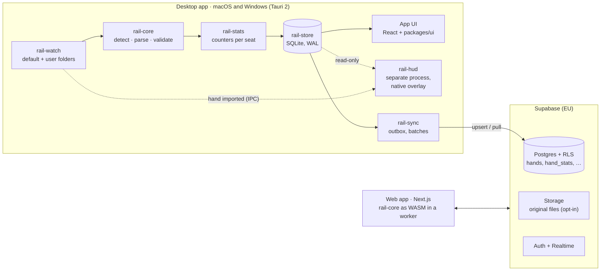

# Rail

**A poker tracker and HUD for macOS and Windows, with a web app on the same
data.**

Rail reads hand histories from almost any poker room, turns every hand into one
canonical document, and builds everything else on top of that document: a
heads-up display over your tables, a library of your hands with a replayer,
reports, opponent profiles, and post-session analysis. The desktop app and the
web app share one account and one database (Supabase), so a hand played on the
desktop shows up on the web, and a file uploaded on the web shows up on the
desktop.

Rail is free until it is fully built, and then moves to a subscription.

| | |
| --- | --- |
| Live web app | **https://poker-hand-converter.vercel.app** |
| Product guideline (source of truth for *what*) | [`docs/RAIL_GUIDELINE.md`](docs/RAIL_GUIDELINE.md) |
| Implementation plan (source of truth for *how* and *in what order*) | [`docs/RAIL-PLAN.md`](docs/RAIL-PLAN.md) |
| The web app as it stands today | [`docs/WEB.md`](docs/WEB.md) |

> **Where we are (2026-10-12).** The web app is live and mature: 19 parsers,
> a 413-file real corpus, 3188 tests, library, replayer, statistics, all-in EV,
> hand analysis with our own solver, a course and a forum. The desktop app and
> the HUD do not exist yet. Building them is Phases 0–3 of the plan; the first
> step is porting the parser core from TypeScript to Rust.

---

## Contents

1. [What Rail is for](#1-what-rail-is-for)
2. [Principles](#2-principles)
3. [Status by component](#3-status-by-component)
4. [Architecture](#4-architecture)
5. [Components](#5-components)
6. [Rooms, formats and HUD policy](#6-rooms-formats-and-hud-policy)
7. [Repository layout](#7-repository-layout)
8. [Getting started](#8-getting-started)
9. [Rules for working in this repository](#9-rules-for-working-in-this-repository)
10. [Roadmap](#10-roadmap)
11. [Documentation index](#11-documentation-index)

---

## 1. What Rail is for

Rail wins on a combination no single competitor offers today:

- **A modern HUD** that reads at a glance: few numbers, colours that mean
  something, details only on click.
- **An interface a new user masters in minutes.** Install, sign in, confirm the
  folders Rail found, open a table. Three steps to the first HUD.
- **The same hands in the app and on the web.** Local-first on the desktop,
  synced to Supabase in the background, readable from any browser.
- **First-class macOS and Windows**, built from one codebase.
- **Correct numbers.** A hand that cannot be read faithfully is refused and
  recorded, never guessed at (see §2).

Rail is a study and tracking tool. It never gives advice during play (no solver
output, no action recommendations at the table), and it switches the HUD off on
rooms that do not allow one.

---

## 2. Principles

From the guideline (§1), plus the two that the existing code was built on and
that the desktop work must keep.

| Principle | What it means in practice |
| --- | --- |
| **Works immediately** | After install Rail finds the hand-history folders itself and shows a HUD without manual setup. Advanced options exist but are never in the way. |
| **Speed is a feature** | The HUD updates within a second of a hand ending; reports open instantly on large databases. |
| **Local-first** | The desktop app works offline. Sync to Supabase happens in the background. |
| **One source of logic** | Parsing and statistics live in Rail core, shared by the app and the web. |
| **Room rules are respected by default** | Compliance mode is on by default; Rail offers nothing that could get an account closed. |
| **Refuse when unsure** | A hand that cannot be converted faithfully is refused with a machine-readable reason, recorded, and shown to the user. Never approximated, never silently dropped. A wrong hand poisons a player's statistics for months; a refused one is a visible, recoverable annoyance. ([`docs/WEB.md`](docs/WEB.md#the-refusal-principle)) |
| **No synthetic fixtures** | Every test hand is a real export. Generated data is allowed only for performance benchmarks, is labelled as such, and never lives under the fixture trees. |

Performance targets (guideline §1, measured from Phase 2):

| Measure | Target |
| --- | --- |
| Install to first HUD | < 5 min |
| HUD delay after a hand ends | < 1 s |
| Local import of old hands | ≥ 5,000 hands/s |
| Opening a report over 1 million hands | < 1 s |
| Tables with a HUD and no slowdown | ≥ 12 |

---

## 3. Status by component

| Component | Today | Target | Phase |
| --- | --- | --- | --- |
| Hand format | **PHF `phf/1`**, TypeScript types, validator, serializer; empty Rust workspace in place (R0.1) | Same format, defined in Rust and exported to TypeScript | 0 |
| Parsers | **19 parsers in TypeScript**, run in the browser; **all 19 also in Rust** (R0.6–R0.10d), and the whole Rust pipeline equals the TypeScript on every corpus file (556 files, 8 422 hands, 196 refusals); not yet used by the web (WASM and shadow mode are R0.13) | Rail core in Rust: native in the app, WebAssembly on the web | 0 |
| Unsupported-format registry | `unparsed_hands` corpus + `unparsed_gaps` view (web uploads); since R0.11 the Rust core's `Unrecognized` record and anonymiser, and the table's desktop fields and consent rule ([`docs/unsupported-formats.md`](docs/unsupported-formats.md)) | The desktop app's local registry and consented uploads (R1.2) | 0 |
| `config/sites.json` | **v1 (R0.12)**: one entry per client (22: the 19 parsers, plus WPT Global, Boss Media, Merge), JSON Schema, `core/rail-config` loader, validator and remote-merge rule; paths, live files and table data mostly unknown (`null`), every HUD policy unknown | Paths verified on real installs (R1.4), window data (R3.3, R3.11), HUD policy from the compliance check (R3.0) | 0–3 |
| File watcher | — | FSEvents / ReadDirectoryChangesW + periodic rescan | 1 |
| Local database | — | SQLite (WAL), cache for HUD and offline | 1 |
| Sync | Web saves to Supabase directly | Desktop outbox → idempotent upsert; pull of web uploads | 1 |
| Desktop sign-in | — | System browser + PKCE + `rail://` deep link | 1 |
| Statistics engine | **`stats/2`** in TypeScript, ~90 counters, rows in `hand_stats` | Ported to Rust, computed at import; display stats defined in `config/stats/` | 2 |
| Desktop UI | — | Tauri 2 + React: Today, Hands, Reports, Players, HUD, Settings | 2 |
| HUD | — | Separate native process, Windows first, then macOS | 3 |
| Web app | **Live**: converter, library, replayer, stats, sessions, notes, all-in EV, analysis, Learn, forum, share links | Parses with the WASM core; reads desktop-synced hands live | 4 |
| Analysis | **Live on web**: phases S, A1–A9 of [`docs/ANALYSIS-PLAN.md`](docs/ANALYSIS-PLAN.md) | Session review, leak finder in the app (never during play) | 5 |
| Subscription | — | Plans, Stripe, EU VAT | 6 |

---

## 4. Architecture



**Three rules hold the picture together:**

1. **Rail core is the only thing that reads a hand-history file.** Everything
   downstream — database, statistics, HUD, replayer, web — works only with the
   normalized hand (PHF) that core returns.
2. **The HUD reads only the local database.** A network round trip after every
   hand is neither fast enough nor reliable enough. Supabase connects the app
   and the web; it is never on the HUD's path.
3. **The HUD is its own process.** A stalled UI, a long report or a crash in the
   app never freezes or kills overlays on live tables, and vice versa.

The latency budget from "hand written to disk" to "HUD redrawn" and the process
and IPC design are in [`docs/RAIL-PLAN.md` §3](docs/RAIL-PLAN.md#3-target-architecture).

---

## 5. Components

### 5.1 Rail core (`core/`, Rust — Phase 0)

The parser, today's `frontend/src/lib/{phf,parsers}`, ported to Rust crate by
crate. It is compiled natively into the desktop app and to WebAssembly for the
web. One file goes through:

1. **Decode** — strict UTF-8, then BOM, then Windows-1252; 22 of the 413 corpus
   files are not UTF-8 and the site does not tell you which.
2. **Detect** — rank parser candidates, scored 0..1.
3. **Split and parse** — one PHF hand per chunk, or a `ParseSkip(reason)`.
4. **Positions** — BTN/SB/BB/… from the posted blinds.
5. **Validate** — chip conservation, payouts, cards; errors refuse the hand.
6. **Dedupe** — `(owner, site, hand id)`.
7. **Derive statistics** — counters per seat (Phase 2).

The TypeScript implementation is the **reference oracle** for the port: for
every file in the corpus it produces golden output, and the Rust core must
reproduce it exactly before it replaces anything. The format itself is
specified in [`docs/PHF-SPEC.md`](docs/PHF-SPEC.md). The guideline calls it the
*Rail Hand Format*; it is PHF, and the identifier stays `phf/1` because every
stored row already carries it.

### 5.2 File watcher (`core/rail-watch`, Phase 1)

- Finds the default folders of every known room on first run and shows them with
  file counts and the date of the last hand; the user confirms with one click
  and chooses "import everything" or "only new hands".
- Settings → Folders: add (picker, external and network drives), edit the path,
  override the room, enable or disable without deleting imported hands,
  recursive watching, per-folder status (last import, hands today, errors,
  quarantined hands).
- OS notifications (FSEvents on macOS, ReadDirectoryChangesW on Windows) with a
  periodic rescan as the safety net; network drives are polled.
- Files the room is still writing are read from the last remembered offset, and
  a hand is imported only once it is complete.
- Known folders, file patterns and formats live in
  `config/sites.json`, so a new path ships without a new app version.

### 5.3 Local database and sync (`core/rail-store`, `core/rail-sync`, Phase 1)

SQLite in WAL mode: the app writes, the HUD reads concurrently. Hands are stored
as compressed PHF; statistics as counters plus per-player rollups so the HUD and
reports only add up ready numbers. Every imported hand enters an outbox; the
sync worker sends batches to Supabase as an idempotent insert keyed by the
dedupe key (hands are immutable, so there are no conflicts), and pulls hands
that arrived through the web.

### 5.4 Statistics engine (`core/rail-stats`, Phase 2)

Today's [`stats/2`](docs/STATS-SPEC.md) engine — every judgement call where
PokerTracker 4 and Holdem Manager 3 disagree is written down there — ported to
Rust and run at import. Stats are stored as *made / had the chance* counters, so
every value carries its sample size and the UI can show how reliable it is.
Displayed statistics are data in `config/stats/`, identical in the app and on
the web; custom statistics are built in an editor and preview on the user's own
hands immediately. A definition change recomputes only the counters it touches.

Starting set (~30): VPIP, PFR, 3-bet, fold to 3-bet, 4-bet, steal, fold to
steal, limp; c-bet flop/turn, fold to c-bet, check-raise, donk bet, aggression
frequency; WTSD, W$SD, WWSF; bb/100, all-in EV bb/100, rake per 100.

### 5.5 Desktop app (`app/`, Tauri 2 + React + TypeScript, Phases 1–2)

Six screens:

| Screen | What the user does there |
| --- | --- |
| Today | Current session, result, hands played, import status |
| Hands | Filterable list, replayer, tags and notes |
| Reports | Winnings and all-in EV graphs, results by position and situation |
| Players | Opponent profile, notes, colour tags |
| HUD | Visual editor and presets |
| Settings | Folders, rooms, account, theme |

Filters are chips in one row (position, limit, date, stack depth) with saved
filters; Cmd/Ctrl + K opens a command palette; dark and light themes and a
density setting; English first with translations prepared from the start;
automatic, signed updates (Apple notarization, Windows code signing).

### 5.6 HUD (`hud/`, Rust, Phase 3)

- 4–6 stats by default (e.g. VPIP, PFR, 3-bet, hands), coloured by value ranges
  with a legend and editable thresholds; values are dimmed while the sample is
  small; click or hover opens a popup with situational detail and notes.
- Visual editor: drag-and-drop stats, presets for cash, MTT and Spin, layouts
  per room and table size; seat positions remembered per table size.
- One transparent, click-through overlay window per table, owned by and moving
  with the table window.

| Task | Windows | macOS |
| --- | --- | --- |
| Find tables | `EnumWindows`, titles and process names | Accessibility API (`AXTitle`), `CGWindowList` for bounds |
| Overlay | layered, no-activate, click-through window owned by the table | non-activating transparent `NSPanel` ordered above the table |
| Follow moves and resizes | `SetWinEventHook` | `AXObserver` notifications |
| User permissions | usually none | Accessibility (Screen Recording only if a room's titles need it) |

**Compliance mode** is on by default: `config/sites.json` says per room whether
a HUD is allowed, and Rail refuses to attach where it is not. No real-time
assistance of any kind; no sharing or selling of opponent data between users;
the room list is re-checked before every release.

### 5.7 Web (`frontend/` → `web/`, Next.js 15)

Live today; described in full in [`docs/WEB.md`](docs/WEB.md). In the target
picture it shows the same Hands, Reports and Players screens and replayer as the
app, built from the same component library, and reads hands the desktop synced
— live, through Realtime. Parsing stays **in the browser** (the WASM core in a
Web Worker), so the existing promise that a dropped file never leaves the tab
unless the user saves it still holds. The HUD exists only in the desktop app.

### 5.8 Supabase (`supabase/`)

Project `riybwcfnclphacnfawiq`, Central EU, Postgres 17. Every query runs as the
signed-in user under RLS; there is no service-role key in either client. Rows
are insert-only for clients (update and delete are refused everywhere, with a
handful of narrow `security definer` exceptions). Full schema, threat model and
migration procedure: [`docs/DATABASE.md`](docs/DATABASE.md).

| Guideline table | In this repository |
| --- | --- |
| `profiles` | exists (`20261007090000`); subscription plan added in Phase 6 |
| `hands` | exists; unique on `(owner_id, hand_key)` where `hand_key = site:hand id` |
| `hand_players` | covered by `hand_stats` (one row per dealt-in seat) — not added |
| `players` | new in Phase 2 (tags, colours); `player_notes` exists |
| `player_stats` | new in Phase 2, only if the 1M-hand benchmark needs it server-side |
| `hand_sources` | new in Phase 1 |
| `hud_layouts` | new in Phase 3 |
| `unsupported_formats` | the existing `unparsed_hands` corpus, extended in Phase 0 (R0.11: `origin`, `os`, `client_version`, `consented_at`) |

---

## 6. Rooms, formats and HUD policy

Rail aims at every game format and as many rooms as possible. "Parser" is the
state of the TypeScript parser today; every row still has to be ported to Rust
in Phase 0. "Live files" is whether the client writes hand histories to disk
while you play, which a HUD needs. **The HUD and live-file columns are a
starting point to verify, not a policy**: Phase 3 opens with a dated,
sourced compliance check of every room, and only that check goes into
[`config/sites.json`](config/sites.json). That file (since R0.12) carries
this table's live-file column as unverified starting points and
`hud.allowed: null` - unknown, which the HUD treats as no - for every room.

| Room or network | Parser | Live files | HUD (to verify) |
| --- | --- | --- | --- |
| PokerStars | ✅ | yes | likely allowed |
| GGPoker (GG Network) | ✅ | no — downloaded afterwards, opponents hashed | likely prohibited |
| Winamax | ✅ | yes | likely allowed |
| 888poker | ✅ (2012–15 era verified) | to verify | to verify |
| partypoker | ✅ (2012–15 era verified) | to verify | likely prohibited |
| iPoker network | ✅ | per skin | per skin |
| Winning Poker Network (ACR) | ✅ | yes | likely allowed |
| WPT Global | — (no export exists since June 2026) | no | not applicable |
| CoinPoker | ✅ | to verify | to verify |
| Unibet Poker | ✅ | to verify | to verify |
| Chico network | ✅ | to verify | to verify |
| Ignition / Bodog / Bovada | ✅ | no — anonymous tables | not useful |
| WePlay, PokerBros, MicroGaming, Full Tilt, Ongame, Entraction, Run It Once | ✅ | — | — (import only) |

Games: No Limit and Pot Limit Hold'em, Omaha (4 and 5 cards, Hi/Lo where a room's
own fixtures prove it), short deck. Structures: cash and fast-fold, MTT
(including bounty/PKO), SNG, Spin & Go. Stud, razz and draw games are refused by
name. Per-room detail: [`docs/research/hh-formats/`](docs/research/hh-formats/);
what to build next: [`docs/research/COVERAGE-PLAN.md`](docs/research/COVERAGE-PLAN.md).

---

## 7. Repository layout

Today, and where each part is going (the move is a planned step,
[`docs/RAIL-PLAN.md` R0.14](docs/RAIL-PLAN.md#phase-0--foundations)):

| Today | Target | Contents |
| --- | --- | --- |
| `frontend/src/lib/{phf,parsers}` | `core/rail-core` | Parsers, PHF model, validation, serializer |
| `frontend/src/lib/stats`, `lib/equity` | `core/rail-stats`, `core/rail-equity` | Statistics and all-in EV |
| — | `core/rail-store`, `core/rail-watch`, `core/rail-sync` | SQLite, file watcher, sync |
| — | `app/` | Tauri desktop app |
| — | `hud/` | Native HUD overlay, Windows and macOS |
| `frontend/` | `web/` | Next.js web app (Vercel root directory moves with it) |
| `frontend/src/components`, `src/styles/tokens` | `packages/ui/` | Shared components and design tokens |
| `supabase/` | `supabase/` | Migrations, RLS, pgTAP tests |
| `config/sites.json` (R0.12) | `config/` | `sites.json` and its schema; `stats/` |
| `fixtures/`, `gg-hh/`, `weplay-hh/`, `tests/test/fixtures/` | `testdata/` | Real corpus and goldens (moved with a byte-hash check) |
| `tests/` | `tests/` | TypeScript harness; the oracle until the port is complete |
| `docs/` | `docs/` | Guideline, plan, specs, research |

---

## 8. Getting started

### Web app (works today)

```bash
cd frontend
npm install
cp .env.example .env.local   # Supabase URL and anon key; optional
npm run dev                  # http://localhost:3000
```

Without `.env.local` the app runs as an offline converter and says so.

### Tests (work today)

```bash
cd tests
npm install
npm test                     # 3188 tests over the real corpus
npm run golden:emit          # regenerate the golden oracle (testdata/golden/README.md)
```

A change to a parser, the serializer or the validator changes the goldens;
commit `testdata/golden/` in the same PR, or CI's `golden-fresh` job fails.

Database tests (pgTAP) run against a local Supabase stack; see
[`docs/DATABASE.md`](docs/DATABASE.md).

### Rust workspace (since R0.1)

The Cargo workspace at the root holds the core, desktop and HUD crates
(`core/`, `hud/`); see [`docs/RAIL-PLAN.md` §3.1](docs/RAIL-PLAN.md#31-cargo-workspace).
`rust-toolchain.toml` pins the compiler, so rustup installs the right one on the
first `cargo` call. Install rustup once:

```bash
curl --proto '=https' --tlsv1.2 -sSf https://sh.rustup.rs | sh
```

What CI runs on Linux, macOS and Windows:

```bash
(cd tests && npm ci && npm run golden:emit)   # cargo test needs testdata/golden-full/
cargo fmt --all --check
cargo clippy --workspace --all-targets --locked -- -D warnings
cargo test --workspace --locked
cargo build -p rail-core -p rail-core-wasm -p rail-config --target wasm32-unknown-unknown --locked
(cd tests && npm run phf:dts-check)           # Rust-generated PHF declarations = types.ts
(cd tests && npm run wasm:build && npm run wasm:shadow)   # Linux only, CI job `wasm` (below)
```

`cargo test` round-trips every golden hand through the Rust PHF model and
fails, rather than skips, without the full goldens. After changing the model,
regenerate its TypeScript declarations with
`RAIL_UPDATE_DTS=1 cargo test -p rail-core --lib phf::dts`.

Workspace lints deny lossy integer casts and float arithmetic, because money is
integer minor units everywhere; the core crates forbid `unsafe`.

Convert files from the command line with the Rust core (since R0.8; all 19
parsers since R0.10d):

```bash
cargo run -p rail-core --bin rail-convert -- <file>...          # per file: encoding, detected parsers, hands, refusals
cargo run -p rail-core --bin rail-convert -- --json <file>...   # stdout: each file's hands as a canonical PHF array
cargo run -p rail-core --bin rail-convert -- --text <file>...   # stdout: each file's standard text, byte for byte
cargo run -p rail-core --bin rail-convert -- --anonymise <file>...  # stdout: a shareable sample, player names replaced
```

With `--json`, `--text` or `--anonymise` the per-file summary goes to stderr.
A file no parser claims gets an `unrecognized:` line: its registry
fingerprint and the core's guess (R0.11). The exit code is
1 only when a file cannot be read (2 for a usage error); a refused hand or an
unrecognised file is part of the result. `meta.parsedAt` is pinned to
1970-01-01, as in the goldens: the core has no clock.

The core as WebAssembly (since R0.13; the web app switches to it in R4.1),
and shadow mode - the WASM core next to the TypeScript pipeline over the
whole corpus, every result compared byte for byte:

```bash
cargo install wasm-bindgen-cli --version 0.2.129 --locked   # once; must match Cargo.lock
cd tests
npm run wasm:build           # core/rail-core-wasm/pkg/nodejs/ (gitignored); fails over 1.5 MB gzipped
npm run wasm:build -- web    # the ES-module target the web worker will load (R4.1)
npm run wasm:shadow          # 556 files: WASM = TypeScript; prints both throughputs
```

Coming with later steps:

| Command | What it does | Step |
| --- | --- | --- |
| `npm run tauri dev --workspace app` | Desktop app in development | R1.1 |
| `cargo run -p rail-hud-sim` | Table simulator: fake tables writing real corpus hands, for HUD work without a poker client | R3.1 |

---

## 9. Rules for working in this repository

The guideline is the source of truth for the plan: **a change of plan goes into
[`docs/RAIL_GUIDELINE.md`](docs/RAIL_GUIDELINE.md) first, then into the code.**
Proposed changes to the guideline (amendments; A1–A11 are accepted) wait in
[`docs/RAIL-PLAN.md` §2](docs/RAIL-PLAN.md#2-proposed-amendments-to-the-guideline)
until the owner accepts them.

From the guideline (§14):

- A new room or format is a parser + golden tests + an entry in
  `config/sites.json`, in the same pull request. Enforced since R0.12:
  `cargo test` fails on a parser without an entry and on an entry naming a
  parser that does not exist (`core/rail-config/tests/sites.rs`).
- Database changes only through migrations in `supabase/`.
- A new statistic is a definition in `config/stats/`, not code in the app or
  the web.
- Every pull request builds on macOS and Windows.

Carried over from the web app, each with a lint rule or test behind it
(details in [`docs/WEB.md`](docs/WEB.md#rules-that-are-load-bearing)):

- **The pure layer may not import the framework.** Nothing under
  `frontend/src/lib/{phf,parsers,replay,cards,format,stats}` imports `next/*`,
  `server-only` or `process.env`; the test harness imports those files directly.
- **Never normalise the fixture trees.** `.gitattributes` marks them binary so
  CRLF, UTF-16LE and Windows-1252 bytes survive; the byte-exactness tests depend
  on it.
- **CSS Modules and design tokens, not ad-hoc styles**; no raw hex outside the
  token layer.
- **User-facing strings go through i18n** (`lib/i18n/en.ts` today).
- **Server code resolves identity with `getUser()`, never `getSession()`.**
- **Merge only when every CI check is green.**

---

## 10. Roadmap

Each phase starts when the previous one meets its exit criterion. Steps, owners
of each decision and risks are in [`docs/RAIL-PLAN.md`](docs/RAIL-PLAN.md).

| Phase | Scope | Done when |
| --- | --- | --- |
| **0 — Foundations** | Rust core (all 19 parsers), golden diff, `sites.json`, unsupported-format registry, rename to Rail, repository layout, CI on macOS + Windows | The Rust core reproduces the TypeScript output for every file in the corpus, natively and as WASM |
| **1 — Import and sync** | Tauri shell, watcher, folder management, SQLite, desktop sign-in, sync to Supabase | Hands from a new session reach Supabase with no manual step |
| **2 — Stats and UI** | Stats in Rust, `config/stats/`, shared UI package, the five non-HUD screens, replayer | The performance targets hold on a 1M-hand benchmark database |
| **3 — HUD** | Compliance check, table simulator, Windows HUD, then macOS, editor, presets | HUD on 12 tables on both systems, only on rooms that allow it |
| **4 — Web** | WASM core in the browser, bulk upload, live desktop hands, screen parity | A hand uploaded on the web and the same hand from the app look identical |
| **5 — Analysis** | Session review, leak finder, preflop charts vs played hands, in the app | — |
| **6 — Subscription** | Plans, Stripe, EU VAT, early-user benefit | — |

---

## 11. Documentation index

| Question | Document |
| --- | --- |
| What are we building and why? | [`docs/RAIL_GUIDELINE.md`](docs/RAIL_GUIDELINE.md) |
| In what order, with what steps, and what is still undecided? | [`docs/RAIL-PLAN.md`](docs/RAIL-PLAN.md) |
| How does the web app work today? | [`docs/WEB.md`](docs/WEB.md) |
| What is a hand, exactly? How do I write a parser? | [`docs/PHF-SPEC.md`](docs/PHF-SPEC.md) |
| What does each statistic mean, and where do PT4 and HM3 disagree? | [`docs/STATS-SPEC.md`](docs/STATS-SPEC.md) |
| Schema, RLS, threat model, applying a migration | [`docs/DATABASE.md`](docs/DATABASE.md) |
| How hand analysis works | [`docs/ANALYSIS-PLAN.md`](docs/ANALYSIS-PLAN.md) |
| The course | [`docs/LEARN-PLAN.md`](docs/LEARN-PLAN.md) |
| Preflop reference charts | [`docs/CHARTS.md`](docs/CHARTS.md) |
| What does room X's format look like? | `docs/research/hh-formats/<room>.md` |
| Which formats are alike? | [`docs/research/FORMAT-MATRIX.md`](docs/research/FORMAT-MATRIX.md) |
| Which room next? | [`docs/research/COVERAGE-PLAN.md`](docs/research/COVERAGE-PLAN.md) |
| Which formats can we not read, and how is that triaged? | [`docs/unsupported-formats.md`](docs/unsupported-formats.md) |
| Where did this sample come from? | `fixtures/samples/<room>/SOURCES.md` |
