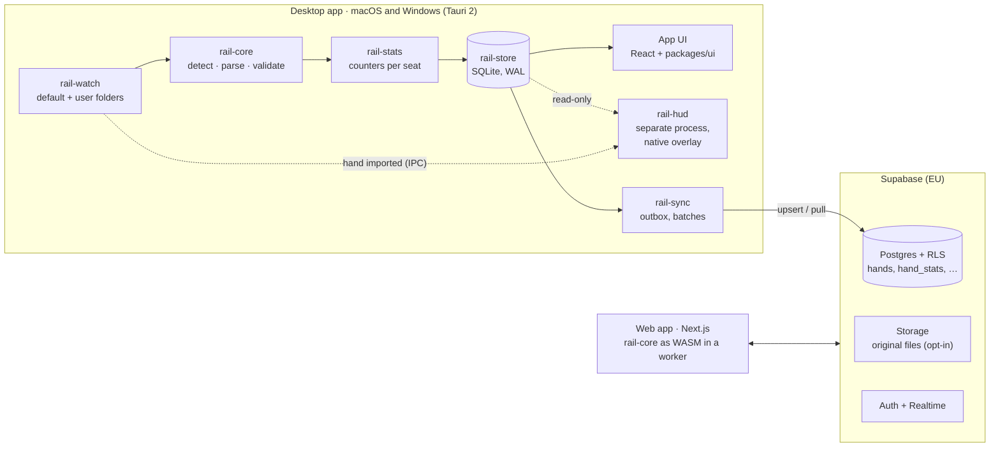

# Rail

**A poker tracker and HUD for macOS and Windows, with a web app on the same
data.**

Rail reads hand histories from almost any poker room, turns every hand into one
canonical document, and builds everything else on top of that document: a
heads-up display over your tables, a library of your hands with a replayer,
reports, opponent profiles, and post-session analysis. The desktop app and the
web app share one account and one database (Supabase), so a hand played on the
desktop shows up on the web, and a file uploaded on the web shows up on the
desktop.

Rail is free until it is fully built, and then moves to a subscription.

| | |
| --- | --- |
| Live web app | **https://poker-hand-converter.vercel.app** |
| Product guideline (source of truth for *what*) | [`docs/RAIL_GUIDELINE.md`](docs/RAIL_GUIDELINE.md) |
| Implementation plan (source of truth for *how* and *in what order*) | [`docs/RAIL-PLAN.md`](docs/RAIL-PLAN.md) |
| The web app as it stands today | [`docs/WEB.md`](docs/WEB.md) |

> **Where we are (2026-10-12).** The web app is live and mature: 19 parsers,
> a 413-file real corpus, 3188 tests, library, replayer, statistics, all-in EV,
> hand analysis with our own solver, a course and a forum. The desktop app and
> the HUD do not exist yet. Building them is Phases 0–3 of the plan; the first
> step is porting the parser core from TypeScript to Rust.

---

## Contents

1. [What Rail is for](#1-what-rail-is-for)
2. [Principles](#2-principles)
3. [Status by component](#3-status-by-component)
4. [Architecture](#4-architecture)
5. [Components](#5-components)
6. [Rooms, formats and HUD policy](#6-rooms-formats-and-hud-policy)
7. [Repository layout](#7-repository-layout)
8. [Getting started](#8-getting-started)
9. [Rules for working in this repository](#9-rules-for-working-in-this-repository)
10. [Roadmap](#10-roadmap)
11. [Documentation index](#11-documentation-index)

---

## 1. What Rail is for

Rail wins on a combination no single competitor offers today:

- **A modern HUD** that reads at a glance: few numbers, colours that mean
  something, details only on click.
- **An interface a new user masters in minutes.** Install, sign in, confirm the
  folders Rail found, open a table. Three steps to the first HUD.
- **The same hands in the app and on the web.** Local-first on the desktop,
  synced to Supabase in the background, readable from any browser.
- **First-class macOS and Windows**, built from one codebase.
- **Correct numbers.** A hand that cannot be read faithfully is refused and
  recorded, never guessed at (see §2).

Rail is a study and tracking tool. It never gives advice during play (no solver
output, no action recommendations at the table), and it switches the HUD off on
rooms that do not allow one.

---

## 2. Principles

From the guideline (§1), plus the two that the existing code was built on and
that the desktop work must keep.

| Principle | What it means in practice |
| --- | --- |
| **Works immediately** | After install Rail finds the hand-history folders itself and shows a HUD without manual setup. Advanced options exist but are never in the way. |
| **Speed is a feature** | The HUD updates within a second of a hand ending; reports open instantly on large databases. |
| **Local-first** | The desktop app works offline. Sync to Supabase happens in the background. |
| **One source of logic** | Parsing and statistics live in Rail core, shared by the app and the web. |
| **Room rules are respected by default** | Compliance mode is on by default; Rail offers nothing that could get an account closed. |
| **Refuse when unsure** | A hand that cannot be converted faithfully is refused with a machine-readable reason, recorded, and shown to the user. Never approximated, never silently dropped. A wrong hand poisons a player's statistics for months; a refused one is a visible, recoverable annoyance. ([`docs/WEB.md`](docs/WEB.md#the-refusal-principle)) |
| **No synthetic fixtures** | Every test hand is a real export. Generated data is allowed only for performance benchmarks, is labelled as such, and never lives under the fixture trees. |

Performance targets (guideline §1, measured from Phase 2):

| Measure | Target |
| --- | --- |
| Install to first HUD | < 5 min |
| HUD delay after a hand ends | < 1 s |
| Local import of old hands | ≥ 5,000 hands/s |
| Opening a report over 1 million hands | < 1 s |
| Tables with a HUD and no slowdown | ≥ 12 |

---

## 3. Status by component

| Component | Today | Target | Phase |
| --- | --- | --- | --- |
| Hand format | **PHF `phf/1`**, TypeScript types, validator, serializer; empty Rust workspace in place (R0.1) | Same format, defined in Rust and exported to TypeScript | 0 |
| Parsers | **19 parsers in TypeScript**, run in the browser; **all 19 also in Rust** (R0.6–R0.10d), and the whole Rust pipeline equals the TypeScript on every corpus file (556 files, 8 422 hands, 196 refusals); not yet used by the web (WASM and shadow mode are R0.13) | Rail core in Rust: native in the app, WebAssembly on the web | 0 |
| Unsupported-format registry | `unparsed_hands` corpus + `unparsed_gaps` view (web uploads); since R0.11 the Rust core's `Unrecognized` record and anonymiser, and the table's desktop fields and consent rule ([`docs/unsupported-formats.md`](docs/unsupported-formats.md)); since R1.2 the desktop's local registry (`unsupported` in `rail-store`, count and consent state) | Unknown files from watched folders recorded (R1.3), consented uploads after sign-in (R1.7+) | 0–1 |
| `config/sites.json` | **v1 (R0.12)**: one entry per client (22: the 19 parsers, plus WPT Global, Boss Media, Merge), JSON Schema, `core/rail-config` loader, validator and remote-merge rule; since R1.4 the first observations from a real install (macOS: WePlay's folder and live files, GGPoker's and CoinPoker's "no local files"), everything else still unverified; table data unknown (`null`); **R3.0** HUD policy per entry from each room's own page, dated (signed by the owner on 2026-10-14: allowed on PokerStars, Winamax, ACR; [`HUD-POLICIES.md`](docs/research/HUD-POLICIES.md)) | Every room's paths verified on real installs ([how](docs/research/VERIFYING-PATHS.md)), window data (R3.3, R3.11), the unknown HUD policies settled, re-checked every release | 0–3 |
| File watcher | **`core/rail-watch` (R1.3)**: FSEvents / ReadDirectoryChangesW / inotify (`notify`) + a rescan every 60 s, network folders polled; reads each file from its stored offset and imports a hand once it is complete (the next hand started, or the file quiet and the hand valid), in any of the corpus encodings; truncation, replaced, renamed and deleted files, unplugged drives; pause / resume. Proven by appending corpus files in random chunks, byte by byte included; the app runs it, tray and Today show it. **Folder discovery (R1.4)**: the rooms' default folders from `sites.json` that exist on this computer, with file counts and the last file's date, confirmed on the first-run screen with "import everything" or "only new hands"; a room's folder reads only its files. **Settings → Folders (R1.5)**: add, change path (moves keep offsets), room override, on/off, recursive, poll only, remove, per-folder status and refused hands. **Import pipeline (R1.6)**: a pool of import threads (physical cores - 1), live files first, large files cut into parallel batches, grouped commits; backfill progress in the tray, on Today and the folder cards; refused hands app-wide with their raw text and "Try again after an update"; 10 300 hands/s on an M2 Pro (target >= 5 000), guarded in CI | Sync to Supabase (R1.8-R1.9) | 1 |
| Local database | **`core/rail-store` (R1.2)**: SQLite (bundled, WAL), embedded migrations, one writer thread committing each file read with its offset in one transaction, read pool, hands as zstd PHF deduped by `hand_key`, quarantine, unsupported-format registry, sync outbox; survives a killed process mid-import (tested on three OSes); the app opens it and Today shows its counts; **R2.3**: the local statistics (seat rows, rollups per player and segment, the hero's per day, all-in EV); **R2.7a**: the hand list (one narrow row per hand in the list's order, written with the statistics), notes, tags and saved filters - a page of 100 in ~1 ms at 500k hands, filtered pages 1-35 ms; **R2.7b**: the reports' reads (`rail_store::report`) - the win-rate graph from one scan of the list (migration 8 adds the columns it needs), sessions by the web's 30-minute rule, breakdowns by situation - Reports opens in 0.1-0.5 s at 500k hands (1.8 s on a cold disk cache); **R2.7c**: the players (`rail_store::players`, migration 9) - per opponent of a room with real names the hands together and your result against them (written with the statistics), their seat rows by name (written by the background pass after the import, which keeps the import's rate), the user's colour tags, labels and notes (local only); **R2.10**: the user's own statistics (migration 11) and their counts, made by the background pass from the stored hands (~26k hands/s) and summed like the coded rollups; **R3.7**: the part of the opponents' rollups from hands you did not play, written with each hand (migration 14), for the rooms that allow HUD statistics from your own hands only; **R3.9**: the HUD's designs and where each is used (migration 15), synced | — | 1 |
| Sync | Web saves to Supabase directly; **R1.8**: `ingest_hands` / `hand_sources` for desktop rows (PHF only, Q4); **R1.9**: the desktop sync worker (`rail_sync::worker`) - the outbox in batches of 500 to `ingest_hands`, hands just played first, backoff while offline, the account's rate limit waited out, refused hands kept with their reason, a bandwidth cap while a large backlog syncs, resumable after a kill, never sent to another account than the store's; and the pull (`hands_since`) of the account's hands from the web and its other computers; **R3.9**: the HUD's designs, assignments and dragged panels (`hud_layouts`, last writer wins). Settings → Account, Today and the tray show it; **R1.10**: the web's `/library` and `/stats` show synced hands live (Realtime on a one-row-per-account signal, `hand_arrivals`; debounced, nothing while the tab is hidden; statistics derived without a click). Phase 1 is complete on `staging`; production needs the owner's checklist ([`docs/RAIL-PLAN.md`](docs/RAIL-PLAN.md) R1.10) | gzip uploads if bandwidth needs it | 1 |
| Desktop sign-in | **R1.7**: the app signs in through the system browser - `/auth/desktop` on the web (Turnstile, password managers and Google work there), the Edge Function `desktop-handoff`, and a `rail://` link carrying a one-time token encrypted to a key the app keeps in memory for that sign-in; the app gets a session of its own (its own refresh-token chain), the refresh token in the OS keychain, refreshed in the background, sign-out ends only the app's session; optional ("Use offline") while Q3 is open. Tested end to end against a local stack; production needs the owner's checklist (function deploy, the anon key in the build: [`docs/RAIL-PLAN.md`](docs/RAIL-PLAN.md) R1.7) | Sign in with Apple; the domain (P2) | 1 |
| Statistics engine | **`stats/2`** in TypeScript, ~90 counters, rows in `hand_stats`; **R2.1**: ported to Rust (`core/rail-stats`, `rows_for(&PhfHand)`), its rows equal to the TypeScript's for all 8 422 corpus hands (51 464 rows) and 4 000 seeded mutations of them; the TypeScript stays the oracle (`testdata/golden-stats/`); **R2.2**: all-in EV ported too (`core/rail-equity`, `ev_row`), its `hand_stats_ev` rows and analyses equal to the TypeScript's for every corpus hand (8 121 rows, 508 all-ins, the 11 Omaha preflop Monte Carlo ones included, equities bit for bit) and 4 500 seeded vectors (`testdata/golden-ev/`); **R2.3**: run at import on the desktop - seat rows, per-player rollups by segment and the hero's by day, written with each hand; preflop all-ins evaluated by a background pass that also rebuilds after a version bump; **R2.4**: displayed statistics are data - `config/stats/standard.json` (32 definitions: formula over the counters, format, colour bands, sample, labels in `en` + `hr`, HUD membership), evaluated identically in Rust (`rail_stats::display`) and on the web (`lib/stats/display.ts`), equal to the web's `rates()` and `Intl` text over the corpus; **R2.5**: every value's reliability - a 95% Wilson interval for rates, a level and an opacity from the definition's `sample.min` - the same bits in Rust (`rail_stats::reliability`) and on the web (`lib/stats/reliability.ts`), which `/stats` uses; **R2.7b**: the desktop's reports print the web's numbers - over the corpus, every statistic, graph bucket, breakdown row and session equal to the web's SQL restated in TypeScript over the TypeScript engine's rows (`core/rail-store/tests/data/report-vectors.*`); **R2.10**: custom statistics - per-seat decision events (`rail_stats::events`) and a predicate language over them (`first` / `any` / `each` opportunity `=>` action), which re-expresses the standard set and equals the coded counters on every corpus row but 12 (seats that never decided anything, STATS-SPEC §14.4); **R2.11**: targeted recompute - a dependency map from each kind of definition change to the tables it touches, worked out in the background beside the statistics on screen and swapped in whole | Custom statistics on the web | 2 |
| Desktop UI | **App shell (R1.1)**: Tauri 2 + React in `app/` - single instance, tray, start at login, log files, settings; the six screens as placeholders; Settings, About reads the Rust core; unsigned macOS and Windows bundles from CI. **Shared UI package (R2.6)**: `packages/ui` - the design tokens, cards, chips, the replayer, stat tile and table, dialog, overlay and the command palette's shell, one set for the web and the app; the web renders from it with no visual change, the app takes its tokens and dialog from it. **Hands (R2.7a)**: the virtualised hand list over the local store (keyset pages), filter chips in one row with counts and saved filters, the shared replayer beside it (the web's, with Inter bundled), tags and a note per hand, Cmd/Ctrl + K to go to a hand by its number or to a screen. **Today and Reports (R2.7b)**: the current session (the web's 30-minute rule: result in money and big blinds, hands, hands per hour, its key statistics, its biggest pots into Hands) above the import status; Reports with the filter row and its own saved filters - the result, bb/100 and all-in EV bb/100, the web's win-rate graph (moved into `packages/ui`) in big blinds or money, every statistic with its reliability, breakdowns by position, stake, table size, room, game, pot type, stack depth, players, street and the 13 x 13 starting-hand grid. **Players (R2.7c)**: the opponents of rooms that print screen names, most hands together first, searched by the start of a name (also from Cmd/Ctrl + K), with your result against each in big blinds; a profile with their statistics and reliability, rows by position, stake, table size and game, a colour tag, labels and a note, and "hands with this player" into Hands; opaque-id rooms' opponents counted, never listed. **Polish (R2.8)**: the command palette complete (fuzzy search over screens, hands, players, reports, saved filters, Settings sections and commands, recent choices, shortcut hints, keyboard only), theme (dark / light / system) and density (comfortable / compact) saved and painted before the first frame, Croatian complete and switchable in Settings (the tray follows), the Players list virtualised as a keyboard grid, the profile's own game kind, one shape for loading, empty and error states, a contrast pass in both themes. **Custom statistics (R2.10)**: Settings → Your statistics - a counter and a formula written in code fields with what is wrong underlined in place, a live preview on your last 5 000 hands, label, format, colour bands and minimum sample; listed in Reports with the shipped statistics | Tauri 2 + React: HUD, Settings (Phase 3) | 1–2 |
| HUD | **Table simulator (R3.1)**: `rail-hud-sim` opens table windows titled like PokerStars, Winamax or ACR tables and writes real corpus hands into a folder of its own at play speed (fresh ids, one cast of players per table, the hero in a fixed seat), for the watcher and every HUD step; scriptable (move, resize, minimise, table move, close); runs headless in `cargo test` and with windows in CI on macOS and Windows. **HUD process and IPC (R3.2)**: `rail-hud` is its own process, the app's Tauri sidecar - started, health-checked and restarted with a backoff by the app, told of every imported hand over a local socket / named pipe that only the user can reach, with a per-process token and a mutual handshake; it reads the store read-only, attaches only to rooms whose HUD policy is `allowed` (compliance mode in the process itself) and pauses the app's heavy work while tables are open. **Compliance mode in the app (R3.10)**: the room list kept current from the web (stricter only, cached, checked whole), the HUD screen and Today listing the tables with the HUD and the tables without it and why, with each room's policy page and date, no override anywhere, the tray's HUD line; tested in CI on Windows with a table posing as a prohibited room. **Finding tables on Windows (R3.3)**: visible top-level windows by program and title, client area in physical pixels at the monitor's scale, a window matched to its hands by the exact table name; tested in CI against the simulator's real windows, and `rail-hud --list-windows` captures real clients' titles (redacted) for `sites.json` - no real room's titles are captured yet, so the HUD attaches to no real client. **Overlays on Windows (R3.4)**: one layered, no-activate window per table, owned by the table window and exactly over its client area, painted with Direct2D and DirectWrite - six statistics and the hand count per seat, coloured by band and dimmed while the sample is small, clicks through everywhere but on the panels, hidden while the table is minimised; each room's restrictions (`sites.json` `hud.restrictions`) enforced by the renderer and the default panel compliant with all of them; tested in CI on the simulator's windows, twelve tables measured. **Following tables on Windows (R3.5)**: WinEvent hooks on the poker clients' processes move each overlay with its table as it is dragged (a move, no repaint; a new size or monitor scale repaints), hide it while minimised, cloaked or hidden, see a tournament table move at once and drop it when the table or its process goes; the periodic re-find stays as a safety net that can never move an overlay back; tested in CI with the simulator (scripted moves, a hundred moves in a second, the tracking script with the HUD process; lag measured). **Seats and layouts (R3.6)**: each room's layout per table size in fractions of the window and the hero's "preferred seat" rotation (the user's setting, else `sites.json`; no real client measured yet, so the simulator's geometry stands in), panels dragged with the mouse kept per room, table size and seat in the store (written by the app, read by the HUD) and kept off ACR's table graphics; tested in CI on the simulator's tables with its rotation off and on, a drag through the HUD process and a restart. **The data path (R3.7)**: each table's players read over the table's own segment (room, game, limit, table size, stake), on PokerStars, Winamax and ACR from your own hands only (hands you only watched never count), never anything of the hand in play, a restarted HUD showing its tables at once from their latest hands, the user's own statistics in a panel, and every hand's latency from the file to the overlay reported (and shown on the table in debug builds). **Panel and popup (R3.8)**: a colour legend on the table, your colour tag, note mark and labels on the panels where the room allows labels (Winamax), and a click on a panel opens the app's popup beside it - the player's statistics, thresholds, hands together and your result, by position where allowed, your words where allowed - without taking the keyboard from the table; while a table is open the app hides what could help with play (A10). **HUD editor and presets (R3.9)**: the HUD screen builds the panel by dragging statistics in (or with the keyboard), per statistic its colours, decimals and sample, the popup's sections; presets for cash, tournaments and Spin (and one by stack depth, ACR only); a design per room, table size and game; a live preview drawn by the HUD's own renderer under each room's rules; what a room forbids (PokerStars: statistics that read the cards, a display that changes with the stack, more than two colour thresholds, labels) refused in the editor with the reason and dropped by the HUD anyway; designs and dragged panels follow the account to another computer. **Finding tables on macOS (R3.11)**: the window server's list for places and sizes, the Accessibility API for titles (the one permission the HUD asks for, explained on the HUD screen with a button to System Settings; never Screen Recording), pixels at the screen's backing scale, tables on other Spaces kept hidden; tested on the macOS runner against the simulator's windows. **Overlays on macOS (R3.12)**: one transparent, non-activating panel per table exactly over its client area and directly above it in the window order (put back when the table is raised), hidden while the table is minimised, on another Space or hidden, clicks through everywhere but the panels (small click windows take theirs - no extra permission), the same panels drawn with Core Graphics and Core Text at the screen's backing scale; AppKit on the HUD's main thread, the engine beside it; tested on the macOS runner, twelve tables measured; tracking on macOS is R3.13; a fake backend driven by the simulator runs the whole data path in CI (the watcher noticing the file -> the frame: p50 ~505 ms, the watcher's quiet period; inside the HUD under 2 ms) | Native overlays, Windows first, then macOS | 3 |
| Web app | **Live**: converter, library, replayer, stats, sessions, notes, all-in EV, analysis, Learn, forum, share links | Parses with the WASM core; reads desktop-synced hands live | 4 |
| Analysis | **Live on web**: phases S, A1–A9 of [`docs/ANALYSIS-PLAN.md`](docs/ANALYSIS-PLAN.md) | Session review, leak finder in the app (never during play) | 5 |
| Subscription | — | Plans, Stripe, EU VAT | 6 |

---

## 4. Architecture



**Three rules hold the picture together:**

1. **Rail core is the only thing that reads a hand-history file.** Everything
   downstream — database, statistics, HUD, replayer, web — works only with the
   normalized hand (PHF) that core returns.
2. **The HUD reads only the local database.** A network round trip after every
   hand is neither fast enough nor reliable enough. Supabase connects the app
   and the web; it is never on the HUD's path.
3. **The HUD is its own process.** A stalled UI, a long report or a crash in the
   app never freezes or kills overlays on live tables, and vice versa.

The latency budget from "hand written to disk" to "HUD redrawn" and the process
and IPC design are in [`docs/RAIL-PLAN.md` §3](docs/RAIL-PLAN.md#3-target-architecture).

---

## 5. Components

### 5.1 Rail core (`core/`, Rust — Phase 0)

The parser, today's `frontend/src/lib/{phf,parsers}`, ported to Rust crate by
crate. It is compiled natively into the desktop app and to WebAssembly for the
web. One file goes through:

1. **Decode** — strict UTF-8, then BOM, then Windows-1252; 22 of the 413 corpus
   files are not UTF-8 and the site does not tell you which.
2. **Detect** — rank parser candidates, scored 0..1.
3. **Split and parse** — one PHF hand per chunk, or a `ParseSkip(reason)`.
4. **Positions** — BTN/SB/BB/… from the posted blinds.
5. **Validate** — chip conservation, payouts, cards; errors refuse the hand.
6. **Dedupe** — `(owner, site, hand id)`.
7. **Derive statistics** — counters per seat (Phase 2).

The TypeScript implementation is the **reference oracle** for the port: for
every file in the corpus it produces golden output, and the Rust core must
reproduce it exactly before it replaces anything. The format itself is
specified in [`docs/PHF-SPEC.md`](docs/PHF-SPEC.md). The guideline calls it the
*Rail Hand Format*; it is PHF, and the identifier stays `phf/1` because every
stored row already carries it.

### 5.2 File watcher (`core/rail-watch`, Phase 1)

- Finds the default folders of every known room on first run and shows them with
  file counts and the date of the last hand; the user confirms with one click
  and chooses "import everything" or "only new hands".
- Settings → Folders: add (picker, external and network drives), edit the path,
  override the room, enable or disable without deleting imported hands,
  recursive watching, per-folder status (last import, hands today, errors,
  quarantined hands).
- OS notifications (FSEvents on macOS, ReadDirectoryChangesW on Windows) with a
  periodic rescan as the safety net; network drives are polled.
- Files the room is still writing are read from the last remembered offset, and
  a hand is imported only once it is complete.
- Known folders, file patterns and formats live in
  `config/sites.json`, so a new path ships without a new app version.

Built so far (R1.3): `core/rail-watch`. A file is read from its stored
offset; a hand is complete when the next hand's header has started (the
offset then stops at that header's first byte) or when the file has been
quiet for 500 ms and the last hand validates; the decoding is the core's,
one piece at a time (UTF-8, BOM, UTF-16 on code-unit boundaries,
Windows-1252). `cargo test -p rail-watch --test random_append` appends
corpus files of every parser and encoding to a watched file in random
chunks, byte by byte included, and requires exactly their golden hands,
once (`RAIL_WATCH_FILES=all` for the whole corpus).

Since R1.4, `rail_watch::discover` finds the rooms' default folders from
`config/sites.json` (account folders included), counts their hand-history
files in a bounded walk and dates the newest; the first-run screen lists
them for one-click confirmation, and "only new hands" marks the files there
as read without importing them. Few folders are verified on a real install
yet - see [`docs/research/VERIFYING-PATHS.md`](docs/research/VERIFYING-PATHS.md)
for what was seen and how to check a room.

Since R1.5, Settings → Folders lists every watched folder with its room,
state, last import, hands today, problems and refused hands (by reason
code, with messages), and edits it: add a folder by hand ("import
everything" or "only new hands"), change its path (a moved or copied
folder continues from its stored offsets; another folder is read from
scratch and the old files keep their hands), choose its room when
detection fails (the folder's files are read again with that parser),
switch it on or off, recursive, poll only, remove it (hands stay), and
find the rooms' folders again.

Since R1.6 the import scales: files are read on a pool of import threads
(physical cores minus one, at most 8), files the room is writing go before
a backfill, a file with many hands is committed in batches of 500 converted
in parallel (each batch with its own offset, so a crash keeps a prefix),
and batches waiting together share one transaction. A backfill shows its
progress (bytes read of bytes to read, files, hands, time left) in the
tray, on Today and on the folder's card. Refused hands can be opened as
the raw text the room wrote, listed app-wide by reason (Settings, Refused
hands), and read again after an update ("Try again after an update" resets
the files whose hands an older parser version refused). Folder counts are
kept as rollups, so the folder list costs the same at a million hands.

### 5.3 Local database and sync (`core/rail-store`, `core/rail-sync`, Phase 1)

SQLite in WAL mode: the app writes, the HUD reads concurrently. Hands are stored
as compressed PHF; statistics as counters plus per-player rollups so the HUD and
reports only add up ready numbers. Every imported hand enters an outbox; the
sync worker sends batches to Supabase as an idempotent insert keyed by the
dedupe key (hands are immutable, so there are no conflicts), and pulls hands
that arrived through the web.

Built so far (R1.2): `core/rail-store`, its tables documented in
[`core/rail-store/SCHEMA.md`](core/rail-store/SCHEMA.md). A file's read
offset moves in the same transaction as the hands read up to it, so a crash
never loses or doubles a hand; `cargo test -p rail-store --test crash` kills
an importing process at random points and checks exactly that.

Since R1.7, `core/rail-sync` holds the desktop account (`rail_sync::auth`):
the `rail://` sign-in handoff (an X25519 key pair and a `state` per sign-in,
in memory only; the web's payload decrypts only with that key and that
state), the three GoTrue calls (verify the one-time token, refresh, log out;
reqwest with rustls on *ring* and the OS certificate verifier), and the
manager: one sign-in at a time for ten minutes, refresh five minutes before
expiry with backoff while offline, sign-out when the server refuses the
refresh token.

Since R1.9, `rail_sync::worker` is the sync worker the app runs in the
background: it takes up to 500 hands from the outbox - those queued in the
last 15 minutes first, newest played first, so a hand just played never
waits behind a backfill - and sends them with `ingest_hands` under the
watched folder's `hand_sources` row. Inserted and duplicate hands leave the
outbox; refused ones are kept with their reason (Settings → Account counts
them, "Try again" after an update); while offline it backs off (5 s doubling
to 10 min, with jitter), a spent rate limit is waited out and probed with
one hand. A large backlog is paced to an upload cap (1 MiB/s by default,
lower with tables open - the Phase 3 hook). Every call's token is for the
account that owns the store's hands (`kv` `sync.owner`); signing in as
another account syncs nothing until the user chooses to upload this
computer's hands to it. The pull fetches the account's other hands (saved on
the web, synced from other computers) by keyset cursor, keys first, PHF only
for the hands the store lacks.

Since R1.10 the web sees synced hands without a reload: every insert
statement on `hands` bumps the account's one row in `hand_arrivals`, which
`/library` and `/stats` follow through Supabase Realtime under its
select-own policy (`hands` itself is not published, so no hand content
travels this way). Refreshes are debounced (1.5 s, backing off to every
30 s while a backfill streams) and wait while the tab is hidden; the library
says "Hands arriving from <device>". Checked end to end with `npm run
realtime:arrivals` in `tests/` against a local stack.

### 5.4 Statistics engine (`core/rail-stats`, Phase 2)

Today's [`stats/2`](docs/STATS-SPEC.md) engine — every judgement call where
PokerTracker 4 and Holdem Manager 3 disagree is written down there — ported to
Rust and run at import. Stats are stored as *made / had the chance* counters, so
every value carries its sample size and the UI can show how reliable it is.
Displayed statistics are data in `config/stats/`, identical in the app and on
the web; custom statistics are built in an editor and preview on the user's own
hands immediately. A definition change recomputes only the counters it touches.

Starting set (~30): VPIP, PFR, 3-bet, fold to 3-bet, 4-bet, steal, fold to
steal, limp; c-bet flop/turn, fold to c-bet, check-raise, donk bet, aggression
frequency; WTSD, W$SD, WWSF; bb/100, all-in EV bb/100, rake per 100.

*As built (R2.1):* `core/rail-stats` is `lib/stats` ported counter for
counter - `hand_facts(&PhfHand) -> HandFacts`, `rows_for(&PhfHand) ->
Vec<StatsRow>` (one row per dealt-in seat, hero and villains), `StatsRow::to_json`
in the `hand_stats` column shape. Integers only; the three divisions the
TypeScript does in doubles go through `rail_core::js::JsNumber`. The
TypeScript engine stays the reference until the web moves to the Rust core
(R4.x): `npm run golden:emit` also writes its rows for every corpus hand
(`testdata/golden-stats/`, hashes; `testdata/golden-stats-full/`, gitignored,
in full), and `cargo test -p rail-stats` requires the same bytes.

*As built (R2.2):* `core/rail-equity` is `lib/equity` ported - exhaustive
enumeration and the seeded Monte Carlo (`equity`), ranges, multiway ranges,
`analyze_all_in`, and `ev_row(&PhfHand, &StatsRow)`, the hero's
`hand_stats_ev` row (`EV_VERSION` `ev/1`). Equity is exact integer
arithmetic (shares of a pot in units of 1/27720 of a board); the doubles
the TypeScript derives from it (an equity, a pot split by equity, range
weights) are the same IEEE-754 operations in `JsNumber`, so every row and
every equity equals the TypeScript's bit for bit, Monte Carlo included
(`testdata/golden-ev/`). About 25 ms for a heads-up preflop all-in
(1.7M boards), under 1 ms on the flop or turn, ~15 ms for Omaha preflop
(sampled), in a release build on an M2 Pro.

*As built (R2.3):* the desktop computes them at import. With each hand the
store writes its seat rows (the hero always, villains unless the room
renames seats by position every hand; an opaque per-session token is summed
per session only, never across sessions), adds them to per-player rollups by
*segment* - site, format, variant, limit, table size (`hu` / `6max` /
`full`), stake (a cash game's exact big blind; `chips` for tournaments) -
and to the hero's per-day rollups, in the same transaction; a duplicate
adds nothing. The hero's all-in EV comes with the hand unless the all-in
was preflop (25-46 ms of enumeration): those wait for a background pass,
which also recomputes the statistics after a definition changes (R2.11,
below). The HUD's lookup for a table of 9 players takes well under a
millisecond at 500k hands. Schema and rules:
[`core/rail-store/SCHEMA.md`](core/rail-store/SCHEMA.md) "Statistics".

*As built (R2.4):* what is displayed is data.
[`config/stats/standard.json`](config/stats/standard.json) holds 32
definitions (the starting set above plus hands, result in bb, RFI, iso, cold
call, squeeze, fold to 4-bet, river cbet, fold to turn cbet, raise flop cbet,
saw flop, AF): a formula over the counters in a small language (`pct(three_bet,
three_bet_opp)`, `net_bb_milli / 1000 / money_hands * 100`; names, `+ - * /`,
`pct`, `sum`, nothing else), a format, colour bands, the sample behind the
value and its minimum for full opacity, labels and descriptions in English and
Croatian, and default HUD membership. The app and the HUD evaluate it in Rust,
the web in TypeScript, both in JavaScript's arithmetic, so every number is the
web's to the last digit ([`docs/STATS-SPEC.md`](docs/STATS-SPEC.md) §13). A
new statistic is a definition, not code; a test scans the web and the app
for formulas written anywhere else.

*As built (R2.5):* every value says how far to trust it. A rate carries its
95% Wilson score interval (asymmetric, inside 0-100%, honestly wide at 0 of
3); every value carries its sample and, against its definition's
`sample.min`, a level - `ok` from the minimum, `low` from a quarter of it,
`insufficient` below - and an opacity that rises with the square root of the
sample from 0.6 to 1 at the minimum, which the HUD, the app and the web dim
by. A win rate gets no interval: that needs the per-hand variance, and the
store keeps sums, not sums of squares. Rust and the web compute the same
bits (`JsNumber` gained a correctly rounded `sqrt`), held to each other over
the corpus ([`docs/STATS-SPEC.md`](docs/STATS-SPEC.md) §13).

*As built (R2.10):* a user counts what the standard statistics do not. The
engine exports every seat's decisions with the state they were made in -
street, position, what was faced (unopened, limped, a raise of level n, a
bet, a continuation bet, a steal), the action, its size as a share of the
pot or in big blinds, stacks, position in the hand, multiway, initiative -
and a counter is a predicate over them, for example `first street = flop and
facing_cbet and multiway => action = fold`. The standard set written that
way equals the coded counters on every one of the corpus's 51 464 seat rows
except twelve seats that never made a decision
([`docs/STATS-SPEC.md`](docs/STATS-SPEC.md) §14). The user's statistics live
in their store; a background pass counts them over every stored hand and
keeps them current as hands arrive; the editor in Settings previews the
value on the last 5 000 hands while you type, and Reports lists the result.

*As built (R2.11):* a definition change recomputes only what it touches. A
dependency map in `rail-store` (`recompute::DEPENDENCIES`) says, per kind
of change, what work it needs and which tables it writes: a label, format,
colour band or formula nothing (formulas are evaluated when read); a custom
predicate that statistic's counts; a coded counter (`STATS_VERSION`) the
rows of the hands that come out different, with the rollups summed again;
the segment definition (`SEGMENT_VERSION`) the rollups regrouped from the
stored rows without deriving a statistic; the all-in EV (`EV_VERSION`) the
EV rows. The background pass works the new numbers out beside the ones on
screen and swaps them in with one commit, so the app, the reports and the
HUD see the old statistics or the new ones, never half of each; it resumes
after a quit or a crash, waits for a backfill and for open tables, and its
progress shows on Reports, Hands, Players and in Settings. Every hand keeps
its id, so the user's own statistics survive a recompute that moves no
seat. Schema: [`core/rail-store/SCHEMA.md`](core/rail-store/SCHEMA.md)
"Targeted recompute".

### 5.5 Desktop app (`app/`, Tauri 2 + React + TypeScript, Phases 1–2)

Six screens:

| Screen | What the user does there |
| --- | --- |
| Today | Current session, result, hands played, import status |
| Hands | Filterable list, replayer, tags and notes |
| Reports | Winnings and all-in EV graphs, results by position and situation |
| Players | Opponent profile, notes, colour tags |
| HUD | Visual editor and presets (built in R3.9: drag-and-drop panel, popup sections, presets for cash, tournaments and Spin, a design per room, table size and game, live preview under each room's rules) |
| Settings | Folders, rooms, account, your own statistics (R2.10), theme, density, language |

Filters are chips in one row (position, limit, date, stack depth) with saved
filters (built in R2.7a for Hands: room, date, stakes, position, pot, result,
stack, all-in, game, variant, limit, table size, tags, notes, each with the
hands it would match; R2.7b: Reports shows the same row with date, room,
stakes, position, game, variant, limit and table size, and its own saved
filters); Cmd/Ctrl + K opens a command palette (R2.7a: a hand by its number,
the screens; R2.7b: the reports' breakdowns by name; R2.7c: players by the start
of their name, and Hands filtered to one player; R2.8: fuzzy search over every
command - saved filters, Settings sections, the refused hands, pause or resume
import, sync now, theme, density, language - recent choices, shortcut hints
and Cmd/Ctrl + 1-6 for the screens, keyboard only); dark, light or the
system's theme and comfortable or compact lists and tables, saved in the
settings and painted before the first frame (R2.8); English by default and
Croatian complete (R2.8: every string, the tray too, Croatian plurals, numbers
and dates in the chosen language; a lint rule keeps words out of components);
automatic, signed updates (Apple notarization, Windows code signing).

### 5.6 HUD (`hud/`, Rust, Phase 3)

- 4–6 stats by default (e.g. VPIP, PFR, 3-bet, hands), coloured by value ranges
  with a legend and editable thresholds; values are dimmed while the sample is
  small; click or hover opens a popup with situational detail and notes.
- Visual editor: drag-and-drop stats, presets for cash, MTT and Spin, layouts
  per room and table size; seat positions remembered per table size.
- One transparent, click-through overlay window per table, owned by and moving
  with the table window.

| Task | Windows | macOS |
| --- | --- | --- |
| Find tables | `EnumWindows`, titles and process names | Accessibility API (`AXTitle`), `CGWindowList` for bounds |
| Overlay | layered, no-activate, click-through window owned by the table | non-activating transparent `NSPanel` ordered above the table |
| Follow moves and resizes | `SetWinEventHook` | `AXObserver` notifications |
| User permissions | usually none | Accessibility only (titles); never Screen Recording or Input Monitoring |

The HUD is developed against the **table simulator** (`hud/rail-hud-sim`,
R3.1; [§8](#table-simulator-since-r31)): windows titled like a room's tables
with a drawn table to align to, writing real corpus hands where the watcher
picks them up - no poker client, no real money, on any machine and in CI.

**The HUD process (R3.2).** `hud/rail-hud` runs apart from the app, as its
Tauri sidecar: the app starts it, checks its health every 2 s, restarts it
with a backoff when it dies or hangs, and shuts it down on exit (it also exits
by itself when the app is gone). They talk over a Unix domain socket (macOS)
or a named pipe (Windows) only the user can open, with length-prefixed JSON
messages (`hud/rail-hud-ipc`): a random token per HUD process on its standard
input and a mutual HMAC handshake keep the user's other programs out. The app
says `hand_imported` (the hand's room, table and players) and
`stats_changed`; the HUD re-reads those players' rollups from the store,
opened read-only, and says `tables_open`, which pauses the app's heavy
background work and slows sync while you play. The platform layer
(`find_tables`, `track`, `overlay`) is one trait with Windows and macOS
backends (Windows finds tables since R3.3, draws over them since R3.4 and
follows them with WinEvent hooks since R3.5; macOS finds them since R3.11
and draws over them since R3.12, its tracking is next) and a fake one driven
by the simulator.

**Finding tables on macOS (R3.11).** The window server's list
(`CGWindowListCopyWindowInfo`) gives every window's place, size, owner and
whether it is on screen - but not its title, which macOS shows only to apps
with Screen Recording, which Rail never asks for. The titles come from the
Accessibility API instead, asked only of the poker clients' processes: so
the HUD needs the **Accessibility** permission, and nothing else. Rail asks
for it only when it would make a difference - a supported room's client is
running - and otherwise says just "HUD on macOS: no supported poker client
running". When it is needed, the HUD screen explains what the
permission is for (titles and window places - no screen recording, no
input monitoring), has macOS show its own prompt and opens System Settings
at the right pane on a click, and notices the grant by itself. The two lists
are joined window by window, the client area is the window less its title
bar, and sizes are reported in pixels at the screen's backing scale (points
times 2 on a Retina display). A table on another Space or of a hidden app is
kept, hidden; a minimised one too. `rail-hud --list-windows` works on macOS
(run from a terminal that has Accessibility). The permission belongs to
Rail.app, keyed by its signature: until releases are signed (Developer ID),
every new build has to be granted again.

**The overlay (R3.4, Windows).** One window per table, owned by the table
window - so it stays directly above that table, hides while the table is
minimised and goes away with it - layered, never activated, off the taskbar,
exactly over the table's client area at the monitor's real pixels. Its
pixels are drawn by Direct2D and DirectWrite and are fully transparent
outside the panels, so every click but one on a panel reaches the table. It
is redrawn only when its figures, size or scale change; moving the table
only moves it. A panel per seat shows six statistics (VPIP, PFR, 3-bet,
fold to 3-bet, flop c-bet, aggression frequency) and the hand count,
coloured light blue / white / orange by band and dimmed while the sample is
small, placed next to the seat and never over the seats or the board.

**Following tables (R3.5, Windows).** The HUD hooks the window events of each
poker client that has a table open (out of context: nothing is loaded into
the client) - move and resize, minimise and restore, title changes, show,
hide, cloak, close, foreground - on the overlays' own thread, which moves an
overlay the moment its table moves, during a drag, without repainting it; a
new size, or a monitor of another scale, repaints it at that size and scale.
A tournament table move (a new title) is seen at once and the panels wait
for the new table's first hand; a table that closes, is hidden or whose
client exits loses its overlay. The search for tables every 500 ms stays as
a safety net for anything a hook missed; overlays are always placed from the
table as it is at that moment, so the two never fight.

**The overlay on macOS (R3.12).** On macOS the HUD process gives its main
thread to AppKit - as an accessory app: no Dock icon, never active, never
the keyboard - and runs the rest beside it. One borderless, transparent,
non-activating panel per table sits exactly over the table's client area
(in points, at the screen's backing scale, so Retina text is sharp),
**directly above the table** in the window order and put back there within
a tenth of a second when the table is raised over it; it is hidden while
the table is minimised, on another Space or its app hidden, and joins the
table's Space (a full-screen table's too) when it is back - never shown on
every Space. The panel lets every click through to the table; a small
invisible window over each statistics panel takes the clicks and drags
meant for it (the popup, moving a panel), so no permission beyond
Accessibility is needed - no Input Monitoring, no Screen Recording. The
same panels as on Windows are drawn by Core Graphics and Core Text, only
when they change; rooms without a HUD get no window at all. Tested on the
macOS runner against the simulator's windows; until R3.13 the overlay
follows its table at the twice-a-second search for tables.

**Seats and layouts (R3.6).** A hand history's seat becomes a place on the
screen through the room's layout for the table size (where its client draws
each seat, in fractions of the table's window, and the graphics a panel must
not cover) and the hero's rotation: clients that always draw you at the
bottom ("preferred seat" on PokerStars, Winamax, ACR) turn the table, so
the HUD does too - when you say your client does (a per-room setting), or
when `sites.json` knows it. No real client's layout is measured yet, so
every table is laid out like the simulator's until the capture measures
them. Drag a panel and it stays there, for that room, table size and place
at the table - on every table of that kind and after a restart (the HUD
tells the app, which keeps it in the store; the HUD itself only reads). On
ACR a dragged panel never covers the room's own table graphics: it lands
at the nearest place clear of them. A panel's place never changes what it
shows - the same statistics at every seat (PokerStars forbids switching the
display by position, stack or opponent).

**The data path (R3.7).** When a hand is imported the app tells the HUD
(`hand_imported`, with when the watcher noticed the file and when the hand
was stored), and the HUD reads that table's players again - over **the
table's segment** (the room, game, limit, table size and stake of its
hand), so a player's numbers are those of games like this one. PokerStars,
Winamax and ACR allow HUD statistics **from hands you played only**: there
the HUD leaves out every hand without you in it (a table you watched,
someone else's hand histories) - the store keeps that part of each
opponent's numbers apart (migration 14) and the HUD subtracts it. Nothing
of the hand in play is ever shown: the rooms write a hand's history when it
has ended, the watcher stores a hand only once its file has been quiet, and
the HUD reads nothing but the store. A HUD that is restarted (or a table
opened before it) shows a table's numbers at once from the table's newest
stored hand, if that hand is from the last 15 minutes. Every hand's way from
the file to the overlay is timed (the watcher, the import, the message, the
read, the frame) and goes back to the app; a debug build also writes it on
the table, a release build never.

**The panel and the popup (R3.8).** Each panel shows the six statistics
the definitions put on it and the hand count, coloured by band (on
PokerStars by at most two thresholds: low, normal, high) and dimmed while
the sample is small; a small legend in a free corner of the table shows the
colours in use (`-` low, `=` normal, `+` high). Where a room allows
labelling players (Winamax; not PokerStars, not ACR) a panel also carries
your colour tag for the player, a mark when you have a note and their
labels. Click a panel (press and release without dragging it) and the app
opens a small popup of its own beside it, without taking the keyboard from
the table: the player's statistics from the definitions by group, over the
table's game and on these rooms from your own hands only, each statistic's
thresholds in words, the hands you played together and your result against
them in big blinds (cash and tournaments apart), rows by position where the
room allows it (ACR; hidden on PokerStars and Winamax, whose rules forbid a
display that changes with position), and - where labels are allowed - the
colour, labels and note, editable (the app writes them; the HUD only
reads). Esc, its close button, the same panel clicked again, the pointer
leaving it or the last table closing close it. Past hands only, never
advice; and while a table is open the app hides whatever could help with
play (A10: the replayer's pot odds and the starting-hand chart today, the
analysis screens when they come).

**Compliance mode** is on by default and lives in the HUD process itself:
`config/sites.json` says per room whether a HUD is allowed (a remote copy can
only make that stricter), and the HUD refuses to attach where it is not -
unknown counts as no, and there is no override. Where a room allows a HUD
with conditions, they are data too (`hud.restrictions`: e.g. PokerStars'
colour by at most two thresholds and no labels, ACR's nothing over its own
table graphics); every frame carries compliance's permit with them and the
renderer enforces them, and the default panel already complies with every
room's. **In the app (R3.10)**: the room list is kept current from the web -
the app downloads `<web>/sites.json` (the repository's `config/sites.json`,
published by the web build) every few hours over HTTPS, checks it whole and
merges it stricter-only, caches the last good copy (the HUD reads it before
its first look for tables), and keeps that copy - or the shipped one - when
offline or when a download is refused; the HUD screen lists the tables the
HUD is on and the tables it left alone, each with the reason in plain words,
the room's policy page and the date it was read, and "Why can't I enable the
HUD here?"; Today and the tray say the same in a line; while a table is open
the sidebar and the command palette leave out any screen that helps with
play (A10). No real-time
assistance of any kind; no sharing or selling of opponent data between users;
the room list is re-checked before every release (the manual workflow
"Release checklist" fails on any allowed room checked more than 90 days ago:
`npm run hud:policy-check` in `tests/`).

### 5.7 Web (`frontend/` → `web/`, Next.js 15)

Live today; described in full in [`docs/WEB.md`](docs/WEB.md). In the target
picture it shows the same Hands, Reports and Players screens and replayer as the
app, built from the same component library, and reads hands the desktop synced
— live, through Realtime. Parsing stays **in the browser** (the WASM core in a
Web Worker), so the existing promise that a dropped file never leaves the tab
unless the user saves it still holds. The HUD exists only in the desktop app.

### 5.8 Supabase (`supabase/`)

Project `riybwcfnclphacnfawiq`, Central EU, Postgres 17. Every query runs as the
signed-in user under RLS; there is no service-role key in either client. The
one server-side use of the service role is the Edge Function
`supabase/functions/desktop-handoff` (R1.7), which mints a one-time sign-in
token for the desktop app, for the signed-in caller only, from the runtime's
own `SUPABASE_SERVICE_ROLE_KEY`. Rows
are insert-only for clients (update and delete are refused everywhere, with a
handful of narrow `security definer` exceptions). Full schema, threat model and
migration procedure: [`docs/DATABASE.md`](docs/DATABASE.md).

| Guideline table | In this repository |
| --- | --- |
| `profiles` | exists (`20261007090000`); subscription plan added in Phase 6 |
| `hands` | exists; unique on `(owner_id, hand_key)` where `hand_key = site:hand id` |
| `hand_players` | covered by `hand_stats` (one row per dealt-in seat) — not added |
| `players` | new in Phase 2 (tags, colours); `player_notes` exists |
| `player_stats` | needed server-side: the 1M-hand benchmark (R2.9) measured the web's reports over a million hands at 5-44 s; with a hero rollup and a covering index it is recommended for R4.x, not built yet |
| `hand_sources` | new in Phase 1 |
| `hud_layouts` | new in Phase 3 (R3.9; local seat positions since R3.6) |
| `unsupported_formats` | the existing `unparsed_hands` corpus, extended in Phase 0 (R0.11: `origin`, `os`, `client_version`, `consented_at`) |

---

## 6. Rooms, formats and HUD policy

Rail aims at every game format and as many rooms as possible. "Parser" is the
state of the TypeScript parser today; every row still has to be ported to Rust
in Phase 0. "Live files" is whether the client writes hand histories to disk
while you play, which a HUD needs; it is a starting point to verify except
where R1.4 looked at a real macOS install (WePlay writes its files live,
GGPoker and CoinPoker write none locally,
[`docs/research/VERIFYING-PATHS.md`](docs/research/VERIFYING-PATHS.md)).
**The HUD column is R3.0's compliance check** (2026-10-14, signed by the
owner the same day): each room's own policy page, quoted and dated in
[`docs/research/HUD-POLICIES.md`](docs/research/HUD-POLICIES.md) and carried
in [`config/sites.json`](config/sites.json) (`hud`). The HUD attaches only
where it says "allowed"; unknown counts as prohibited, and the list is
re-checked before every release. Since R3.10 the app also takes a corrected
list from the web between releases (stricter only): to switch a room off,
change its entry here and let the web deploy. An allowed room's conditions are carried as
data too (`hud.restrictions`, R3.4) and enforced by the HUD's renderer.

| Room or network | Parser | Live files | HUD (R3.0, 2026-10-14) |
| --- | --- | --- | --- |
| PokerStars | ✅ | yes | allowed, with restrictions (own hands only, numeric stats, at most two colour thresholds, no labels, no card-split stats) |
| GGPoker (GG Network) | ✅ | no — downloaded afterwards, opponents hashed | prohibited |
| Winamax | ✅ | yes | allowed (tracking / profiling software is on its authorised list) |
| 888poker | ✅ (2012–15 era verified) | to verify | unknown — 888poker.com's terms not readable from here |
| partypoker | ✅ (2012–15 era verified) | no — MyGame downloads, opponents hidden | prohibited |
| iPoker network | ✅ | per skin | unknown — per skin, no skin's page says so |
| Winning Poker Network (ACR) | ✅ | yes | allowed (ACR), with restrictions (own hands only, nothing from the hand in play, panels off ACR's own graphics) |
| WPT Global | — (no export exists since June 2026) | no | prohibited |
| CoinPoker | ✅ | no — shown in the client from its server (macOS, seen R1.4) | prohibited (since June 2026) |
| Unibet Poker | ✅ | to verify | prohibited |
| Chico network | ✅ | to verify | unknown — per skin, pages not readable |
| Ignition / Bodog / Bovada | ✅ | no — anonymous tables | no — anonymous names |
| WePlay | ✅ | yes (macOS, seen R1.4) | unknown — rules only in the app |
| PokerBros | ✅ | — | no — no desktop client |
| MicroGaming, Full Tilt, Ongame, Entraction, Run It Once | ✅ | — | no — closed (import only) |

Games: No Limit and Pot Limit Hold'em, Omaha (4 and 5 cards, Hi/Lo where a room's
own fixtures prove it), short deck. Structures: cash and fast-fold, MTT
(including bounty/PKO), SNG, Spin & Go. Stud, razz and draw games are refused by
name. Per-room detail: [`docs/research/hh-formats/`](docs/research/hh-formats/);
what to build next: [`docs/research/COVERAGE-PLAN.md`](docs/research/COVERAGE-PLAN.md).

---

## 7. Repository layout

Today, and where each part is going (the move is a planned step,
[`docs/RAIL-PLAN.md` R0.14](docs/RAIL-PLAN.md#phase-0--foundations)):

| Today | Target | Contents |
| --- | --- | --- |
| `frontend/src/lib/{phf,parsers}` | `core/rail-core` | Parsers, PHF model, validation, serializer |
| `frontend/src/lib/stats`, `lib/equity` | `core/rail-stats`, `core/rail-equity` | Statistics and all-in EV |
| — | `core/rail-store`, `core/rail-watch`, `core/rail-sync` | SQLite, file watcher, sync |
| `app/` (R1.1) | `app/` | Tauri desktop app: `src-tauri/` (Rust, in the workspace) and `src/` (React) |
| `hud/` (R3.1, R3.2) | `hud/` | The HUD process `rail-hud` (overlays, Windows and macOS), its channel to the app `rail-hud-ipc`, the table simulator `rail-hud-sim` |
| `frontend/` | `web/` | Next.js web app (Vercel root directory moves with it) |
| `packages/ui/` (R2.6) | `packages/ui/` | Shared UI package `@rail/ui`: design tokens, cards, chips, the replayer, stat tile and table, dialog, overlay, command palette. Source consumed by `frontend/` and `app/` through `file:` links; the web's own screens stay in `frontend/src/components` |
| `supabase/` | `supabase/` | Migrations, RLS, pgTAP tests |
| `config/sites.json` (R0.12) | `config/` | `sites.json` and its schema; `stats/` |
| `fixtures/`, `gg-hh/`, `weplay-hh/`, `tests/test/fixtures/` | `testdata/` | Real corpus and goldens (moved with a byte-hash check) |
| `tests/` | `tests/` | TypeScript harness; the oracle until the port is complete |
| `docs/` | `docs/` | Guideline, plan, specs, research |

---

## 8. Getting started

### Web app (works today)

```bash
cd frontend
npm install
cp .env.example .env.local   # Supabase URL and anon key; optional
npm run dev                  # http://localhost:3000
```

Without `.env.local` the app runs as an offline converter and says so.

### Tests (work today)

```bash
cd tests
npm install
npm test                     # 3188 tests over the real corpus
npm run golden:emit          # regenerate the golden oracle (testdata/golden/README.md)
```

A change to a parser, the serializer or the validator changes the goldens;
commit `testdata/golden/` in the same PR, or CI's `golden-fresh` job fails.

Database tests (pgTAP) run against a local Supabase stack; see
[`docs/DATABASE.md`](docs/DATABASE.md).

### Rust workspace (since R0.1)

The Cargo workspace at the root holds the core, desktop and HUD crates
(`core/`, `hud/`); see [`docs/RAIL-PLAN.md` §3.1](docs/RAIL-PLAN.md#31-cargo-workspace).
`rust-toolchain.toml` pins the compiler, so rustup installs the right one on the
first `cargo` call. Install rustup once:

```bash
curl --proto '=https' --tlsv1.2 -sSf https://sh.rustup.rs | sh
```

What CI runs on Linux, macOS and Windows:

```bash
(cd tests && npm ci && npm run golden:emit)   # cargo test needs testdata/golden-full/
cargo fmt --all --check
cargo clippy --workspace --exclude rail-app --all-targets --locked -- -D warnings
cargo test --workspace --exclude rail-app --locked     # the app crate has its own job (below)
cargo build -p rail-core -p rail-core-wasm -p rail-config -p rail-stats -p rail-equity --target wasm32-unknown-unknown --locked
(cd tests && npm run phf:dts-check)           # Rust-generated PHF declarations = types.ts
(cd tests && npm run wasm:build && npm run wasm:shadow)   # Linux only, CI job `wasm` (below)
```

`cargo test` round-trips every golden hand through the Rust PHF model and
fails, rather than skips, without the full goldens; it also derives every
golden hand's statistics rows with `rail-stats` and compares them with the
TypeScript engine's (`testdata/golden-stats/`, R2.1). After a change to
`frontend/src/lib/stats`, commit the regenerated `testdata/golden-stats/`
and regenerate the stats mutation vectors with
`node core/rail-stats/tests/data/stats-vectors.mjs`. Likewise all-in EV
(R2.2): `cargo test -p rail-equity` compares every golden hand's EV row and
analysis with `testdata/golden-ev/`; after a change to
`frontend/src/lib/equity`, commit the regenerated `testdata/golden-ev/` and
run `node core/rail-equity/tests/data/ev-vectors.mjs`. After a change to
`config/stats/standard.json` or `frontend/src/lib/stats/display.ts` (R2.4),
copy the file to `frontend/src/lib/stats/definitions.json` and run
`node core/rail-stats/tests/data/display-vectors.mjs`; `cargo test -p
rail-stats --test display` replays it. After that, or a change to
`frontend/src/lib/stats/reliability.ts` (R2.5), run
`node core/rail-stats/tests/data/reliability-vectors.mjs`; `cargo test -p
rail-stats --test reliability` replays it. After changing the model,
regenerate its TypeScript declarations with
`RAIL_UPDATE_DTS=1 cargo test -p rail-core --lib phf::dts`.

Workspace lints deny lossy integer casts and float arithmetic, because money is
integer minor units everywhere; the core crates forbid `unsafe`.

Convert files from the command line with the Rust core (since R0.8; all 19
parsers since R0.10d):

```bash
cargo run -p rail-core --bin rail-convert -- <file>...          # per file: encoding, detected parsers, hands, refusals
cargo run -p rail-core --bin rail-convert -- --json <file>...   # stdout: each file's hands as a canonical PHF array
cargo run -p rail-core --bin rail-convert -- --text <file>...   # stdout: each file's standard text, byte for byte
cargo run -p rail-core --bin rail-convert -- --anonymise <file>...  # stdout: a shareable sample, player names replaced
```

With `--json`, `--text` or `--anonymise` the per-file summary goes to stderr.
A file no parser claims gets an `unrecognized:` line: its registry
fingerprint and the core's guess (R0.11). The exit code is
1 only when a file cannot be read (2 for a usage error); a refused hand or an
unrecognised file is part of the result. `meta.parsedAt` is pinned to
1970-01-01, as in the goldens: the core has no clock.

The local store (since R1.2): import the whole corpus into an empty store
and print the time, hands per second and database size (`threads` files are
converted in parallel and fed to the one writer):

```bash
cargo run --release -p rail-store --example import_corpus -- [threads] [db]
```

The import benchmark (since R1.6; the guideline's >= 5 000 hands/s is
measured on the development Mac, an M2 Pro: 10 300 hands/s): builds a
**generated** dataset of about `--hands` hands in a temporary directory -
the corpus copied with every hand id's digits permuted, labelled
`GENERATED.md`, removed afterwards, never committed. It measures a
**reference** on the machine (one thread converting the corpus from memory
with `rail_core`, no store, no watcher) before the first import and after
each one; each run imports the dataset through the real watcher into an
empty store and prints hands stored per second, its reference (the mean of
the passes around it), the **pipeline efficiency** (hands stored/s /
(reference x import threads)), the cost of `Watcher::status()`, and the
database size. `--min-efficiency` (percent) and `--min-rate` (hands/s) make
it exit 1 when the best of `--runs` is below them. CI's `import-bench` job
(3-core macOS runner, whose speed varies from job to job) gates on the
efficiency, 45 %, with a floor of 1 500 hands/s:

```bash
cargo run --release -p rail-watch --example import_bench -- \
    [--hands 100000] [--workers N] [--runs 1] [--min-efficiency PERCENT] \
    [--min-rate HANDS_PER_S] [--dir PATH] [--keep]
```

The efficiency does not see a slower `rail_core` (it slows the reference
too); compare the printed reference rate across runs for that.
`--rename-players` gives every copy new opponents' names and `--spread`
plays every copy a week before the one after it (a real day's volume).

The performance gate (since R2.9): a **generated** store of a million hands
(the dataset above with `--rename-players --spread`, deleted afterwards)
built through the real watcher, then every guideline §1 target that exists
before the HUD - the import rate, the HUD delay after a hand (one table and
twelve at once), Reports and each breakdown tab, Today, Hands, Players, the
HUD's lookup, warm, cold (the store's pages dropped from the OS cache
without `sudo`) and after the warm-up the app runs at start - with times
normalised to the owner's M2 Pro by the machine's reference rate. CI runs
it nightly (`.github/workflows/perf-nightly.yml`; on a pull request only
with the `perf` label) and uploads the report; results in
[`docs/RAIL-PLAN.md`](docs/RAIL-PLAN.md) R2.9:

```bash
cargo run --release -p rail-watch --example perf_gate -- \
    [--hands 1000000] [--dir PATH] [--keep] [--reuse] [--ev-budget SECONDS] \
    [--gate] [--json FILE] [--markdown FILE]
```

The web's reports over a million hands of one user, against a throwaway
local Supabase stack (never the project's): the corpus through
`ingest_hands` / `save_hand_stats` / `save_hand_ev` as a user, copied to
a million, then `stats_summary`, `stats_graph`, `stats_breakdown`,
`stats_opponents` and `stats_sessions` timed:

```bash
cd tests
RAIL_PERF_PSQL='docker exec -i supabase_db_<project> psql -U postgres -d postgres -X -q' \
  npm run supabase:perf
```

The core as WebAssembly (since R0.13; the web app switches to it in R4.1),
and shadow mode - the WASM core next to the TypeScript pipeline over the
whole corpus, every result compared byte for byte:

```bash
cargo install wasm-bindgen-cli --version 0.2.129 --locked   # once; must match Cargo.lock
cd tests
npm run wasm:build           # core/rail-core-wasm/pkg/nodejs/ (gitignored); fails over 1.5 MB gzipped
npm run wasm:build -- web    # the ES-module target the web worker will load (R4.1)
npm run wasm:shadow          # 556 files: WASM = TypeScript; prints both throughputs
```

### Desktop app (since R1.1)

Tauri 2 with React and TypeScript in `app/`: the Rust shell is
`app/src-tauri/` (the `rail-app` crate, a member of the workspace above), the
window is `app/src/` (Vite). It has its own `package.json` until R0.14 adds
npm workspaces at the root.

```bash
cd app
npm install
npm run tauri dev            # Vite on :1420 + the Rust shell, both reloading on change
npm run tauri build          # release bundle for this machine: target/release/bundle/
npm run lint && npm run lint:css && npm run typecheck
```

On Linux, Tauri needs the WebKitGTK development packages first
(`libwebkit2gtk-4.1-dev libayatana-appindicator3-dev librsvg2-dev libxdo-dev
libssl-dev`); Rail does not ship for Linux, CI only checks that it compiles.

`npm run dev` alone serves the window in a browser at
http://localhost:1420, without the Rust side (Settings then says so).
Closing the window hides it; Rail stays in the tray (menu bar), and "Quit
Rail" there ends it. In a debug build (`tauri dev`), Settings has a
developer panel that runs the core on a picked file; release builds have
neither the panel nor its commands. The watcher (since R1.3) starts with
the app and reads the folders it is given. On first launch (since R1.4) the
window opens on the first-run screen: the hand-history folders Rail found,
to confirm with one click ("import everything" or "only new hands"), or a
folder added by hand. Settings → Folders (since R1.5) manages the watched
folders afterwards. The Today screen shows each folder's state and
counts, and the tray's "Pause import" pauses it. Settings, logs and the login item live
under the app identifier `app.rail.desktop` (provisional until the domain
is chosen, Q2): `settings.json` in the OS config directory, `rail.log` in
the OS log directory (Settings, About shows both paths), and the hand store
`rail.db` in the OS local data directory (since R1.2; the Today screen shows
its counts and path).

Signing in (since R1.7): Settings → Account (or step 1 of the first-run
screen) opens `<web>/auth/desktop` in the default browser; after "Sign in to
Rail" there, the browser hands the app a `rail://auth/callback` link and the
app signs in with a session of its own. The refresh token is in the OS
keychain (service `app.rail.desktop`, account `session@<Supabase host>`),
never in `settings.json` or the log. Rail works without an account ("Use
offline"). Signed in, the app syncs by itself (since R1.9): Settings →
Account shows "Syncing 120 of 4 000 hands" / up to date / offline / paused,
the hands the server refused per reason, Sync now, Pause sync and the upload
limit for a large backlog; Today and the tray show one line. Where it signs in is compiled in: `RAIL_SUPABASE_URL` and
`RAIL_WEB_URL` default to production, `RAIL_SUPABASE_ANON_KEY` (the public
anon key) has no default, and a build without it says sign-in is not
available; a debug build also reads the three at run time. `rail://` links
reach only a bundled app on macOS (the bundle's Info.plist registers the
scheme); in `tauri dev` on macOS the link does not come back, so the flow is
checked end to end with `supabase/functions/desktop-handoff/e2e.sh` against
a local Supabase stack instead (the app's code, the real function and
GoTrue; see the script's header). Sync is checked end to end the same way:
`cargo run -p rail-sync --example sync_e2e` against a local stack (kill and
resume, the watcher-to-PostgREST exit check of Phase 1 with a network cut
mid-batch, the pull; see its header).

CI job `app` lints and typechecks the TypeScript on Linux, runs clippy and
the crate's tests on Linux, macOS and Windows, and attaches an unsigned
`.dmg` (macOS, the runner's architecture) and NSIS installer (Windows) to
every pull request run for 7 days. Unsigned means no Developer ID (P3) and
no Windows certificate (P4): the macOS app is only ad-hoc signed (which Apple
silicon requires to launch at all), so the first launch needs System Settings,
Privacy & Security, "Open Anyway"; Windows SmartScreen asks for "Run anyway".

The HUD (since R3.2) is a separate binary the app starts from beside its own
executable: in development `cargo build -p rail-hud` puts it in
`target/debug/` next to `rail` (without it the app runs and says the HUD is
not installed; `RAIL_HUD=off` keeps it from starting). A bundle carries it as
a Tauri sidecar:

```bash
cd app
npm run hud:sidecar          # cargo build --release -p rail-hud, copied to src-tauri/binaries/
npm run tauri -- build --config src-tauri/tauri.hud.conf.json
```

CI's `app` job does the same and checks the HUD is in the `.app` and the
NSIS installer.

### Shared UI package (since R2.6)

`packages/ui/` is `@rail/ui`: the design tokens and the components the web and
the app both render (cards, chips, the replayer, stat tile and table, dialog,
overlay, command palette). It is source, not a build: `frontend/` and `app/`
depend on it as `file:../packages/ui`, so their `npm install` links it and
their bundlers compile it. Its own checks:

```bash
cd packages/ui
npm install
npm run lint && npm run lint:css && npm run typecheck
```

How the consumers import it and the rules that keep it shareable are in
[`docs/WEB.md`](docs/WEB.md), "Shared UI package".

### Table simulator (since R3.1)

`hud/rail-hud-sim`: windows titled like a room's tables (PokerStars,
Winamax, ACR), each with a drawn table - felt, seats with names and stacks,
the dealer button, the board, and "RAIL TABLE SIMULATOR - not a poker
client" across the top - while it writes real corpus hands
(`fixtures/samples/<room>/`, rewritten with fresh ids, the table's name, the
current time and one cast of players per table) into a hand-history folder
at play speed, the way the room appends them. It is not a poker client and
never writes into a real client's folder: the default output is a new
temporary folder, and `--out` must be empty or one it made.

```bash
cargo run -p rail-hud-sim                                  # 3 PokerStars tables, 2 hands/min each
cargo run -p rail-hud-sim -- --room acr --tables 12 --sizes 6 --speed 6
cargo run -p rail-hud-sim -- --room winamax --out /tmp/sim-hh   # then watch /tmp/sim-hh in the app
cargo run -p rail-hud-sim -- --tournament --preferred-seat
cargo run -p rail-hud-sim -- --headless --hands 20 --out /tmp/sim-hh
cargo run -p rail-hud-sim -- verify --room pokerstars --out /tmp/sim-hh --hands 20
cargo run -p rail-hud-sim -- --help                        # every option, command and key
```

Events (a table opened, a hand written with its key and players, a window's
position and size, ...) are JSON lines on standard output; commands are lines
on standard input or in `--script` (`pause`, `speed 6`, `open 9`,
`move 2 100 100`, `resize 2 800 580`, `minimize 2`, `restore 2`,
`tablemove 2`, `close 2`, `status`, `quit`, and `wait <ms>` in scripts;
[`hud/rail-hud-sim/scripts/tracking.txt`](hud/rail-hud-sim/scripts/tracking.txt)
is the HUD tracking tests' script). In a window: space pauses, +/- change the
speed, H writes a hand now, T moves the player to another table, N opens a
table, W closes this one, M minimises, the arrows move it, Q quits.
`hud/rail-hud-sim/rooms.json` holds each room's title and file-name formats,
encoding and separators, and says which of them are sourced and which
invented (all window titles are invented until R3.3 / R3.11 read real ones).

End to end with the watcher and the store (the hand in the file until its
players' rollups are readable; prints p50 / p95 / max):

```bash
cargo build -p rail-hud-sim
cargo run -p rail-hud-sim --example e2e -- [--windows] [--room acr] [--tables 12] [--hands 48] [--speed 6]
```

### HUD process (since R3.2)

`hud/rail-hud` is the HUD process, `hud/rail-hud-ipc` the channel to it (the
protocol, framing, handshake, socket / pipe and the app's supervisor). The
app starts it; by hand it runs only `--standalone` (no app, its messages
printed to standard error):

```bash
cargo run -p rail-hud -- --help
cargo run -p rail-hud -- --standalone --store <rail.db> --platform sim \
    --sim-events <simulator stdout file> --sim-site pokerstars
```

On Windows the native backend finds the simulator's real windows too, posing
as a room (a test-only entry: the simulator's process only, never in
`sites.json`; compliance decides as for a real window):

```bash
cargo run -q -p rail-hud-sim -- --title-regex     # the simulator's own title regex
cargo run -p rail-hud-sim                         # its windows, in another terminal
cargo run -p rail-hud -- --standalone --sim-site pokerstars --sim-title "<that regex>"
```

With an allowed room it draws its overlays on them (R3.4: "waiting for first
hand" until a hand arrives through the app); with a prohibited one
(`--sim-site ggpoker`) it refuses them and draws nothing; drag a simulator
window and its overlay follows it (R3.5). Run the simulator with
`--preferred-seat` to draw the hero at the bottom, as rotating clients do
(R3.6): the HUD rotates its panels the same way when the room's client is
known to (`sites.json` `tables.preferredSeat`) or the user says so (the
app's `hud_set_preferred_seat`). A panel can be dragged with the mouse; the
HUD tells the app (`seat_position_changed`), which keeps it in the store -
standalone there is no app, so it lasts until the HUD exits. The overlay,
tracking and seat tests and the twelve-table measurement (Windows only; the
tracking tests print their lag as `R3.5 ...` lines, the seat tests their
steps):

```bash
cargo test -p rail-hud --test windows_overlay
cargo test -p rail-hud --test windows_tracking -- --nocapture
cargo test -p rail-hud --test windows_seats -- --nocapture --test-threads 1
cargo test -p rail-hud --test windows_compliance -- --nocapture --test-threads 1
cargo test -p rail-hud --test windows_overlay -- --ignored --nocapture twelve_tables_perf
```

On macOS (R3.12) the overlay test opens the simulator's windows and draws
over them from the test itself, which needs no permission; with the
terminal in Accessibility it also clicks for real and runs the HUD process
(it prints `R3.12:` lines saying what it skipped). `--perf` measures twelve
tables instead:

```bash
cargo test -p rail-hud --test macos_overlay -- --nocapture
cargo test -p rail-hud --test macos_overlay -- --perf --nocapture
```

**The remote room list (R3.10).** The app starts the HUD with `--policy
<local data>/policy/sites.json`, its cache of the last good `sites.json`
from the web, which the HUD merges over the shipped copy (stricter only)
before its first look for tables; `--policy <file>` works standalone too, to
try a stricter list by hand. The app looks for a new list shortly after
start and every 6 hours (30 minutes after a failure), and the HUD screen's
"Look for an update now"; a debug build reads `RAIL_WEB_URL` (e.g.
`http://localhost:3000` with `npm run dev` in `frontend/`, which publishes
`/sites.json` from `config/sites.json`).

**Capturing real table titles** (Windows; the procedure for each room is
[docs/research/CAPTURING-TABLES.md](docs/research/CAPTURING-TABLES.md)): a
read-only list of every visible window - program, class, title, client size,
dpi - with "Logged in as ..." and your screen names (`--you`, and the app
store's hero names) replaced by `<you>`. Read it before sharing it.

```bash
cargo run -p rail-hud -- --list-windows --process PokerStars.exe --you MyName
cargo run -p rail-hud -- --list-windows --process PokerStars.exe --try-title "^(?P<table>.+?) - "
cargo run -p rail-hud -- --list-windows --help
```

`--platform sim` takes its "windows" from the table simulator's events
instead of the system: `--sim-site` is the `sites.json` room they pose as,
and compliance mode decides on it as on a real window (`pokerstars`
attaches, `ggpoker` is refused). The whole data path - simulator, watcher,
store, `hand_imported`, the HUD process through the real supervisor,
re-read - runs headless in `cargo test -p rail-hud` (it builds and uses the
simulator binary); bigger runs print their latency, stage by stage (R3.7:
the watcher noticing the file, the import, `hand_imported`, its arrival,
the re-read, the frame):

```bash
RAIL_HUD_E2E_TABLES=12 RAIL_HUD_E2E_HANDS=96 RAIL_HUD_E2E_SPEED=30 \
    cargo test -p rail-hud --test e2e -- --nocapture
```

`--latency-report <file>` makes the HUD write every hand's chain there, one
JSON object a line (the e2e test reads it). The data path against a real
store - own hands only, the table's segment, a restart, a recompute's swap,
the user's own statistics, the debug line - is `tests/data_path.rs`, and
"nothing from the hand in play" with the real watcher is
`tests/in_play.rs`:

```bash
cargo test -p rail-hud --test data_path --test in_play
```

---

## 9. Rules for working in this repository

The guideline is the source of truth for the plan: **a change of plan goes into
[`docs/RAIL_GUIDELINE.md`](docs/RAIL_GUIDELINE.md) first, then into the code.**
Proposed changes to the guideline (amendments; A1–A11 are accepted) wait in
[`docs/RAIL-PLAN.md` §2](docs/RAIL-PLAN.md#2-proposed-amendments-to-the-guideline)
until the owner accepts them.

From the guideline (§14):

- A new room or format is a parser + golden tests + an entry in
  `config/sites.json`, in the same pull request. Enforced since R0.12:
  `cargo test` fails on a parser without an entry and on an entry naming a
  parser that does not exist (`core/rail-config/tests/sites.rs`).
- Database changes only through migrations in `supabase/`.
- A new statistic is a definition in `config/stats/`, not code in the app or
  the web.
- Every pull request builds on macOS and Windows.

Carried over from the web app, each with a lint rule or test behind it
(details in [`docs/WEB.md`](docs/WEB.md#rules-that-are-load-bearing)):

- **The pure layer may not import the framework.** Nothing under
  `frontend/src/lib/{phf,parsers,replay,cards,format,stats}` imports `next/*`,
  `server-only` or `process.env`; the test harness imports those files directly.
- **Never normalise the fixture trees.** `.gitattributes` marks them binary so
  CRLF, UTF-16LE and Windows-1252 bytes survive; the byte-exactness tests depend
  on it.
- **CSS Modules and design tokens, not ad-hoc styles**; no raw hex outside the
  token layer.
- **User-facing strings go through i18n** (`lib/i18n/en.ts` today).
- **Server code resolves identity with `getUser()`, never `getSession()`.**
- **Merge only when every CI check is green.**

---

## 10. Roadmap

Each phase starts when the previous one meets its exit criterion. Steps, owners
of each decision and risks are in [`docs/RAIL-PLAN.md`](docs/RAIL-PLAN.md).

| Phase | Scope | Done when |
| --- | --- | --- |
| **0 — Foundations** | Rust core (all 19 parsers), golden diff, `sites.json`, unsupported-format registry, rename to Rail, repository layout, CI on macOS + Windows | The Rust core reproduces the TypeScript output for every file in the corpus, natively and as WASM |
| **1 — Import and sync** | Tauri shell, watcher, folder management, SQLite, desktop sign-in, sync to Supabase, live arrival on the web — **complete on `staging`** (R1.1–R1.10), production pending the owner's checklist | Hands from a new session reach Supabase with no manual step |
| **2 — Stats and UI** | Stats in Rust, `config/stats/`, shared UI package, the five non-HUD screens, replayer, custom statistics, targeted recompute — **R2.1–R2.11 on `staging`**: the 1M targets hold on the M2 Pro once the store is warm; Reports opened cold in the first seconds and a Windows laptop's numbers remain ([`docs/RAIL-PLAN.md`](docs/RAIL-PLAN.md), Phase 2 summary) | The performance targets hold on a 1M-hand benchmark database |
| **3 — HUD** | Compliance check, table simulator, Windows HUD, then macOS, editor, presets | HUD on 12 tables on both systems, only on rooms that allow it |
| **4 — Web** | WASM core in the browser, bulk upload, live desktop hands, screen parity | A hand uploaded on the web and the same hand from the app look identical |
| **5 — Analysis** | Session review, leak finder, preflop charts vs played hands, in the app | — |
| **6 — Subscription** | Plans, Stripe, EU VAT, early-user benefit | — |

---

## 11. Documentation index

| Question | Document |
| --- | --- |
| What are we building and why? | [`docs/RAIL_GUIDELINE.md`](docs/RAIL_GUIDELINE.md) |
| In what order, with what steps, and what is still undecided? | [`docs/RAIL-PLAN.md`](docs/RAIL-PLAN.md) |
| How does the web app work today? | [`docs/WEB.md`](docs/WEB.md) |
| What is a hand, exactly? How do I write a parser? | [`docs/PHF-SPEC.md`](docs/PHF-SPEC.md) |
| What does each statistic mean, and where do PT4 and HM3 disagree? | [`docs/STATS-SPEC.md`](docs/STATS-SPEC.md) |
| Schema, RLS, threat model, applying a migration | [`docs/DATABASE.md`](docs/DATABASE.md) |
| How hand analysis works | [`docs/ANALYSIS-PLAN.md`](docs/ANALYSIS-PLAN.md) |
| The course | [`docs/LEARN-PLAN.md`](docs/LEARN-PLAN.md) |
| Preflop reference charts | [`docs/CHARTS.md`](docs/CHARTS.md) |
| What does room X's format look like? | `docs/research/hh-formats/<room>.md` |
| Which formats are alike? | [`docs/research/FORMAT-MATRIX.md`](docs/research/FORMAT-MATRIX.md) |
| Which room next? | [`docs/research/COVERAGE-PLAN.md`](docs/research/COVERAGE-PLAN.md) |
| Which formats can we not read, and how is that triaged? | [`docs/unsupported-formats.md`](docs/unsupported-formats.md) |
| Where did this sample come from? | `fixtures/samples/<room>/SOURCES.md` |
| Where does room X keep its hand histories, and how do I check? | [`docs/research/VERIFYING-PATHS.md`](docs/research/VERIFYING-PATHS.md) |
| May the HUD run on room X, says who, and how is it re-checked? | [`docs/research/HUD-POLICIES.md`](docs/research/HUD-POLICIES.md) |
| How does the HUD recognise room X's table windows, and how do I capture their titles? | [`docs/research/CAPTURING-TABLES.md`](docs/research/CAPTURING-TABLES.md) |
