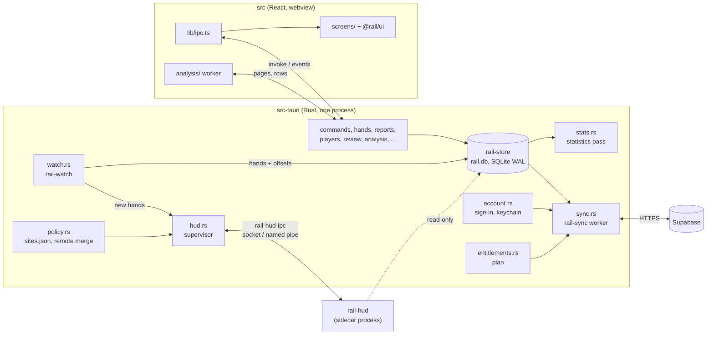

# Rail desktop app (`app/`)

The desktop tracker for macOS and Windows: a Tauri 2 shell in Rust
(`src-tauri/`, the `rail-app` crate, a member of the root Cargo workspace)
around a React + TypeScript window (`src/`, built with Vite). It watches the
poker rooms' hand-history folders, imports every hand into a local SQLite
store, shows the hands, reports, players and analysis, runs the HUD process
beside it, and syncs with the user's Rail account in the background.

The product side (what each screen is for) is in the root
[`README.md` §5](../README.md#5-components); the step-by-step plan and every
"as built" note are in [`docs/RAIL-PLAN.md`](../docs/RAIL-PLAN.md) (R1.1 -
R1.10, R2.3 - R2.11, R3.2 - R3.10, R5.4, R6.4, R6.5). This file is the map of
the code.

---

## How it fits together



- **Rust owns all state and all network.** The window never opens the
  database, never holds a Supabase token and never talks to the network: it
  calls Rust commands through `invoke` and listens to Rust events. The CSP in
  `tauri.conf.json` allows `connect-src ipc:` only.
- **Numbers are computed in Rust, never in the window.** A statistic reaches
  a screen as the R2.4 `Shown` value with its R2.5 reliability
  (`reports.rs`, `players.rs`); the screens from `@rail/ui` compute nothing.
- **The HUD is another process.** The app starts `rail-hud`, tells it about
  every import and never waits for it; the HUD reads the same `rail.db`
  read-only. See [`../hud/README.md`](../hud/README.md).
- **Start order** (`lib.rs` `setup`): settings, the store, the statistics
  pass, the popup state and the room policy, the HUD supervisor (prepared
  before the watcher so imports feed it; the process itself starts on the
  plan's first answer), the watcher, the account, sync, the plan check, the
  policy refresher. On exit the HUD is stopped first, then sync, the watcher
  and the statistics pass, then the store closes.

## Where things live on disk

All under the app identifier `app.rail.desktop` (provisional until the
domain is chosen):

| What | Where |
| --- | --- |
| `settings.json` (theme, density, language, start at login, first run done) | OS config directory; written atomically (`settings.rs`) |
| `rail.log` (rotated) | OS log directory |
| `rail.db` (hands, statistics, folders, refused hands, notes, HUD layouts, outbox) | OS local data directory; schema in [`core/rail-store/SCHEMA.md`](../core/rail-store/SCHEMA.md) |
| `policy/sites.json` (last good room list from the web) | OS local data directory (`policy.rs`) |
| Refresh token of the signed-in session | OS keychain: service `app.rail.desktop`, account `session@<Supabase host>` |

Settings, About shows the paths.

---

## The Rust side (`src-tauri/src/`)

One module per concern; most are thin commands over a core crate.

| Module | What it does |
| --- | --- |
| `lib.rs` | The shell: single instance, tray, autostart (`--minimized`), logging, `setup` order, the `invoke_handler` list, shutdown order |
| `main.rs` | Calls `rail_app::run()` |
| `commands.rs` | Shared state (`StoreState`) and the general commands: `core_info`, `app_info`, settings, `store_status`; the camelCase DTOs the window mirrors |
| `settings.rs` | Crash-safe `settings.json`: temp file + rename, versioned, a newer build's file never written back, an unreadable one moved to `settings.json.corrupt` |
| `tray.rs` | The tray / menu-bar icon: status lines for import, account, sync and HUD, "Pause import", "Quit Rail" |
| `strings.rs` | The tray's words in English and Croatian (everything else is the window's dictionaries) |
| `folders.rs` | First run (R1.4): `discover_folders` (rooms' default folders from the shipped `config/sites.json`), `add_folders`, `pick_folder` |
| `folder_settings.rs` | Settings, Folders (R1.5): add, change path, force a room, on/off, recursive, poll only, remove; paths checked to be absolute existing directories |
| `watch.rs` | Runs `rail-watch`; progress to the tray and the window at most once a second (`CHANGED_EVENT`) |
| `quarantine.rs` | Refused hands (R1.6): counts by reason, entries, raw text, "Try again after an update" (`retry_refused`) |
| `stats.rs` | The statistics pass (`rail_store::StatsWorker`): all-in EV of preflop all-ins in the background, recomputes after a definition change (R2.11) and swaps them in; paused during backfills and while tables are open |
| `custom_stats.rs` | The user's own statistics (R2.10): list, live check with a preview on the last 5 000 hands, save, delete |
| `hands.rs` | The Hands screen (R2.7a): keyset pages, facet counts, PHF for the replayer, notes, tags, saved filters |
| `reports.rs` | Today and Reports (R2.7b): `stat_definitions`, `report`, `report_breakdowns`, `today` |
| `players.rs` | The Players screen (R2.7c): list, profile, note, colour tag, labels (local only) |
| `account.rs` | Desktop sign-in (R1.7): opens `<web>/auth/desktop` in the browser, takes the `rail://auth/callback` deep link, keeps the session (`rail_sync::auth`), keychain |
| `sync.rs` | The sync worker (`rail_sync::worker`, R1.9): status, Sync now, pause, upload cap, choosing what to do when another account signs in, retrying rejected hands |
| `entitlements.rs` | The plan (R6.4): checks `my_entitlements()` (signed in) or `billing_enforced()` (signed out), keeps the answer in the store's `kv`, applies it to the HUD, analysis, full reports and sync |
| `policy.rs` | Compliance mode in the app (R3.10): the shipped `sites.json` with the web's copy merged over it, stricter only; `hud_policy`, "Check now", opening a room's policy page (https only) |
| `hud.rs` | The HUD process from the app's side (R3.2): starts and supervises the sidecar, sends `hand_imported` / `stats_changed` / `policy`, hears `tables_open`, refusals and seat drags; `hud_status`, the macOS permission request |
| `hud_editor.rs` | The HUD editor (R3.9): designs, presets, assignments per room / table size / format, checks against each room's restrictions, a preview drawn by the HUD's own renderer |
| `popup.rs` | The HUD popup (R3.8): opens a small window beside a clicked panel without taking the keyboard from the table; reads what it shows from the store |
| `analysis.rs` | The hand analysis' Rust half (R5.4): the gate, pending hands, saving rows, the opponents' counters, the flop library's files (disk, else the web's public bucket) |
| `review.rs` | Readers for the analysis screens (R5.4): session review, own charts' comparison, top leaks |
| `dev.rs` | Debug builds only: run the core on a picked file (the developer panel in Settings) |

`capabilities/default.json` grants the main window and the popups
(`hud-popup-*`) `core:default` only. Rail's own commands need no permission
entry; no plugin API (dialog, deep link, autostart) is reachable from the
window: Rust calls them.

### Bundling: `tauri.conf.json` and `tauri.hud.conf.json`

`tauri.conf.json` is the app: product `Rail`, identifier
`app.rail.desktop`, the `rail` deep-link scheme, macOS 11+, an NSIS
per-user installer on Windows, ad-hoc macOS signing (`signingIdentity: "-"`).

`tauri.hud.conf.json` adds only `bundle.externalBin: ["binaries/rail-hud"]`,
the HUD as a sidecar. It is kept out of the main config on purpose: with it
there, every `cargo build -p rail-app` (clippy, tests, `tauri dev`) would
fail until the sidecar had been built and copied. `npm run hud:sidecar`
(`scripts/hud-sidecar.mjs`) builds `rail-hud` in release and copies it to
`src-tauri/binaries/rail-hud-<target triple>`; the bundler puts it beside
the app's executable, where `hud.rs` starts it.

---

## The window (`src/`)

| Path | What it is |
| --- | --- |
| `main.tsx` | Entry: adopts the saved theme / density / language, opens the first-run screen until it is done, starts the analysis service, renders the app - or, on the `#/hud-popup` route, the HUD popup |
| `App.tsx` | The shell: sidebar, current screen, command palette; the A10 notice and the Pro lock in place of a screen |
| `lib/router.ts` | Hash routes: `today`, `hands`, `reports`, `players`, `analysis`, `hud`, `settings`, plus `setup` (first run, not in the sidebar); one optional parameter (`#/hands/<hand key>`) |
| `lib/ipc.ts` | The IPC boundary (below) |
| `lib/*Source.ts`, `lib/dataSource.ts` | The app's implementations of the shared screens' sources (`HandsSource`, `ReportSource`, `PlayersSource`, `SessionReviewSource`, `PreflopChartsSource`) over `ipc` |
| `lib/use*.ts` | Hooks over Rust state and events: account, sync, watcher, entitlements, HUD compliance, tables open, statistic definitions |
| `lib/duringPlay.ts` | A10: which screens help with play and are hidden while a table is open |
| `lib/hudCompliance.ts` | Words the HUD's attach refusals and the room list (the decisions are Rust's) |
| `lib/appearance.ts`, `public/appearance.js` | Theme and density painted before the first frame |
| `screens/` | `Today`, `Hands`, `Reports`, `Players`, `Analysis`, `Hud` (+ `hud/`: status panel, editor, preview), `FirstRun`, `settings/` (Account, Folders, Refused hands, Your statistics, Preferences, About, Your data) |
| `components/` | App-only pieces: sidebar, palette, sync and account panels, refused-hands table, `ProLock` |
| `popup/HudPopup.tsx` | The HUD popup window's content |
| `analysis/` | The background hand analysis (below) |
| `i18n/` | `en.ts` and `hr.ts` (complete), number and date formats, the slices handed to `@rail/ui`'s `UiStringsProvider` |

The Hands, Reports and Players screens, the replayer, the session review
and the chart editor are the shared package's ([`packages/ui`](../packages/ui)),
the same components the web renders; the app supplies a source and its words.

### The IPC boundary: `src/lib/ipc.ts`

Every Rust command the window may call, typed, as `ipc.<name>()`; each type
mirrors a `#[derive(Serialize)]` struct on the Rust side, camelCase on both
sides. Outside Tauri (`npm run dev` in a browser) `inApp` is false and the
screens say the data is only available in the app. The command groups:

| Group | Commands |
| --- | --- |
| App and settings | `core_info`, `app_info`, `get_settings`, `set_theme`, `set_density`, `set_locale`, `set_start_at_login`, `set_first_run_done` |
| Store and import | `store_status`, `watcher_status`, `set_import_paused` |
| Folders | `discover_folders`, `add_folders`, `pick_folder`, `add_folder`, `set_folder_path`, `set_folder_room`, `set_folder_enabled`, `set_folder_recursive`, `set_folder_poll_only`, `remove_folder`, `folder_rooms`, `folder_quarantine` |
| Refused hands | `quarantine_summary`, `quarantine_entries`, `quarantine_raw_text`, `retry_refused` |
| Account | `account_status`, `account_sign_in`, `account_open_sign_in_page`, `account_cancel_sign_in`, `account_sign_out`, `account_open_web_page` |
| Sync | `sync_status`, `sync_now`, `sync_set_paused`, `sync_set_cap`, `sync_answer_account`, `sync_retry_rejected` |
| Plan | `entitlements_status`, `entitlements_check_now`, `entitlements_open_upgrade` |
| Statistics | `stats_status`, `stats_rebuild`, `stats_recompute_ev`, `stat_definitions`, `custom_stats_list`, `custom_stat_check`, `custom_stat_save`, `custom_stat_delete` |
| Hands | `hands_page`, `hands_facets`, `hands_by_key`, `hands_find`, `hand_phf`, `hand_annotations`, `hand_set_note`, `hand_add_tag`, `hand_remove_tag`, `saved_filters`, `save_filter`, `delete_saved_filter` |
| Today and Reports | `today`, `report`, `report_breakdowns` |
| Players | `players_list`, `player_profile`, `player_sites`, `player_labels`, `player_set_note`, `player_set_colour`, `player_add_label`, `player_remove_label` |
| HUD | `hud_status`, `hud_request_permission`, `hud_policy`, `hud_policy_check`, `hud_open_policy_source`, `hud_reset_seat_positions`, `hud_set_preferred_seat` |
| HUD popup | `hud_popup`, `hud_popup_close`, `hud_popup_open_in_app` |
| HUD editor | `hud_editor_state`, `hud_design_check`, `hud_design_save`, `hud_design_delete`, `hud_assign`, `hud_preview` |
| Analysis | `analysis_gate`, `analysis_set_paused`, `analysis_pending`, `analysis_offline`, `analysis_save`, `analysis_counts`, `analysis_villains`, `analysis_clear`, `flop_library_file`, `flop_library_reachable`, `flop_library_usage` |
| Charts and review | `chart_sets_list`, `chart_set_load`, `chart_set_save`, `chart_set_delete`, `tournament_settings_save`, `tournament_settings_delete`, `session_preflop`, `chart_played`, `chart_examples`, `top_leaks`, `leak_examples` |
| Debug builds only | `dev_pick_file`, `convert_file` |

Events go the other way (`on<Thing>Changed` helpers in the same file): the
watcher, account, sync, statistics, entitlements, HUD layouts, tables open
and the popup each emit one when their state changes, and the screens read
again. A rejected `invoke` carries the command's `Err(String)`
(`errorText`).

### The analysis worker: `src/analysis/`

The web's hand analysis, run offline over the local store (R5.4). It is not
a copy: `@rail/web-lib` is an alias of `web/src/lib` (`vite.config.ts`,
`tsconfig.app.json`), so the app grades a hand exactly as the web does
(`tests/test/appAnalysisParity.test.ts` holds them to it).

- `library.ts` - the one door to the web's library (analysis, charts,
  solver, equity, stats, PHF), framework-free by the web's lint rule.
- `runner.ts` - the loop, a page of hands at a time: ask the gate, take the
  newest unanalysed hands, read the opponents' counters, analyse in the
  worker, save the rows, wait. Hands analysed without the flop library
  (offline) are done again once it can be reached.
- `worker.ts`, `worker.entry.ts`, `workerClient.ts` - the Web Worker. It
  has no Tauri IPC, so its flop-library fetches go through the window to
  Rust (`flop_library_file`: the disk, else the web's public bucket).
- `engine.ts`, `rows.ts` - one page through the web's `analyseStoredHands`,
  and the rows the store keeps.
- `service.ts` - the running instance, started by `main.tsx` after a delay,
  woken by imports and a table closing, stopped at once by a table opening.

The gate (`analysis_gate` in `analysis.rs`) says no while a poker table is
open (A10), while a backfill or the statistics pass runs, while the user has
paused it, and when the plan does not include analysis.

### The HUD popup: `src/popup/`

A click on a seat's panel at a table makes the HUD send `open_popup`;
`popup.rs` opens (or moves) one small window labelled `hud-popup-<n>` on
this page's `#/hud-popup` route, built hidden and unfocused so the table
keeps the keyboard. `HudPopup.tsx` asks Rust (`hud_popup`) for the player's
statistics over the table's game, each statistic's thresholds in words,
hands together and the result against them, rows by position where the room
allows it, and - only where the room allows labels - the colour, labels and
note, editable. Esc, its close button, the pointer leaving it, a second
click on the same panel, or the last table closing close it. "Open in Rail"
opens the player's profile in the main window.

---

## Rules that bind this code

- **No help during play (A10).** While the HUD has any table open, a screen
  that could help with the hand in play is replaced by a notice, left out of
  the sidebar and the palette, and its shortcut does nothing
  (`lib/duringPlay.ts`; today the Analysis screen); inside other screens the
  replayer's pot odds and the starting-hand chart are hidden; the analysis
  worker stops. Tested in `tests/test/appDuringPlay.test.ts`.
- **Compliance mode, no override.** The HUD's attach decision is the HUD
  process's, from the merged `sites.json`; the app only shows it.
  `policy.rs` merges the web's copy stricter-only and never offers a switch
  (`tests/test/appHudCompliance.test.ts`). Policies:
  [`docs/research/HUD-POLICIES.md`](../docs/research/HUD-POLICIES.md).
- **Refuse when unsure.** A hand the core cannot read faithfully is kept in
  `quarantine` with its reason and raw text and shown in Settings, Refused
  hands; it is never approximated.
- **Tokens stay in Rust.** The refresh token is in the keychain, the access
  token in memory; neither is in `settings.json`, the log or the webview.
- **Words go through i18n.** Components hold no user-facing literals (a lint
  rule); English and Croatian must have the same keys
  (`tests/test/appI18n.test.ts`).
- **A new statistic is a definition** in `config/stats/`, not code here.

### The plan (R6.4)

`entitlements.rs` works out the effective plan from the last kept check and
applies it. Gated features (`src/lib/useEntitlements.ts`, `ProLock.tsx`):

| Feature | Where it shows when locked |
| --- | --- |
| `hud` | The HUD process is not started (a running HUD is not stopped; the plan applies at the next start); the HUD screen shows a compact lock above its status, and the editor stays usable |
| `analysis` | The Analysis screen shows the lock; the analysis gate answers `plan` |
| `reportsFull` | Reports keeps its summary, every statistic, the graph and the breakdowns by position, stake, room, table size and format, and locks the situation tabs; the Players screen shows the lock |
| `desktopSync` | Sync is held (`PlanRequired`); hands wait unsent in the outbox |

Importing, the hand list, the replayer and basic statistics are never
locked. **Enforcement is off today**: the server answers `enforced: false`,
so nothing is locked, signed in or not. Once the owner turns it on, an app
with no account asks the public `billing_enforced()` and is Free; a
signed-in app keeps its last answer for an offline grace period. A failed
check changes nothing. Billing itself: [`docs/BILLING.md`](../docs/BILLING.md).

---

## Build, run, test

Prerequisites: Node 22 and the Rust toolchain pinned by
`rust-toolchain.toml`. On Linux (not shipped; CI only checks it compiles)
Tauri also needs `libwebkit2gtk-4.1-dev libayatana-appindicator3-dev
librsvg2-dev libxdo-dev libssl-dev`.

```bash
cd app
npm install                  # also links ../packages/ui as @rail/ui
npm run tauri dev            # Vite on :1420 + the Rust shell, both reloading
npm run dev                  # the window alone in a browser, no Rust side
npm run lint && npm run lint:css && npm run typecheck

cargo build -p rail-hud      # optional: the HUD next to the dev binary (target/debug/)
RAIL_HUD=off npm run tauri dev   # run without starting the HUD

npm run hud:sidecar          # release rail-hud copied to src-tauri/binaries/
npm run tauri -- build --config src-tauri/tauri.hud.conf.json   # bundle with the HUD
```

From the repository root:

```bash
cargo clippy -p rail-app --all-targets --locked -- -D warnings
cargo test -p rail-app --locked -- --nocapture --test-threads 1
```

Sign-in configuration is compiled in: `RAIL_SUPABASE_URL` and
`RAIL_WEB_URL` default to production, `RAIL_SUPABASE_ANON_KEY` (public, not
in the repository) has no default - a build without it says sign-in is not
available and works offline. A debug build also reads all three at run
time, to point `tauri dev` at a local stack. On macOS the `rail://` link
reaches only a bundled app, so the sign-in flow is checked end to end with
`supabase/functions/desktop-handoff/e2e.sh` and sync with
`cargo run -p rail-sync --example sync_e2e`, both against a local stack.

The window's logic that is pure (A10, compliance wording, filters, plan,
i18n, analysis parity and runner) is tested by vitest in [`tests/`](../tests)
(`tests/test/app*.test.ts`).

**CI (`app` job, `.github/workflows/ci.yml`)**: on Linux, ESLint, stylelint
and `tsc`; on Linux, macOS and Windows, clippy and the crate's tests one at
a time; on macOS and Windows, the HUD sidecar, an unsigned bundle (`.dmg`,
NSIS installer) with LTO off, a check that `rail-hud` is inside it, and the
bundle attached to the run for 7 days. Unsigned means macOS needs System
Settings, Privacy & Security, "Open Anyway" on first launch and Windows
SmartScreen asks for "Run anyway".

---

## Further reading

| Topic | Document |
| --- | --- |
| Screens and features, product view | [`README.md` §5](../README.md#5-components), [`docs/RAIL_GUIDELINE.md`](../docs/RAIL_GUIDELINE.md) §6 - §7 |
| Getting started for the whole repository | [`README.md` §8](../README.md#8-getting-started) |
| Step-by-step plan, as-built notes | [`docs/RAIL-PLAN.md`](../docs/RAIL-PLAN.md) |
| The local store's tables | [`core/rail-store/SCHEMA.md`](../core/rail-store/SCHEMA.md) |
| The HUD process, IPC and simulator | [`hud/README.md`](../hud/README.md) |
| The shared screens and the web's rules for them | [`docs/WEB.md`](../docs/WEB.md), "Shared UI package" |
| Desktop sign-in threat model | [`docs/DATABASE.md`](../docs/DATABASE.md#desktop-sign-in-the-edge-function-desktop-handoff) |
| Paid plans and Stripe | [`docs/BILLING.md`](../docs/BILLING.md) |
