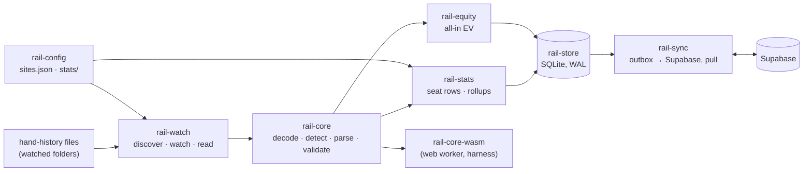

# Rail core (`core/`)

The Rust crates that read hand histories and everything built directly on the
hands they produce: the hand model (PHF), the parsers, statistics, all-in EV,
the local SQLite store, the file watcher and the sync to Supabase. The desktop
app (`app/src-tauri`) and the HUD (`hud/`) link these crates natively; the web
loads `rail-core` as WebAssembly.

The crates are members of the Cargo workspace at the repository root
(`Cargo.toml`); `rust-toolchain.toml` pins the compiler. The overview of the
whole system is the root [`README.md`](../README.md) (§4 Architecture, §5
Components); the plan each step comes from is
[`docs/RAIL-PLAN.md`](../docs/RAIL-PLAN.md).

## Contents

- [How the crates fit together](#how-the-crates-fit-together)
- [Rules that bind every crate](#rules-that-bind-every-crate)
- [`rail-core`](#rail-core) - decode, detect, parse, validate, serialize
- [`rail-core-wasm`](#rail-core-wasm) - the core for the browser and the TypeScript harness
- [`rail-config`](#rail-config) - `config/sites.json` and `config/stats/`
- [`rail-stats`](#rail-stats) - per-seat counters, displayed statistics, custom statistics
- [`rail-equity`](#rail-equity) - all-in EV
- [`rail-store`](#rail-store) - the local SQLite store
- [`rail-watch`](#rail-watch) - folder discovery, file watching, import
- [`rail-sync`](#rail-sync) - account, sync, remote room list, entitlements
- [Building and testing](#building-and-testing)

---

## How the crates fit together



Dependency order (each crate depends only on crates to its left):

```
rail-core ─┬─ rail-core-wasm
           ├─ rail-config (dev-dependency only; takes parser ids as input)
           ├─ rail-stats (+ rail-config) ── rail-equity
           └─ rail-store (rail-core, rail-stats, rail-equity)
                 ├─ rail-watch (+ rail-config)
                 └─ rail-sync  (+ rail-core, rail-config)
```

Consumers: `app/src-tauri` uses all of them except `rail-core-wasm`;
`hud/rail-hud` opens `rail-store` read-only and uses `rail-core`,
`rail-config` and `rail-stats`; the web uses `rail-core-wasm` only.

## Rules that bind every crate

- **Refuse when unsure.** A hand that cannot be represented faithfully is a
  refusal with a machine-readable reason (`ParseSkip` / `FailureReason`),
  recorded and shown to the user; never approximated, never dropped
  ([`docs/WEB.md`, "The refusal principle"](../docs/WEB.md#the-refusal-principle)).
- **The TypeScript is the oracle.** Every port (parsers, statistics, EV,
  display, reliability, reports) must reproduce the TypeScript output for the
  whole corpus, byte for byte, before it replaces anything. Goldens are
  written by `npm run golden:emit` in `tests/` and never edited by hand
  ([`testdata/golden/README.md`](../testdata/golden/README.md)).
- **No synthetic fixtures.** Every test hand is a real export from
  `fixtures/samples/`, `gg-hh/`, `weplay-hh/` or `tests/test/fixtures/`.
  Generated data exists only in the benchmarks (`import_bench`, `perf_gate`),
  is labelled `GENERATED.md`, lives in a temporary directory and is deleted.
- **Money is integer minor units.** The workspace lints deny lossy integer
  casts and `float_arithmetic` (root `Cargo.toml`). Where the TypeScript
  computes in doubles, the port performs the same IEEE-754 operations through
  `rail_core::js::JsNumber`, so results match the browser to the bit.
- **No `unsafe`.** Every core crate has `#![forbid(unsafe_code)]`.
- **The core has no clock.** `meta.parsedAt` is passed in (pinned to
  1970-01-01 in goldens and `rail-convert`); the store stamps real times
  (`rail_store::time`).
- **A new room** is a parser, its goldens and a `config/sites.json` entry in
  the same pull request; `core/rail-config/tests/sites.rs` fails otherwise.

---

## `rail-core`

The only code that reads a hand-history file. Everything downstream works on
the `PhfHand` it returns. It is a port of `web/src/lib/{phf,parsers}`; the
format is specified in [`docs/PHF-SPEC.md`](../docs/PHF-SPEC.md).

**The pipeline** (`convert::convert`, the converter's file path):

```
bytes ─ decode_source ─▶ text
      ─ Registry::detect_site ─▶ ranked parsers (integer per-mille scores, threshold 200)
      ─ best parser's split_hands ─▶ chunks
      ─ per chunk: detect again, parse_hand ─▶ PhfHand | ParseSkip(reason)
      ─ hi/lo and short-deck backstops, assign_positions, validate_hand
      ─▶ FileConversion: one hand or one refusal per chunk, in order
```

A file that nothing claims, whose split fails or that has no hands becomes
one file-level refusal, plus an `Unrecognized` record for the
unsupported-format registry.

| Module | What it does |
| --- | --- |
| `decode` | Bytes to text, step for step as the web's `decodeSource`: BOM (UTF-8, UTF-16LE/BE), UTF-16 without BOM by NUL pattern, strict UTF-8, else Windows-1252 unless implausible; binary refused; CRLF and CR normalised to LF |
| `detect` | The `SiteParser` trait, the `Registry` and its ranking, refusal reasons (`SkipReason`, `FailureReason`, `Stage`), the sha-256 refusal `fingerprint`, the hi/lo and short-deck backstops |
| `convert` | `convert` (a file) and `convert_any` (text), `ConversionFailure` in the shape `unparsed_hands` stores |
| `parsers/` | 19 parsers in `REGISTRATION_ORDER` (the order of `web/src/lib/parsers/index.ts`, which detection ties depend on), `standard` (Rail's own output) included; `shared/` holds the helpers several parsers use, `variant_lock` the per-room variant allowlists |
| `phf/` | The hand model (`hand`, `game`, `money`, `tags`), `hilo` (which half of a split pot each award is), `serialize/` (the GG-style standard text both ways, byte-exact), `dts` (generates the TypeScript declarations) |
| `positions` | `assign_positions`: BTN/SB/BB/... from the posted blinds |
| `validate` | `validate_hand`: chip conservation, payouts, cards; errors refuse the hand, warnings flag it |
| `cards`, `eval` | Card parsing; hand evaluation for full deck, short deck, Omaha high and eight-or-better low |
| `canonical` | The canonical JSON goldens are written in and PHF hashes are taken over |
| `unrecognized`, `anonymise` | The registry record of an unclaimed file, and the shareable sample with player names replaced ([`docs/unsupported-formats.md`](../docs/unsupported-formats.md)) |
| `js` | JavaScript semantics the reference depends on: `\s`, regex differences, `JsNumber` (IEEE-754 arithmetic, correctly rounded `sqrt`), sort |
| `bin/rail-convert.rs` | The command-line converter (below) |

**Command line:**

```bash
cargo run -p rail-core --bin rail-convert -- <file>...              # per file: encoding, detection, hands, refusals
cargo run -p rail-core --bin rail-convert -- --json <file>...       # each file's hands as a canonical PHF array
cargo run -p rail-core --bin rail-convert -- --text <file>...       # each file's standard text, byte for byte
cargo run -p rail-core --bin rail-convert -- --anonymise <file>...  # a shareable sample, names replaced
```

Exit code 1 only when a file cannot be read (2 for a usage error); refusals
and unrecognised files are part of the result.

**Tests.** `tests/golden_*.rs` hold every corpus file to its golden (decode,
detection, sites, hands and refusals, standard text, PHF round trip;
`golden_roundtrip.rs` fails rather than skips without
`testdata/golden-full/`, so run `npm run golden:emit` in `tests/` first).
`tests/*_vectors.rs` replay JSON vectors in `tests/data/`, each written by the
`.mjs` beside it running the TypeScript, for the edge cases the corpus lacks.
After changing the model, regenerate the declarations:
`RAIL_UPDATE_DTS=1 cargo test -p rail-core --lib phf::dts`.

---

## `rail-core-wasm`

The core for the browser's conversion worker and the TypeScript harness's
shadow mode. `src/api.rs` is the logic (plain Rust, tested natively);
`src/lib.rs` is only the `#[wasm_bindgen]` shims. Bytes and JSON text in,
JSON text out:

| Export | Returns |
| --- | --- |
| `convert(bytes, filename, optionsJson)` | The whole pipeline as a `rail-convert/1` document (options must carry `parsedAt`) |
| `detect(bytes)` | Decoding and the detection ranking |
| `split(bytes)` | Decoding, ranking, the top parser and its hand chunks (the web's batched conversion) |
| `serialize(phfJson)` | The standard text of one hand or an array of hands |
| `anonymise(bytes)` | The shareable sample of a file |
| `formats()` | `{ "convert": "rail-convert/1", "phf": "phf/1" }` |

`js/index.ts` is the typed TypeScript wrapper; `types/phf.d.ts` the
declarations generated from the Rust model. `wasm-bindgen` is pinned exactly
(`=0.2.129`) and the CLI must match.

```bash
cargo install wasm-bindgen-cli --version 0.2.129 --locked   # once
cd tests
npm run wasm:build           # Node target into core/rail-core-wasm/pkg/ (gitignored); fails over 1.5 MB gzipped
npm run wasm:shadow          # every corpus file: WASM = TypeScript
npm run wasm:web-from-ci     # install CI's Linux build into web/src/lib/wasm/rail-core/
```

The copy the web ships (`web/src/lib/wasm/rail-core/`) is **always CI's Linux
build**, never a local one: the linker lays the module out differently on
macOS. CI's `wasm` job fails when the committed copy differs. Details:
[`docs/WEB.md`, "The conversion core is WebAssembly"](../docs/WEB.md#the-conversion-core-is-webassembly-r41).

---

## `rail-config`

Loading and validation of [`config/sites.json`](../config/sites.json) (one
entry per poker client: folders, file patterns, encodings, table windows,
HUD policy) and [`config/stats/`](../config/stats/) (the displayed
statistics). Pure functions only: no file system, no network; builds for
wasm32. Parser ids and the counter vocabulary are passed in by the caller,
so it does not depend on `rail-core` or `rail-stats`.

| Module | What it does |
| --- | --- |
| `lib.rs` | `SHIPPED` (the file compiled in), `parse`, `load` / `load_shipped` (validate + every parser covered), `load_remote` (a downloaded copy, validated, merged over the shipped one) |
| `model` | The `sites.json` shape field for field (`config/sites.schema.json`); `Site::hud_permitted`, compliance mode's one question |
| `validate` | Every problem in a file: unknown parsers, title patterns that do not compile, coverage |
| `merge` | `merge_remote`: paths, files and tables may change; **HUD policy only gets stricter**; unknown ids are ignored |
| `stats/` | `config/stats/`: `load_stats`, `SHIPPED_STATS`, the formula language (`formula`: names, `+ - * /`, `pct`, `sum`) and the custom-statistic predicate language (`predicate`) |

Unknown is `null`, never a guess: a folder is `verified` only once seen on a
real install, and an unknown HUD policy counts as prohibited. Rooms' policies
and their sources: [`docs/research/HUD-POLICIES.md`](../docs/research/HUD-POLICIES.md);
how paths are verified: [`docs/research/VERIFYING-PATHS.md`](../docs/research/VERIFYING-PATHS.md).

```bash
cargo test -p rail-config      # tests/sites.rs: the file against the Rust parser registry
```

---

## `rail-stats`

The `stats/2` statistics engine, ported from `web/src/lib/stats` counter for
counter. Every judgement call (straddles, walks, RFI against isolation, steals,
bomb pots, ...) is the TypeScript's and is written down in
[`docs/STATS-SPEC.md`](../docs/STATS-SPEC.md).

```
PhfHand ── hand_facts() ──▶ HandFacts ── stats_rows() ──▶ Vec<StatsRow>   (one per dealt-in seat)
rows_for(&hand) = stats_rows(&hand_facts(&hand))
```

| Module | What it does |
| --- | --- |
| `counters` | The ~90 counters (`Counter`, `SeatCounters`), seat money, opportunity pairs |
| `context` | The decision stream and the hand's shape |
| `preflop`, `postflop`, `showdown`, `money` | The counter walks |
| `derive` | `hand_facts`, `STATS_VERSION`, pot type, hand class |
| `mapping` | `StatsRow`, the flat row in the `hand_stats` column shape |
| `anonymization` | Whether a room's names are persistent, positional or opaque per-session ids |
| `segment` | What rollups sum over: site, format, variant, limit, table size (`hu` / `6max` / `full`), stake; `SEGMENT_VERSION` |
| `stored` | Which rows a store keeps and the identity they are summed under |
| `display` | Evaluates `config/stats/` definitions over summed counters in JavaScript's arithmetic, so the app prints the web's digits |
| `reliability` | 95% Wilson interval for rates, sample level (`ok` / `low` / `insufficient`) and opacity from `sample.min` |
| `events`, `custom` | Per-seat decision events and the user's own counters (a predicate over events) and statistics |

Integers only: amounts `i64` minor units, counters `u32`; the three divisions
the TypeScript does in doubles go through `JsNumber`.

**Tests.** `tests/corpus.rs` compares every corpus hand's rows with
`testdata/golden-stats/`; `vectors.rs`, `display.rs` and `reliability.rs`
replay `tests/data/*-vectors.json`; `custom_acceptance.rs` re-expresses the
standard set as predicates and compares it with the coded counters. After a
change on the TypeScript side regenerate the vectors with the `.mjs` beside
them (e.g. `node core/rail-stats/tests/data/display-vectors.mjs`); the root
README §8 lists which change needs which.

---

## `rail-equity`

All-in EV, ported from `web/src/lib/equity`.

```
rail_core::eval   5-7 card values, full and short deck, Omaha
enumerate         equity per pot over every runout, or a seeded sample
range             one hand against a weighted range, card removal applied
multiway          one hand against several ranges
all_in            PhfHand -> pots at the all-in -> EV net per seat
row               the stored hand_stats_ev row (ev_row, ev_row_for), EV_VERSION
```

Equity is exact integer arithmetic (a share of a pot in units of
`1/(boards * 27720)`); where the TypeScript turns it into doubles the port
does the same IEEE-754 operations, and the Monte Carlo path (Omaha preflop)
uses the same seeded `mulberry32` and shuffle. Every row and equity therefore
equals the TypeScript's bit for bit, not within a tolerance.

```bash
cargo test -p rail-equity      # tests/corpus.rs against testdata/golden-ev/; tests/vectors.rs against tests/data/ev-vectors.json
```

Its tests are compiled with optimisation (see the profile overrides in the
root `Cargo.toml`): unoptimised, enumerating every preflop all-in takes minutes.

---

## `rail-store`

The local SQLite database the app writes and the HUD reads. Local-first: a
hand is written here first and synced later. Every table is documented in
[`core/rail-store/SCHEMA.md`](rail-store/SCHEMA.md).

```
rail-watch / import_file ──ImportBatch──▶ writer thread ──one transaction──▶ rail.db (WAL)
                                            hands (zstd PHF, deduped by hand_key)
                                            file offset · seat rows · rollups · outbox
UI screens, HUD (read-only) ◀── reader pool ◀──┘
background pass: preflop all-in EV, custom statistics, targeted recompute
```

- **One file** (`rail.db`), SQLite compiled in (`rusqlite` `bundled`,
  pinned), WAL, `synchronous = NORMAL`, 16 KiB pages.
- **One writer thread.** An `ImportBatch` (one read of one file) commits in
  one transaction with the file's new read offset, so a crash never stores
  hands without moving the offset or the reverse. A newly stored hand enters
  the sync `outbox` in the same transaction; duplicates add nothing.
- **Readers** are a pool of read-only connections; WAL readers never wait for
  the writer. The HUD process opens the file read-only.
- **Migrations** are embedded SQL files in `migrations/`, versioned by
  `PRAGMA user_version`, forward-only, each in its own transaction.

| Module | What it does |
| --- | --- |
| `writer`, `batch`, `import` | The writer thread and its commands; `ImportBatch` and prepared hands; `import_file` (a whole file through `rail_core`) |
| `read` | The reader pool, store status, stale refusals |
| `sources` | Watched folders: add, move (offsets kept), room override, reset after a parser update |
| `stats`, `stats_read` | Seat rows, rollups per player and segment, the hero's per day; the reads the HUD and screens use, including own-hands-only totals |
| `background` | The background pass: preflop all-in EV, custom statistics, recompute jobs |
| `recompute` | Targeted recompute (`DEPENDENCIES`: which change touches which tables), computed beside the live numbers and swapped in one commit |
| `custom` | The user's own statistics and their counts |
| `hand_list` | The Hands screen: keyset pages, filters and counts, notes, tags, saved filters |
| `report` | Reports: win-rate graph, sessions (30-minute rule), breakdowns |
| `players` | Opponents, profiles, colour tags, labels, notes (local only) |
| `hud` | HUD layouts, designs and dragged panels; written by the app, read by the HUD |
| `analysis`, `leaks`, `review` | The app's hand analysis rows, the leak finder's sums and the session review over this store (R5.4) |
| `sync` | Outbox, rejected hands, pulled hands |
| `time`, `error`, `migrate` | Wall-clock helpers (ms since epoch), errors, the migration runner |

```bash
cargo test -p rail-store                                       # includes tests/crash.rs: kills an importing process at random points
cargo run --release -p rail-store --example import_corpus -- [threads] [db]
```

The other examples (`report_queries`, `hand_list_queries`, `players_queries`,
`stats_queries`, `analysis_queries`, `recompute_bench`) time the screens'
queries on a large store built with `rail-watch`'s `import_bench`; each
file's header has the command. Report vectors
(`tests/data/report-vectors.*`) hold the reports to the web's SQL restated in
TypeScript.

---

## `rail-watch`

Finds the rooms' hand-history folders, watches them and reads what the rooms
write into the store, incrementally. Native only, never built for wasm32.

```
discover (first run) ─▶ sources in the store
OS notifications (notify: FSEvents / ReadDirectoryChangesW / inotify)
  + rescan every 60 s, poll-only folders every 3 s
  ─▶ import threads (rayon; physical cores - 1, live files before backfill)
  ─▶ FileReader: from the stored offset to the last complete hand
  ─▶ rail_store ImportBatch (hands + new offset, one transaction)
```

**When a hand is complete:** the next hand's header has started (the offset
then stops at that header), or the file has been quiet for 500 ms
(`ReadConfig::quiet_ms`) and the last hand validates. A hand still being
written is never imported, which is also why the HUD never shows anything of
the hand in play.

| Module | What it does |
| --- | --- |
| `codec` | The core's decoding one piece of a file at a time (UTF-8, BOM, UTF-16 on code-unit boundaries, Windows-1252), mapping text positions back to byte offsets |
| `reader` | `FileReader`: one file from its offset; the completeness rule; `mark_read` for "only new hands"; truncated, replaced, renamed and deleted files |
| `scan` | Which files of a folder are read (a room's `files.glob`, or hand-history extensions); network volumes |
| `watcher` | The service the app runs: notifications, rescans, the import pool, pause / resume, backfill progress, status events |
| `discover` | The rooms' default folders from `config/sites.json` that exist on this machine, with file counts and the newest file's date |

```bash
cargo test -p rail-watch
cargo test -p rail-watch --test random_append       # corpus files appended in random chunks, byte by byte included
RAIL_WATCH_FILES=all cargo test -p rail-watch --test random_append   # the whole corpus
cargo run --release -p rail-watch --example import_bench -- --hands 100000
cargo run --release -p rail-watch --example perf_gate -- --hands 1000000
```

`import_bench` builds a **generated** dataset (the corpus copied with hand
ids permuted, labelled, deleted afterwards) and measures hands per second
through the real watcher; CI's `import-bench` job gates on its efficiency.
`perf_gate` builds a generated million-hand store and checks every
performance target that exists before the HUD; it runs nightly
(`perf-nightly.yml`). Options and results: root README §8 and
[`docs/RAIL-PLAN.md`](../docs/RAIL-PLAN.md) (R1.6, R2.9).

---

## `rail-sync`

Everything between the desktop app and Supabase. HTTPS is `reqwest` with
rustls on *ring* and the operating system's certificate verifier.

| Module | What it does |
| --- | --- |
| `auth/` | The app's own session: `handoff` (an X25519 key pair and `state` per sign-in, kept in memory; the `rail://auth/callback` payload decrypts only with them), `gotrue` (verify the one-time token, refresh, log out), `account` (one sign-in at a time for ten minutes, refresh before expiry with backoff, sign-out when the refresh token is refused), `secret` |
| `ingest/` | `register_hand_source` and `ingest_hands` with the account's token (batches, rows), the pull's reads (`hands_since`), HUD layout sync |
| `worker` | The sync worker: drains the outbox, pulls the account's other hands |
| `policy` | The remote `sites.json` from the web: fetched, validated, merged stricter-only, cached |
| `floplib` | The flop library files the app's analysis reads, fetched from the public `flop-library` bucket and kept on disk |
| `entitlements` | The account's plan kept for offline use and the rules for the app's effective entitlements |

**The session is the app's own.** The handoff carries a one-time token that
GoTrue turns into a fresh session with its own refresh-token chain; the
browser's refresh token never reaches the app. The app keeps the refresh
token in the OS keychain. The web half and threat model are in
[`docs/DATABASE.md`](../docs/DATABASE.md) ("Desktop sign-in").

**Push.** Each round takes up to 500 hands from the outbox (hands queued in
the last 15 minutes first, newest played first, then the backlog) and sends
them with `ingest_hands` under the watched folder's `hand_sources` row.
`inserted` and `duplicate` leave the outbox (a replay is all duplicates, so a
crash costs a resend, never a second row); `rejected` moves to
`sync_rejected` with its reason; a transient failure backs off from 5 s
doubling to 10 min with jitter; a spent rate limit is waited out and probed
with one hand. Hands are only ever sent for the account that owns the
store's hands (`kv` `sync.owner`). **Pull** fetches the account's other hands
by keyset cursor, keys first, PHF only for hands the store lacks.

**Entitlements** (R6.4). The server gates everything that touches the cloud
(sync, pull, HUD layouts refuse with `PT402` once enforcement is on); this
module decides the **local** Pro features (HUD, analysis, full reports). Rules
in order: enforcement unknown or off - everything open; on and signed out -
Free; on and signed in without a usable check - Free until the next check;
on and checked - the plan it said, for `offlineGraceDays` (14) after the
check, then Free until the app reconnects. A failed check changes nothing.
Plans and enforcement: [`docs/BILLING.md`](../docs/BILLING.md).

```bash
cargo test -p rail-sync
```

End to end against a **local** Supabase stack (Docker; not run in CI, each
file's header has the environment it needs):
`examples/desktop_sign_in_e2e.rs` (driven by
`supabase/functions/desktop-handoff/e2e.sh`), `desktop_ingest_e2e.rs`,
`sync_e2e.rs` (kill and resume, a network cut mid-batch, the pull) and
`parity_app.rs` (the app's half of `npm run parity` in `tests/`).

---

## Building and testing

What CI runs for these crates (Linux, macOS and Windows), from the
repository root:

```bash
(cd tests && npm ci && npm run golden:emit)   # cargo test needs testdata/golden-full/
cargo fmt --all --check
cargo clippy --workspace --exclude rail-app --all-targets --locked -- -D warnings
cargo test --workspace --exclude rail-app --locked
cargo build -p rail-core -p rail-core-wasm -p rail-config -p rail-stats -p rail-equity \
  --target wasm32-unknown-unknown --locked
(cd tests && npm run phf:dts-check)           # Rust-generated PHF declarations = web/src/lib/phf/types.ts
```

One crate at a time: `cargo test -p <crate>`. Which TypeScript change needs
which regenerated golden or vector file is listed in the root
[`README.md` §8](../README.md#8-getting-started).

| Question | Document |
| --- | --- |
| What is a hand? How do I write a parser? | [`docs/PHF-SPEC.md`](../docs/PHF-SPEC.md) (§8 for parsers) |
| What does each statistic count, and why? | [`docs/STATS-SPEC.md`](../docs/STATS-SPEC.md) (§12-14 for the Rust side) |
| What is in the local store? | [`rail-store/SCHEMA.md`](rail-store/SCHEMA.md) |
| What are the goldens? | [`testdata/golden/README.md`](../testdata/golden/README.md) |
| Unrecognised files and the registry | [`docs/unsupported-formats.md`](../docs/unsupported-formats.md) |
| Why each step was built the way it was | [`docs/RAIL-PLAN.md`](../docs/RAIL-PLAN.md) (Phases 0-2, R3.7, R5.4, R6.4) |
