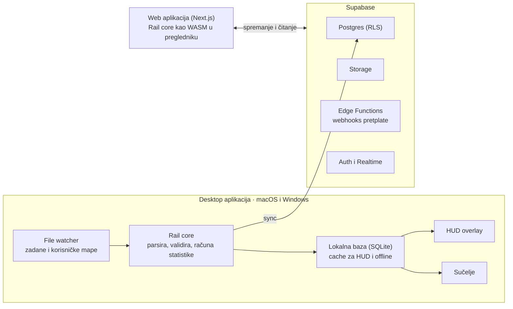

# Rail — plan razvoja i smjernice

Ažurirano: 12. listopada 2026. (uključeni amandmani A1–A11 iz `docs/RAIL-PLAN.md` §2, prihvaćeni istog dana)

Rail (dosadašnji Poker Hand Converter) razvijamo u najmoderniji HUD i poker tracker današnjice: desktop aplikacija za macOS i Windows i web aplikacija s istim podacima, na Supabaseu, s jednostavnim sučeljem, za sve formate igara i što više soba. Rail je besplatan dok se ne razvije u potpunosti, a zatim prelazi na pretplatu. Ovaj dokument je smjernica za nastavak razvoja i čuva se u repozitoriju projekta.

## 1. Vizija i načela

Rail pobjeđuje kombinacijom koju konkurencija nema na jednom mjestu: moderan HUD, sučelje koje novi korisnik savlada za nekoliko minuta, iste ruke u aplikaciji i na webu te puna podrška za macOS i Windows.

Načela koja vode svaku odluku:

- **Radi odmah.** Nakon instalacije Rail sam pronađe mape i prikaže HUD bez ručnog podešavanja; napredne opcije postoje, ali nisu na putu.
- **Brzina je značajka.** HUD se osvježava odmah nakon ruke, a izvještaji se otvaraju bez čekanja i na velikim bazama.
- **Local-first.** Aplikacija radi i bez interneta; sinkronizacija sa Supabaseom ide u pozadini.
- **Jedan izvor logike.** Parser i statistike žive u Rail coreu, koji dijele aplikacija i web.
- **Pravila soba poštujemo po zadanome.** Rail ne nudi ništa što bi korisniku moglo zatvoriti račun.

Ciljevi performansi (prijedlog, mjeri se od Faze 2):

| Mjera | Cilj |
| --- | --- |
| Vrijeme od instalacije do prvog HUD-a | < 5 min |
| Kašnjenje HUD-a nakon završetka ruke | < 1 s |
| Lokalni uvoz starih ruku | ≥ 5.000 ruku/s |
| Otvaranje izvještaja nad 1 milijun ruku | < 1 s |
| Broj stolova s HUD-om bez pada performansi | ≥ 12 |

## 2. Parser: Rail core

Postojeći Poker Hand Converter postaje Rail core, jedina komponenta koja čita hand historyje, uključujući sve stare formate. Sve ostalo (baza, HUD, web) radi samo s normaliziranim rukama koje core vraća. Core se piše u Rustu (poglavlje 15).

Tijek obrade jedne datoteke:

1. Detekcija sobe, igre i verzije formata.
2. Parsiranje u normalizirani model ruke.
3. Validacija: zbroj uloga mora odgovarati potu i rakeu, a stackovi na kraju ruke rezultatima.
4. Deduplikacija po ključu (korisnik, soba, ID ruke).
5. Izračun brojača statistika (poglavlje 5) i zapis u lokalnu bazu.

Normalizirani model ruke (Rail Hand Format) je postojeći PHF (`phf/1`, specifikacija u `docs/PHF-SPEC.md`); identifikator ostaje `phf/1`, a sljedeća nekompatibilna promjena bit će `phf/2` (A1). Sadrži: sobu, ID ruke, vrstu igre i limit, valutu, stol i broj sjedala, igrače sa sjedalima, pozicijama i stackovima, blindove, ante i straddle, akcije po ulicama s iznosima, board, showdown, dobitke, rake te podatke o turniru kad postoje. Model nosi `schema_version` (`phf/1`) kako bi se stari podaci mogli migrirati.

Pravila kvalitete:

- Ruka koja ne prođe validaciju ide u karantenu s razlogom greške, nikad tiho u bazu; nepoznat format ide u registar nepodržanih formata (Dodatak A).
- Svaki format ima golden testove (ulazna datoteka i očekivani izlaz) koji se vrte na svakoj promjeni.
- Korisnik iz aplikacije može poslati anonimizirani uzorak ruke koju Rail nije razumio.
- Core se izlaže kao biblioteka s jasnim API-jem kako bi ga web koristio bez kopiranja koda: nativno u aplikaciji, kao WebAssembly na webu.
- Postojeći TypeScript parser je referenca (orakl): za svaku datoteku u korpusu generira golden izlaz, a Rust core ga mora reproducirati prije nego što ga zamijeni.

## 3. File watcher

Većina soba sprema ruke u standardne mape, pa ih Rail pronalazi automatski; korisnik ih uvijek može dodati, urediti ili isključiti.

Prvo pokretanje:

1. Rail provjeri poznate zadane putanje za svaku sobu na macOS-u i Windowsu.
2. Prikaže pronađene mape s brojem datoteka i datumom zadnje ruke.
3. Korisnik jednim klikom potvrdi i bira: uvezi sve stare ruke ili samo nove.

Upravljanje mapama (Postavke → Mape):

- Dodavanje mape ručno preko pickera, uključujući vanjske diskove i mrežne mape.
- Promjena putanje postojeće mape i ručni odabir sobe kad automatska detekcija ne uspije.
- Uključivanje i isključivanje mape bez brisanja već uvezenih ruku.
- Opcija rekurzivnog praćenja podmapa.
- Status po mapi: zadnji uvoz, broj ruku danas, greške i ruke u karanteni.

Pouzdanost:

- Sistemske obavijesti o promjenama (FSEvents na macOS-u, ReadDirectoryChangesW na Windowsu) uz periodični sken kao rezervu.
- Datoteke koje soba još piše čitaju se od zadnjeg zapamćenog pomaka, a ruka se uvozi tek kad je završena.
- Popis zadanih putanja i formata drži se u konfiguracijskoj datoteci (`config/sites.json`), tako da se nova putanja može dodati bez nove verzije aplikacije.

## 4. Baza: Supabase

Supabase je glavna baza i backend Raila, a HUD čita iz lokalne cache baze jer mrežni poziv nakon svake ruke ne bi bio dovoljno brz ni pouzdan.

| Dio Supabasea | Uloga u Railu |
| --- | --- |
| Postgres | ruke, igrači, agregirane statistike, HUD izgledi |
| Auth | jedan račun za aplikaciju i web (email, Google, Apple); aplikacija se prijavljuje preko sistemskog preglednika (A6) |
| Storage | originalne hand history datoteke, samo uz pristanak korisnika (A2, A5) |
| Row Level Security | svaki korisnik vidi isključivo svoje podatke |
| Edge Functions | webhooks za pretplatu; parsiranje uploada ide u pregledniku (A2) |
| Realtime | web odmah vidi ruke koje je aplikacija sinkronizirala |

Local-first sinkronizacija: aplikacija ruku najprije zapiše u lokalni SQLite (za HUD i rad bez interneta), zatim je u paketima šalje u Supabase. Zapis je idempotentan upsert po ključu deduplikacije, a konflikata praktički nema jer su ruke nepromjenjive.

Početna shema, mapirana na tablice koje već postoje (A4):

| Tablica | Sadržaj | Ključ | Stanje |
| --- | --- | --- | --- |
| `profiles` | korisnik, postavke, plan pretplate | `user_id` | postoji; plan se dodaje u Fazi 6 |
| `hand_sources` | mape i uploadi, status uvoza | `id`, `user_id` | nova (Faza 1) |
| `hands` | PHF dokument ruke i denormalizirani stupci za pretragu | (`owner_id`, `hand_key`), `hand_key` = soba:ID ruke | postoji |
| `hand_stats` | jedan redak po igraču u ruci: pozicija, stack, brojači statistika (umjesto `hand_players`) | (`hand`, sjedalo, verzija) | postoji |
| `players` | igrači po sobi, oznake i boje (bilješke su u postojećoj `player_notes`) | (`user_id`, `site`, `name`) | nova (Faza 2) |
| `player_stats` | agregirani brojači po igraču i segmentu | (`user_id`, `player_id`, `segment`) | samo ako benchmark od milijun ruku pokaže da treba |
| `hud_layouts` | korisnički HUD izgledi | `id`, `user_id` | nova (Faza 3) |
| `unparsed_hands` | registar nepodržanih i odbijenih formata (umjesto `unsupported_formats`), proširen poljima za desktop | `fingerprint` | postoji |

Budžet prostora po ruci (A5): danas ruka zauzima oko 7,3 KB u `hands` i 3,9 KB u `hand_stats`, oko 11 GB na milijun ruku. Aplikacija zato šalje samo PHF ruke i brojače po sjedalu, bez `standard_text` i bez `source_text`: originalne datoteke ostaju na korisnikovu disku, a standardni tekst se po potrebi izvodi iz PHF-a (Q4, 2026-10-13).

Akcije se spremaju kao JSONB unutar `hands` umjesto retka po akciji, što drastično smanjuje broj redaka na velikim bazama; izvještaji ionako čitaju `player_stats`. Podaci o protivnicima uvijek pripadaju jednom korisniku i nikad se ne dijele među korisnicima. Sve promjene sheme idu kroz Supabase migracije u repozitoriju.

## 5. Statistički engine

Statistike se računaju u Rail coreu pri uvozu ruke i spremaju kao brojači (napravio / imao priliku), pa HUD i izvještaji samo zbrajaju gotove brojeve.

- **Definicije kao podaci, u dva sloja (A11).** Oko 90 brojača iz `stats/2` (`docs/STATS-SPEC.md`) ostaje kod, prenesen u Rust i pokriven golden testovima, jer svaki od njih nosi dokumentiranu odluku gdje se PT4 i HM3 razilaze. Prikazane i custom statistike su zapisi u `config/stats/` (naziv, formula nad brojačima, filteri, pragovi boja), isti za aplikaciju i web; nove prilike opisuju se malim jezikom uvjeta nad odlukama igrača (ulica, pozicija, situacija, akcija).
- **Custom statistike.** Editor u sučelju gradi definiciju iz formule i odmah pokazuje vrijednost na korisnikovim rukama.
- **Uzorak uz svaku vrijednost.** Uz statistiku se uvijek čuva broj prilika, a sučelje prikazuje koliko je vrijednost pouzdana.
- **Ciljani preračun.** Kad se definicija promijeni, pozadinski posao preračuna samo pogođene brojače, ne cijelu bazu.

Početni set (oko 30 statistika):

| Skupina | Statistike |
| --- | --- |
| Preflop | VPIP, PFR, 3-bet, fold to 3-bet, 4-bet, steal, fold to steal, limp |
| Postflop | c-bet flop/turn, fold to c-bet, check-raise, donk bet, aggression frequency |
| Showdown | WTSD, W$SD, WWSF |
| Rezultati | bb/100, all-in EV bb/100, rake po 100 ruku |

## 6. Desktop aplikacija i sučelje

Aplikacija ima šest jasnih ekrana, a novi korisnik do prvog HUD-a dolazi u tri koraka: prijava, potvrda pronađenih mapa, otvaranje stola.

Aplikacija radi i bez interneta i bez računa; račun je potreban samo za sinkronizaciju s webom, pa je prvi korak (prijava) moguće preskočiti (Q3, 2026-10-13).

| Ekran | Što korisnik tu radi |
| --- | --- |
| Danas | trenutna sesija, rezultat, broj ruku, status uvoza |
| Ruke | lista s filterima, replayer, oznake i bilješke |
| Izvještaji | grafovi zarade i all-in EV, rezultati po poziciji i situaciji |
| Igrači | profil protivnika, bilješke, oznake bojom |
| HUD | vizualni uređivač i preseti |
| Postavke | mape, sobe, račun, tema |

UX smjernice:

- Filteri kao čipovi u jednom redu (pozicija, limit, datum, stack depth) umjesto dugih dijaloga, uz spremljene filtere.
- Command palette (Cmd/Ctrl + K) za skok na ruku, igrača ili izvještaj.
- Tamna i svijetla tema te prilagodba gustoće prikaza.
- Isti dizajnerski sustav i komponente u aplikaciji i na webu.
- Engleski kao zadani jezik, s prijevodima pripremljenim od početka.
- Automatska ažuriranja i potpisane verzije: Apple notarizacija za macOS, code signing za Windows.
- Prijava iz aplikacije ide preko sistemskog preglednika: web dovrši prijavu (uključujući Turnstile) i vrati sesiju aplikaciji preko `rail://` deep linka s PKCE-om (A6).

## 7. HUD

Railov HUD čita se na prvi pogled: malo brojeva, boje koje imaju značenje i detalji tek na klik.

Dizajn:

- Zadani HUD prikazuje 4 do 6 statistika (npr. VPIP, PFR, 3-bet i broj ruku), dovoljno malo da ne prekriva stol.
- Boje po rasponima vrijednosti s legendom; korisnik može mijenjati pragove.
- Dok je uzorak malen, vrijednosti su prigušene kako se ne bi precijenile.
- Klik ili hover otvara popup s detaljima po situacijama i bilješkama o igraču.
- Vizualni uređivač: drag-and-drop statistika, preseti za cash, MTT i Spin te izgledi po sobi i broju sjedala.
- Položaj HUD-a po sjedalu pamti se po veličini stola.

Tehnika po platformi (HUD radi kao zaseban proces kako zastoj sučelja ne bi utjecao na stolove):

| Zadatak | Windows | macOS |
| --- | --- | --- |
| Pronalaženje stolova | Win32 popis prozora i naslovi | CGWindowList i Accessibility API |
| Overlay | prozirni click-through prozor | prozirni NSPanel iznad prozora stola |
| Praćenje pomaka i veličine | WinEvent hookovi | Accessibility notifikacije |
| Dozvole korisnika | uglavnom nisu potrebne | Accessibility, po potrebi Screen Recording |

Usklađenost s pravilima soba:

- Compliance mode je uključen po zadanome: `config/sites.json` za svaku sobu određuje je li HUD dopušten, i Rail ga isključuje gdje nije.
- Nema pomoći u stvarnom vremenu: bez solver savjeta i preporuka akcija tijekom igre. To je mehaničko pravilo (A10): dok HUD vidi bilo koji otvoreni stol, aplikacija skriva ekrane analize, solvera, equityja i chartova.
- HUD se ne spaja na prozore soba čije pravilo nije izričito „dopušteno”; nepoznato se računa kao zabranjeno i nema ručnog zaobilaženja.
- Nema dijeljenja ili prodaje podataka o protivnicima među korisnicima.
- Pravila soba se mijenjaju, pa se popis provjerava prije svakog izdanja.

## 8. Rail web

Rail web prikazuje iste ruke i izvještaje kao aplikacija: korisnik se prijavi istim računom, uploada ruke ili vidi one koje je aplikacija već sinkronizirala. Jedino HUD postoji samo u desktop aplikaciji.

- **Prijava:** Supabase Auth, isti račun i ista pretplata kao u aplikaciji.
- **Upload:** drag-and-drop datoteka, mapa ili ZIP arhive; Rail core kompajliran u WebAssembly obrađuje ih u pregledniku (Web Worker), pa datoteka ne napušta preglednik dok je korisnik ne spremi (A2). Originalne datoteke idu u Supabase Storage samo uz pristanak, a napredak i ruke iz aplikacije prikazuju se uživo preko Realtimea.
- **Pregled:** ekrani Ruke, Izvještaji i Igrači te replayer, izgledom i ponašanjem jednaki aplikaciji.
- **Dijeljenje ruke:** opcionalni javni link na replayer, sa skrivenim imenima igrača po zadanome.
- **Mobitel:** responzivan prikaz za pregled sesije u hodu.
- **Brzina:** izvještaji čitaju agregirane tablice, a liste ruku se učitavaju po stranicama.
- **Tehnologija:** Next.js i React, s istom bibliotekom komponenti kao aplikacija.
- **Ostaje na webu:** Learn, forum, dijeljenje ruku i analiza ruku, koji već postoje, ne uklanjaju se.

## 9. Analiza i AI

Railova glavna analitička prednost je pregled nakon sesije koji sam pokaže što popraviti, umjesto da korisnik traži po izvještajima. Sve ovo radi isključivo izvan igre.

- **All-in EV i equity kalkulator:** EV graf uz stvarne rezultate, kalkulator za ruku iz replayera.
- **Session review:** nakon sesije Rail izdvoji ruke vrijedne pregleda (najveći potovi, odstupanja od korisnikovih preflop chartova).
- **AI leak finder:** uspoređuje korisnikove statistike s uobičajenim rasponima za njegov format i daje tri najvažnija leaka, svaki s primjerima ruku.
- **Preflop chartovi:** uvoz ili izrada vlastitih chartova i usporedba s odigranim rukama.
- **Kasnije:** integracija s GTO alatima za dublju analizu pojedinih ruku.

## 10. Arhitektura

Rail core je u središtu: u aplikaciji obrađuje ruke iz praćenih mapa, a na webu, kao WebAssembly u pregledniku, uploadane datoteke. HUD čita samo lokalnu bazu, dok Supabase povezuje aplikaciju i web.

## 11. Tehnološki stack

Stack je odabran tako da se macOS i Windows grade iz istog koda, a logika postoji samo jednom.

| Dio | Tehnologija | Napomena |
| --- | --- | --- |
| Rail core (parser, statistike) | Rust (prijenos postojećeg Poker Hand Convertera) | nativno u aplikaciji, WebAssembly na webu |
| Desktop aplikacija | Tauri 2 + React + TypeScript | jedan kod za macOS i Windows, mala instalacija |
| Razvojni alat za HUD | simulator stolova (`rail-hud-sim`) | prozori nazvani kao pravi stolovi pišu stvarne ruke iz korpusa (A8) |
| HUD overlay | nativni modul u Rustu po platformi | zaseban proces |
| Lokalna baza | SQLite | cache za HUD i rad bez interneta |
| Backend | Supabase | Postgres, Auth, Storage, Edge Functions, Realtime |
| Web | Next.js + React | ista biblioteka komponenti; Rail core kao WebAssembly u pregledniku |
| Stil i komponente | CSS Modules + postojeći sloj dizajnerskih tokena, zajednički UI paket | jedan dizajnerski sustav, bez Tailwinda (A3) |
| CI/CD | GitHub Actions | build i potpisivanje za oba OS-a, golden testovi |
| Praćenje grešaka | Sentry | samo uz pristanak korisnika |

## 12. Redoslijed rada

Svaka faza počinje tek kad prethodna zadovolji svoj uvjet završetka, osim gdje nema ovisnosti (A9): ljuska aplikacije, lokalna baza i file watcher (R1.1–R1.3) smiju početi čim je prenesena PokerStars obitelj parsera, dok se ostali parseri još prenose. Faza 0 je i dalje gotova tek kad su preneseni svi. Rail je besplatan kroz sve faze do 6. Koraci svake faze su u `docs/RAIL-PLAN.md`.

1. **Faza 0 – Temelji:** preimenovanje u Rail, struktura repozitorija (poglavlje 14), prijenos convertera u Rust core, Rail Hand Format za sve formate igara, testni korpus, CI za macOS i Windows.
   - Gotovo kad: Rust core daje isti izlaz kao stari converter za sve formate koje već podržava, a registar nepodržanih formata radi.
2. **Faza 1 – Uvoz i sinkronizacija:** file watcher s uređivanjem mapa, lokalni SQLite, Supabase shema s RLS-om, prijava.
   - Gotovo kad: ruke iz nove sesije stižu u Supabase bez ručnog koraka.
3. **Faza 2 – Statistike i sučelje:** početni set statistika, ekrani Danas, Ruke, Izvještaji i Igrači, replayer.
   - Gotovo kad: ciljevi performansi iz poglavlja 1 vrijede na testnoj bazi od milijun ruku.
4. **Faza 3 – HUD:** provjera pravila soba, simulator stolova (A8), prvo Windows, zatim macOS; uređivač, preseti, compliance mode.
   - Gotovo kad: HUD radi na 12 stolova na oba sustava, samo na sobama koje ga dopuštaju.
5. **Faza 4 – Web:** prijava, upload, pregled ruku i izvještaja.
   - Gotovo kad: ruka uploadana na webu i ruka iz aplikacije izgledaju jednako.
6. **Faza 5 – Analiza:** all-in EV, session review, AI leak finder.
7. **Faza 6 – Pretplata:** planovi, naplata, prijelaz s besplatne verzije.

## 13. Poslovna strana

Rail je besplatan dok projekt nije u potpunosti razvijen, a zatim prelazi na pretplatu.

- [ ] Besplatna verzija bez ograničenja, uz jasnu najavu korisnicima da će doći pretplata.
- [ ] Pogodnost za rane korisnike (npr. popust ili besplatni mjeseci) kao zahvala beta testerima.
- [ ] Definirati planove i cijene pretplate prije Faze 6.
- [ ] Odabrati sustav naplate koji podržava pretplate i PDV u EU (npr. Stripe).
- [ ] Napisati uvjete korištenja i politiku privatnosti usklađene s GDPR-om.
- [ ] Postaviti Supabase projekt u EU regiji.
- [ ] Prije svakog izdanja provjeriti pravila podržanih soba.

## 14. Smjernice za rad u repozitoriju

Ovaj dokument je izvor istine za plan: promjena plana prvo se upisuje ovdje, zatim u kod.

Predložena struktura repozitorija:

| Mapa | Sadržaj |
| --- | --- |
| `core/` | Rail core: parseri, Rail Hand Format, statistike |
| `app/` | Tauri desktop aplikacija |
| `hud/` | nativni HUD overlay za Windows i macOS |
| `web/` | Next.js web aplikacija |
| `packages/ui/` | zajednička biblioteka komponenti |
| `supabase/` | migracije, RLS pravila, Edge Functions |
| `config/` | `sites.json` (putanje, formati, pravila soba) i `stats/` |
| `testdata/` | golden testovi po sobi i formatu |
| `docs/` | ovaj dokument i odluke o arhitekturi |

Pravila:

- Nova soba ili format = parser + golden testovi + unos u `config/sites.json`, u istom pull requestu. Od R0.12 to provjerava `cargo test`: parser bez unosa ili unos s nepostojećim parserom ruši build (`core/rail-config/tests/sites.rs`).
- Promjene baze samo kroz migracije u `supabase/`.
- Nova statistika = definicija u `config/stats/`, ne kod u aplikaciji ili webu. Od R2.4 to provjerava `npm test` u `tests/` (`statDisplay.test.ts`): pretraga izvornog koda weba i aplikacije za formulama statistika izvan definicija, s popisom postojećih iznimki koji se smije samo smanjivati.
- Svaki pull request mora proći build za macOS i Windows.

## 15. Donesene odluke

Sva otvorena pitanja su riješena 12. listopada 2026. Istog dana prihvaćeni su amandmani A1–A11 iz `docs/RAIL-PLAN.md` §2 i upisani u ovaj dokument.

| Pitanje | Odluka | Posljedica |
| --- | --- | --- |
| Jezik Rail corea | Rust | isti kod se kompajlira nativno za aplikaciju (macOS i Windows) i u WebAssembly za web (u pregledniku, A2) |
| Koje sobe podržavamo | što više soba | sobe i nepodržani formati vode se u Dodatku A |
| Koje formate igara ciljamo | sve formate | model ruke, statistike i HUD podržavaju sve formate od Faze 0 |

Zašto Rust: Tauri je i sam napisan u Rustu, pa core radi u aplikaciji bez ikakvog mosta. Isti crate se preko `wasm-bindgen` i `wasm-pack` kompajlira u WebAssembly za web, a brzina i sigurnost memorije odgovaraju parseru koji obrađuje milijune ruku. Postojeći Poker Hand Converter prenosi se u Rust format po format, a stari converter služi kao referenca: za isti ulaz Rust core mora dati isti izlaz.

## Dodatak A: Sobe i formati igara

Rail cilja sve formate igara i što više soba; sve što još ne podržavamo vodi se ovdje i u registru nepodržanih formata, kako bi se moglo implementirati kasnije.

### Formati igara

Model ruke od Faze 0 nosi varijantu igre i strukturu, a HUD i izvještaji imaju zasebne presete po formatu.

| Dimenzija | Što podržavamo |
| --- | --- |
| Strukture | cash (i fast-fold), MTT (i bounty/PKO, sateliti), SNG, Spin&Go i ostali lottery SNG-ovi |
| Igre | No Limit Hold'em, Pot Limit Omaha (4, 5 i 6 karata), Short Deck, ostale varijante po potrebi |
| Turnirski podaci | stackovi u big blindovima, razina i faza turnira, bounty vrijednosti, nagradni fond |
| Kasnije (Faza 5) | ICM izračuni za MTT i SNG odluke |

### Sobe

Redoslijed implementacije određuje broj korisnika koji je traže; pravila HUD-a provjeravaju se za svaku sobu prije izdanja. Status: Planirano · U izradi · Podržano · Nepodržano.

Stanje 12. listopada 2026. (A7). „Parser” je postojeći TypeScript parser, koji se u Fazi 0 prenosi u Rust. Stupac „Pravila HUD-a” je provjera iz koraka R3.0 (14. listopada 2026., prijedlog koji čeka vlasnikovo odobrenje): pravilo svake sobe s njezine službene stranice, s izvorom i datumom, u `config/sites.json` i u `docs/research/HUD-POLICIES.md`. Nepoznato se računa kao zabranjeno.

| Soba ili mreža | Status | Live datoteke | Pravila HUD-a |
| --- | --- | --- | --- |
| PokerStars | Podržano (TS) | da | dopušten, uz ograničenja (samo vlastite ruke, brojčane statistike, najviše dva praga boje, bez oznaka igrača) |
| GGPoker (GG Network) | Podržano (TS), samo uvoz | ne: preuzimaju se naknadno, protivnici su hashirani | zabranjen |
| Winamax | Podržano (TS) | da | dopušten (tracking softver je na popisu dopuštenih) |
| 888poker | Podržano (TS), provjereno za 2012–15 | provjeriti | nepoznato: uvjeti 888poker.com nisu dostupni iz Hrvatske |
| partypoker | Podržano (TS), provjereno za 2012–15 | ne: preuzimanje kroz MyGame, protivnici skriveni | zabranjen |
| iPoker mreža | Podržano (TS) | ovisi o skinu | nepoznato: ovisi o skinu, nijedan skin to ne navodi |
| Winning Poker Network (ACR) | Podržano (TS) | da | dopušten na ACR-u, uz ograničenja (samo vlastite ruke, ništa iz ruke u tijeku, paneli ne prekrivaju grafiku stola) |
| WPT Global | Nepodržano: soba od lipnja 2026. nema izvoz ruku | ne | zabranjen |
| CoinPoker | Podržano (TS) | ne (macOS, R1.4) | zabranjen (od lipnja 2026.) |
| Unibet Poker | Podržano (TS) | provjeriti | zabranjen |
| Chico mreža | Podržano (TS) | provjeriti | nepoznato: ovisi o skinu, stranice nedostupne |
| Ignition / Bodog / Bovada | Podržano (TS), samo uvoz | ne: anonimni stolovi | ne: anonimna imena |
| WePlay | Podržano (TS), samo uvoz | da (macOS, R1.4) | nepoznato: pravila su samo u aplikaciji |
| PokerBros | Podržano (TS), samo uvoz | — | ne: nema desktop klijenta |
| MicroGaming, Full Tilt, Ongame, Entraction, Run It Once | Podržano (TS), samo uvoz | — | ne: zatvoreno |

### Registar nepodržanih formata

Svaka datoteka koju Rail core ne prepozna automatski se bilježi, tako da nijedan novi format ne ostane neprimijećen.

1. Core zapisuje: sobu (ako se može prepoznati), uzorak zaglavlja datoteke, OS, verziju klijenta sobe, broj takvih datoteka i datum prvog pojavljivanja.
2. Zapis se čuva lokalno u aplikaciji, a uz pristanak korisnika anonimizirani uzorak (bez imena igrača) šalje se u postojeću Supabase tablicu `unparsed_hands`, proširenu poljima `origin`, `os`, `client_version` i `consented_at` (A4).
3. Tim pregledava registar tjedno; svaki novi format dobiva redak u tablici soba i issue u repozitoriju s oznakom `new-format`.
4. Formate za koje znamo, a nemamo uzorak, ručno upisujemo u `docs/unsupported-formats.md`.
