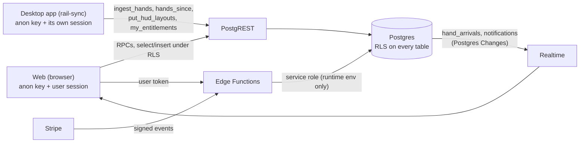

# `supabase/` — the shared database

Rail's desktop app and web app keep one account's hands in one Supabase
project (Postgres 17, Auth, Realtime, Storage, Edge Functions). This folder
is everything that defines it: the migrations, the database tests, the Edge
Functions and the local stack's configuration.

The full reference — every table and column, the threat model, the RLS
reasoning, the indexes and the procedures — is
[`docs/DATABASE.md`](../docs/DATABASE.md). This README is the map: what is
here, how the pieces fit, and how to run them. Billing has its own owner's
guide, [`docs/BILLING.md`](../docs/BILLING.md).

---

## Layout

| Path | What it is |
| --- | --- |
| [`config.toml`](config.toml) | The local stack (`supabase start`): API on 54321, Postgres on 54322, Realtime, Storage, Auth settings, and one `[functions.<name>]` block per Edge Function with the reason it sets `verify_jwt = false` |
| [`migrations/`](migrations) | The schema, one SQL file per change, applied in filename order |
| [`tests/database/`](tests/database) | pgTAP tests, one file per migration theme (54 files) |
| [`functions/`](functions) | Deno Edge Functions: the desktop sign-in handoff, billing, account deletion, and their shared code |

The client code that talks to this database lives elsewhere: the web's
`web/src/lib/db/` (and its generated types `web/src/lib/db/database.types.ts`),
and the desktop's `core/rail-sync` (sign-in, sync, entitlements).

---

## How data reaches the database



- **Clients hold only the public anon key** and the signed-in user's token.
  Every query runs as that user. There is no service-role key in the web or
  the desktop app.
- **The Edge Functions are the only server-side code**, and the only place
  the service role is used: the runtime's own `SUPABASE_SERVICE_ROLE_KEY`,
  set by Supabase inside the function; no file in this repository holds it.

---

## Migrations

### Naming and order

`YYYYMMDDHHMMSS_<what_it_does>.sql`. The timestamp is an ordering key, not
the date the file was written (many are dated in 2027). Each file opens with a
header comment saying which plan step it belongs to (`R1.8`, `R6.2`, …), what
it adds and why; that header is the first place to read before touching a
table.

A database change goes **only** through a new migration in this folder
(guideline §14). Never edit a migration that has been applied; write the next
one.

### What the 69 migrations cover

Grouped by theme; one or two representative files per group.

| Theme | Representative files | What they hold |
| --- | --- | --- |
| Origins | `20260226114000_initial_pokerconverter.sql`, `20260916120000_stored_hands_replayer.sql` | The first schema before PHF. Superseded |
| Inert history | `20260226123000_frontend_storage_bucket.sql`, `20260308091000_frontend_storage_bucket_guards.sql` | A bucket from an old deploy path that no longer exists. Applied and inert; leave them alone ([`docs/WEB.md`](../docs/WEB.md#deployment-vercel)) |
| PHF baseline and accounts | `20260916190000_phf_baseline.sql`, `20260916210000_position_search_and_anonymization.sql`, `20260922130000_user_accounts_and_ownership.sql`, `20261004090000_omaha_hand_class.sql` | `hands`, `unparsed_hands`, `shares`, owner-scoped RLS, per-account dedupe on `(owner_id, hand_key)`, `site_anonymization`, the search columns |
| Share links | `20261003090000_share_projection.sql`, `20261004120000_share_spoilers.sql`, `20270623090000_share_names.sql` | `create_share`, `read_share` / `record_share_view`, spoilers, names hidden by default |
| Community | `20261007090000_forum_identity.sql` … `20261102090000_forum_moderation.sql`, `20261130090000_forum_polls.sql`, `20270519090000_notifications_anon_realtime.sql` | Profiles and usernames, published hands (`scrub_phf`, `publish_hand`), boards, posts, comments, votes, notifications, moderation, polls |
| Statistics and reports | `20261005090000_hand_stats.sql`, `20261109090000_stats_rebuild.sql`, `20261207090000_stats_ev.sql`, `20270526090000_villain_counters.sql`, `20270707090000_report_summaries.sql`, `20270714090000_players_screen.sql`, `20270630090000_library_list.sql` | `hand_stats` (one row per dealt-in seat), `hand_stats_ev`, the report and library readers, the Players screen |
| Big accounts | `20270804090000_owner_first_readers.sql`, `20270818090000_big_account_readers.sql`, `20270623093000_stats_seats_and_budget.sql` | Readers whose time depends only on the caller's rows; per-account insert budgets |
| Sessions and notes | `20261214090000_sessions_notes.sql` | Sessions, bankroll, opponent notes |
| Analysis | `20261228090000_analysis.sql` … `20270310090000_analysis_multiway.sql`, `20270721090000_session_review.sql`, `20270728090000_leak_summaries.sql`, `20270811090000_preflop_charts.sql`, `20270901090000_tournament_icm.sql`, `20270331090000_flop_library_bucket.sql` | `hand_analysis`, `decision_analysis`, grades, leaks, training, study plan, shared analyses, session review, the user's own preflop charts, tournament settings, the public read-only `flop-library` bucket |
| Learn | `20270317090000_learn_progress.sql` | Lesson progress and review cards |
| Unsupported formats | `20270414090000_unparsed_registry.sql` | `unparsed_hands` as the registry for the desktop too ([`docs/unsupported-formats.md`](../docs/unsupported-formats.md)) |
| Desktop | `20270421090000_desktop_sign_in.sql`, `20270428090000_desktop_ingest.sql`, `20270505090000_desktop_pull.sql`, `20270512090000_hand_arrivals.sql`, `20270602090000_hud_layouts.sql` | The sign-in budget, `hand_sources` and `ingest_hands`, the pull `hands_since`, live arrival, the HUD's synced layouts |
| Web bulk upload | `20270609090000_hand_origin_upload.sql`, `20270609091000_web_bulk_upload.sql`, `20270616090000_live_activity.sql` | The web's own hand source, the private `hand-uploads` bucket for opt-in originals, the `activity:<uid>` Realtime channel |
| Plans and billing | `20270908090000_entitlements.sql`, `20270915090000_billing_stripe.sql`, `20270929090000_billing_enforced.sql`, `20271013090000_billing_consents.sql` | Plans, the enforcement switch, Stripe state, consents at checkout |
| Your data | `20271006090000_account_export.sql`, `20271006100000_account_deletion.sql`, `20271006110000_legal_routes.sql` | The data inventory, export readers, the deletion steps; `/terms` and `/privacy` reserved as usernames |

### Applying a migration

**`supabase db push` does not work on this project** (the CLI cannot get a
login role). Migrations are applied through the Supabase Management API, one
file at a time in filename order, and then recorded in
`supabase_migrations.schema_migrations`. The exact commands, and the
verification queries to run afterwards ("Do not trust a 201"), are in
[`docs/DATABASE.md`, "Applying a migration"](../docs/DATABASE.md#applying-a-migration).

Several recent migrations are marked "Not applied to production" in
`docs/DATABASE.md`; check that table before assuming a feature exists on the
live project.

After adding a migration, regenerate the client types from a local stack:

```bash
supabase gen types typescript --local --schema public > web/src/lib/db/database.types.ts
```

CI regenerates the file from a fresh database and fails on any difference.

---

## Row-level security

The anon key is public by construction (it is in the web's JavaScript), so
every policy is written for an untrusted caller. The only thing that keeps
two users' rows apart is the database. Details:
[`docs/DATABASE.md`, "RLS policies and grants"](../docs/DATABASE.md#rls-policies-and-grants)
and ["Threat model"](../docs/DATABASE.md#threat-model-read-this-first).

The rules every migration follows:

- **Revoke first, then grant.** Supabase's default privileges grant everything
  to `anon` and `authenticated`, so each new object starts over-permissioned
  and the migration revokes before it grants.
- **Owner-scoped.** A user's rows carry `owner_id`, and policies compare it
  with `(select auth.uid())` (the subquery form is evaluated once per
  statement, not per row). `anon` has no grant on `hands`.
- **Insert-only by default.** Most tables have no `UPDATE` or `DELETE`
  policy, so both are refused even for the owner. Counters that must move
  (share views, failure occurrences) change inside narrow `security definer`
  functions. A few tables the user edits directly have owner-only policies
  for every command, guarded by triggers that check the row's shape
  (`preflop_chart_sets`, `tournament_settings`).
- **Sealed tables.** Some tables have RLS on and no policies and no grants:
  `shares`, `ingest_rate_limit`, `billing_settings`, `plan_limits`, the plan
  fields of `profiles`, `billing_consents`. They are reached only through
  definer functions (`create_share`, `read_share`, `my_entitlements`, …) or
  the service role.
- **Definer functions check ownership themselves.** A `security definer`
  function sees every row, so its body filters by the caller explicitly
  (`create_share` is the classic case). Definer functions also pin
  `search_path` (see "`security` and `search_path` on functions" in
  `docs/DATABASE.md`).
- **Owner first.** Readers that page or aggregate over an account filter by
  the owner explicitly as well, so a small account's page does not slow down
  because another account holds a million hands.
- **Writes from the desktop go through `ingest_hands`.** The direct insert
  policy on `hands` accepts only `origin = 'web'`; desktop and bulk-upload
  rows are derived from the PHF on the server, so both clients store the same
  columns for the same hand.

---

## Edge Functions

Deno, in [`functions/`](functions). Each function is `index.ts` (serves),
`handler.ts` (the logic, exported for tests) and `handler_test.ts`.
[`functions/deno.json`](functions/deno.json) sets the formatter's line width
and the recommended lint rules.

All six set `verify_jwt = false` in `config.toml`, each for a stated reason:
the gateway's own check knows only the legacy HS256 secret, so the functions
that take a user verify the token themselves with GoTrue
(`GET /auth/v1/user`); the webhook has no JWT at all. Deploy each with
`--no-verify-jwt` (or let `config.toml` set it).

| Function | Called by | Authenticates with | What it does |
| --- | --- | --- | --- |
| `desktop-handoff` | `/auth/desktop` on the web | the user's token, verified with GoTrue | Mints a one-time sign-in token for the same account and returns it encrypted to the desktop app's key (`handoff.ts`); per-account budget through `claim_desktop_sign_in()` |
| `billing-checkout` | the web, Settings → Plan | the user's token | `GET`: prices as Stripe has them (no secret). `POST`: checks both consents, records them (`billing_record_consent`), opens a Stripe Checkout Session with Stripe Tax and the early-user coupon when it applies |
| `billing-portal` | the web, Settings → Plan | the user's token | A Stripe Customer Portal session for the account's own customer |
| `billing-webhook` | Stripe | the `Stripe-Signature` header (HMAC over the raw body) | Reads the subscription back from Stripe and applies it with `billing_apply_subscription(...)` (idempotent, out-of-order safe) |
| `billing-cancel` | server only (account deletion) | the service role key, compared in constant time | Cancels every live subscription of an account |
| `account-delete` | the web, Settings → Delete account | the user's token, plus a typed username and a recent sign-in | Deletes the account step by step (billing, storage, content, hands, then the auth user); resumable, answers 202 while a large library is still being erased |

[`functions/_shared/billing/`](functions/_shared/billing) is the code the
billing functions and `account-delete` share: configuration, HTTP helpers,
the Stripe client and signature check, the subscription-to-plan mapping, the
consent wording and cancellation.

Configuration comes from the function's environment only. The names (no
values here or anywhere in the repository): `SUPABASE_URL`,
`SUPABASE_ANON_KEY`, `SUPABASE_SERVICE_ROLE_KEY` (set by Supabase), the
`STRIPE_*` secrets and `BILLING_*` URLs described in
[`docs/BILLING.md`](../docs/BILLING.md), and the optional
`ACCOUNT_DELETE_TIME_BUDGET_MS` / `ACCOUNT_DELETE_HANDS_BATCH`. With the
Stripe secrets unset the billing functions answer "unavailable" and the web
says paid plans open soon. Logs carry outcomes and status codes only — never
a token, email, user id or request body.

### Checking them

What CI's `functions` job runs, from `supabase/functions/`:

```bash
deno fmt --check
deno lint
deno check desktop-handoff/*.ts desktop-handoff/testdata/*.ts billing-*/*.ts _shared/billing/*.ts account-delete/*.ts
deno test --allow-read=.
```

The unit tests run each handler against fakes (GoTrue, PostgREST, Stripe);
`desktop-handoff/testdata/vector.json` is a test vector the Rust side
(`rail_sync::auth`) also opens. End-to-end runs need Docker and a **local**
stack, never production (each creates users):

| Check | How |
| --- | --- |
| Desktop sign-in | [`functions/desktop-handoff/e2e.sh`](functions/desktop-handoff/e2e.sh) `<workdir>` (runs `cargo run -p rail-sync --example desktop_sign_in_e2e`) |
| Account deletion | [`functions/account-delete/e2e.sh`](functions/account-delete/e2e.sh) `<workdir>` |
| Billing | `RAIL_BILLING_E2E_URL=… deno test … _shared/billing/e2e_test.ts` (Stripe played by a fake; see the file's header) |

Each script's header says how to prepare the work directory and why the
linked project's `.temp` folder must be removed first.

---

## Plans and entitlements

The database is where a plan is enforced; the web and the app only show it
first ([`docs/DATABASE.md`, "Plans and entitlements"](../docs/DATABASE.md#plans-and-entitlements)).

- **The switch.** `billing_settings.enforcement_enabled` is `false` until the
  owner launches paid plans. While it is false every account's effective plan
  is Pro and nothing is locked or capped.
- **The data.** `plan_limits` holds each plan's hand cap and features. As
  seeded: Free has a cap of 10 000 stored hands and no features; Pro has no
  cap and `desktop_sync`, `hud`, `reports_full`, `analysis`, `learn`. Both
  tables are sealed; the owner changes them in SQL.
- **The check.** Every Pro function starts with
  `perform public.require_entitlement('<feature>')`; the list lives in
  `entitlement_gates`, and pgTAP fails when a client-callable function is on
  neither the gated nor the free list. The hand cap is a statement trigger on
  `hands`. A refusal is SQLSTATE `PT402`, which PostgREST answers as HTTP 402,
  with the feature (or `hand_cap`) as the hint.
- **Reading it.** `my_entitlements()` returns the effective plan and why,
  the features, usage, the Free cap, the subscription, the early-user state
  and the grace periods. `billing_enforced()` answers only whether the switch
  is on, to anyone (the desktop app asks it before it has an account).
- **Who changes the plan.** Only Stripe's webhook, through
  `billing_apply_subscription(...)` → `billing_set_plan(...)` (service role).
  Arriving on a success page grants nothing.

---

## Realtime

Realtime carries signals, never hand content.

| Channel | Source | Used by |
| --- | --- | --- |
| `hand_arrivals` (Postgres Changes, filtered by owner) | One row per account, bumped once per insert statement on `hands` by the trigger `hands_signal_arrival`: a counter, the count, the origin, the time | `/library` and `/stats` refresh when hands arrive from the desktop app or another tab |
| `activity:<uid>` (private Presence) | The uploading tab publishes its state and counts | Other tabs and devices show "Saving N of ~M hands" |
| `notifications` (Postgres Changes, filtered by user) | Rows written by the forum's fan-out | The unread badge |
| `post:<public_id>` (Broadcast) | The `comments_broadcast` trigger | "N new comments" on an open thread |

`hands` itself is not in the `supabase_realtime` publication. `anon` holds a
`SELECT` grant without a policy on `hand_arrivals` and `notifications` so an
anonymous socket gets nothing rather than an error per change. Only the
account itself may join `activity:<uid>` (`realtime.messages` policies).
Details: [`docs/DATABASE.md`, "Live arrival on the web"](../docs/DATABASE.md#live-arrival-on-the-web-hand_arrivals)
and ["Notifications and realtime"](../docs/DATABASE.md#notifications-and-realtime).

---

## Storage

| Bucket | Access | Holds |
| --- | --- | --- |
| `hand-uploads` | private; the owner's own folder only | Original hand-history files, gzip, only when the user ticks "Also keep the original files" on `/convert` |
| `flop-library` | public, read-only (no policies: nobody can list or write through the API) | The solved flop chunks the analysis fetches; uploaded by the owner's script with the service role |
| `frontend-site` | inert | Left from an old deploy path |

---

## Tests (pgTAP)

[`tests/database/`](tests/database) holds one file per theme
(`hand_arrivals.test.sql`, `entitlements.test.sql`, `share_names.test.sql`,
…). Each runs in a transaction, creates its own users in `auth.users`, and
acts as `anon` and `authenticated` for real (`set local role` with
`request.jwt.claims` set, through small `pg_temp.act_as` helpers),
not as a superuser — a migration that returns success proves only that the SQL
ran, not that the grants and policies do what they claim.

CI's `database` job ("Migrations and pgTAP"):

1. `supabase db start` — a throwaway Postgres (the image Supabase runs) with
   every migration applied in order; retried against several image
   registries when one rate-limits.
2. Regenerates `web/src/lib/db/database.types.ts` and fails when it differs
   from the committed file.
3. `supabase test db` — every file under `tests/`.

No secrets: nothing in CI talks to the live project.

---

## Running it locally

Needs Docker and the Supabase CLI (CI pins 2.75.0).

```bash
supabase db start          # Postgres only, every migration applied
supabase test db           # the pgTAP suite
supabase start             # the whole stack: API on :54321, DB on :54322
supabase status -o env     # the local URL and keys, for tests/ scripts
supabase functions serve   # the Edge Functions against the local stack
```

Run these from the repository root. For a second stack beside another
project, copy this folder to a work directory with its own `project_id` and
ports, as the e2e scripts' headers describe.

Checks in [`tests/`](../tests/README.md) that need a local stack: `npm run
parity` (web/app parity, also in CI), `npm run realtime:arrivals`, `npm run
realtime:activity`, `npm run share:names`, `npm run supabase:perf`; and the
whole-corpus scrub check in
[`tests/scripts/scrub-corpus/`](../tests/scripts/scrub-corpus/README.md).
All of them are for a throwaway local stack only (they create users or
load generated data); the parity, share-names and Realtime checks refuse any
host but a local one.

---

## Rules

- Schema changes only through a new migration here; never edit an applied one.
- Every migration revokes before it grants and turns RLS on for every new table.
- A new client-callable function goes on `entitlement_gates` or on the
  entitlements test's free list.
- A new table holding account data goes into `account_data_inventory`
  (export and deletion decided per table); pgTAP fails otherwise.
- No service-role key in any client and no secret in any file; functions read
  theirs from the runtime environment.
- Server code in the web resolves identity with `getUser()`, never
  `getSession()`.
- Commit the regenerated `database.types.ts` with the migration.

## Further reading

| Question | Document |
| --- | --- |
| Every table, function, policy and index | [`docs/DATABASE.md`](../docs/DATABASE.md) |
| Setting up Stripe, prices, VAT, the webhook | [`docs/BILLING.md`](../docs/BILLING.md) |
| What a stored hand (`phf`) contains | [`docs/PHF-SPEC.md`](../docs/PHF-SPEC.md) |
| The statistics rows in `hand_stats` | [`docs/STATS-SPEC.md`](../docs/STATS-SPEC.md) |
| The plan steps the migration headers cite | [`docs/RAIL-PLAN.md`](../docs/RAIL-PLAN.md) |
