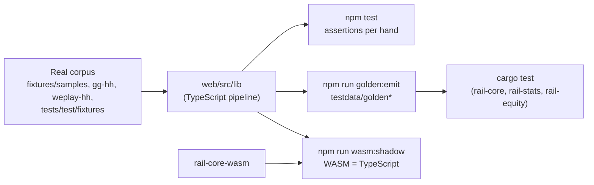

# `tests/` — the TypeScript test harness

`tests/` is a test harness with no runtime of its own. It imports the web's
pure library (`web/src/lib/...`), the shared UI package (`packages/ui`) and
the desktop app's front-end modules (`app/src/...`) directly, by relative
path or alias, and runs them under plain Node with Vitest — over the real
hand-history corpus in this repository.

It has three jobs:

1. **The corpus suite** (`npm test`): every parser, the PHF validator and
   serializer, the replayer, statistics, all-in EV, analysis, the course, and
   the screens shared by the web and the app.
2. **The oracle for the Rust core**: `npm run golden:emit` writes what the
   TypeScript pipeline concludes about every corpus file into `testdata/`,
   and the Rust crates are held to it byte for byte.
3. **Scripts** that need more than a unit test: WebAssembly builds and shadow
   mode, web/app parity against a local Supabase stack, benchmarks, and the
   generators for committed data (preflop charts, the push/fold table).



---

## Running it

```bash
cd tests
npm install            # CI: npm ci
npm test               # the corpus suite (vitest run)
```

Some suites render the shared screens with React from the web's install
(`vitest.config.ts` aliases `react` to `../web/node_modules`), so run
`npm install` in `web/` as well, as CI does.

One file or one name:

```bash
npx vitest run test/phfValidate.test.ts
npx vitest run -t "round trip"
```

`vitest.config.ts` sets a 30 s test timeout: the suites are table-driven over
whole corpora, and a single `it` can run for seconds under parallel load. It
also resolves `@rail/ui` to `packages/ui`, `@rail/web-lib` to `web/src/lib`
(as the desktop app's Vite config does), and stubs `@tauri-apps/api/core` and
`/event` with `test/support/tauriCore.ts` and `tauriEvent.ts`, so the app's
screens can be rendered here with each test answering the IPC commands.

---

## Layout

| Path | What it is |
| --- | --- |
| `test/*.test.ts` | The corpus suite (121 test files with the subfolders) |
| `test/charts/`, `test/solver/` | Preflop chart generation and lookup; the postflop solver (toy games, isomorphism, river, turn, flop, preflop) |
| `test/support/` | Corpus loaders (`corpus.ts`, `p2Corpus.ts`, `p4Corpus.ts`, `p6Corpus.ts`, `psggCorpus.ts`), shared invariants (`statsInvariants.ts`, `psggInvariants.ts`), the web's conversion path (`webConversion.ts`), the app's webview and Tauri stubs, a zip writer |
| `test/fixtures/` | `gg/` and `weplay/`: regression hands, each kept because a specific real hand broke something. `stats/`: seventeen minimal hand-written hands in the GG dialect, one per hard statistics case, pinned by `statsSpots.test.ts` (see the exception below) |
| `test/legacy/legacyConverter.ts` | A frozen copy of the converter before the PHF rewrite: the reference the byte-compatibility test measures against. Never "fix" it |
| `scripts/` | Everything that is not `npm test` (below) |
| `vitest.config.ts` | Aliases, JSX and the timeout above |

### The suite by area

| Area | Files |
| --- | --- |
| PHF core | `phfDetect`, `phfMoney`, `phfPositions`, `phfValidate`, `phfRoundTrip`, `phfSerializeStyle`, `phfReplay`, `phfHiLo`, `phfOmaha`, `phfCoreGaps`, `byteCompat`, `shortDeck` |
| Parsers, over each room's whole sample directory | `pokerstarsParser`, `ggpokerParser`, `weplayParserPhf`, `coinpokerParser`, `unibetParser`, `handParser`, `p2Parsers` / `p2Xml` (888poker, partypoker, iPoker), `p3Parsers` (Full Tilt, Run It Once, PokerBros), `p5Parsers` (Ignition family, ACR/WPN), `p6Parsers` (Winamax, Chico), `legacyNetworks` (Ongame, Entraction, MicroGaming) |
| Manual entry | `manualHand` (the betting engine, settlement and the bridge into PHF) |
| Statistics | `statsDerive`, `statsPotType`, `statsSpots`, `statsRebuildSave`, `statDisplay`, `statReliability`, `villainCounters`, `desktopRows` |
| All-in EV | `equityEvaluator`, `equityEnumerate`, `equityRange`, `equityAllInEv`, `equityCorpus` |
| Solver, charts, flop library | `test/solver/*`, `test/charts/*`, `preflopCharts`, `flopLibrary*`, `flopBets`, `flopRealisation`, `turnRealisation`, `potOdds` |
| Analysis | `analysis*` (spots, preflop, turn, river, multiway, ranges, villain, leaks, reports, ICM, push/fold, tournaments, bomb pots, share, coverage, corpus), `sessionReview`, `topLeaks`, `training`, `studyPlan`, `icmScreens` |
| Learn | `learn`, `learnFlop`, `learnTurnRiver`, `learnExtras`, `learnLab`, `course` |
| Web features | `bulkUploadInputs`, `bulkUploadWorker`, `bulkUploadSave`, `wasmWeb`, `liveArrivals`, `liveActivity`, `forumPure`, `i18n`, `legalPages`, `accountData` |
| Plans and billing | `entitlements`, `planRefusal`, `billing`, `checkoutConsent` |
| Configuration and compliance | `sitesConfig` (`config/sites.json` against its schema), `hudPolicyCheck` |
| Shared screens (`packages/ui`) | `sharedHandsScreen`, `sharedReportsScreen`, `sharedPlayersScreen`, `preflopChartsScreen` |
| Desktop app front end | `app*` (hands filter, i18n, plan, your data, HUD compliance, nothing-during-play (A10), analysis screens, runner and parity) |

### What the corpus suites check, per hand

From [`docs/WEB.md`, "Tests"](../docs/WEB.md#tests):

- **Detection** — the right parser ranks first for every file.
- **No unknown lines** — a hand a parser claims parses with no warnings, so
  an unhandled line shape fails the build instead of reaching a user.
- **Validation** — every emitted hand satisfies the PHF invariants; every
  refused hand carries a machine-readable reason.
- **Round trip** — `parseStandardText(toStandardText(h))` equals `h`.
- **Byte compatibility** — the re-serialized text is byte-identical to the
  source, which tracker import depends on.
- **Positions** — cross-checked against the rooms' own summary labels, from
  heads-up to nine-handed.
- **Replay** — no stack goes negative, and the whole pot is awarded in the
  final frame.

---

## The corpus and the goldens

The inputs are every `.txt` and `.xml` file under `fixtures/samples/` (one
directory per room, each with a `SOURCES.md`), `gg-hh/`, `weplay-hh/` and
`tests/test/fixtures/` — 556 files today.

**No synthetic fixtures.** Every corpus file is a real export or a real
data-mined sample. The one exception in the tree is
`test/fixtures/stats/`: seventeen deliberately minimal hands that pin one
statistics definition each, so a failure points at the definition and not at
a parser (`statsSpots.test.ts` explains why; the cases that cannot be
written honestly by hand — bomb pots, run-it-twice, a room's straddle — are
pinned against real corpus files instead). They are inputs of the goldens
too. Do not add others without the same justification. Generated data is allowed only for performance measurements, is labelled as
generated, lives in a temporary directory, and never goes under the fixture
trees (the `bulk-upload`, `supabase-perf`, `account-data` and the Rust
`import_bench` / `perf_gate` measurements build theirs from copies of the
corpus with new hand ids).

**Never normalise the fixture trees.** `.gitattributes` marks them binary so
CRLF, UTF-16LE and Windows-1252 bytes survive; CI's `fixtures` job fails if a
checkout changes a byte.

### Goldens

```bash
npm run golden:emit    # ~10-15 s; rewrites testdata/golden*, including the gitignored -full trees
```

`scripts/golden/` runs every input through exactly the converter's pipeline
and writes:

| Tree | Committed | Holds |
| --- | --- | --- |
| `testdata/golden/` | yes | Detection, refusals with reasons, warnings, and each hand's PHF as a sha-256 of its canonical JSON |
| `testdata/golden-full/` | no | The same with every PHF written out (the Rust tests read it) |
| `testdata/golden-stats/`, `-full/` | yes / no | The statistics engine's rows per hand |
| `testdata/golden-ev/`, `-full/` | yes / no | All-in EV rows and analyses |

**Never edit a golden by hand.** A change to a parser, the serializer, the
validator, `lib/stats` or `lib/equity` lands with its regenerated goldens in
the same pull request, or CI's `golden-fresh` job fails. The format, the size
decision and the canonical JSON are in
[`testdata/golden/README.md`](../testdata/golden/README.md).

---

## Scripts

Each is `npm run <name>` from `tests/`. Those marked *local stack* need a
throwaway local Supabase stack (see [`supabase/README.md`](../supabase/README.md))
and must never be pointed at the live project (the parity, share-names and
Realtime checks refuse any host but a local one).

| Scripts | What they do |
| --- | --- |
| `golden:emit` | The goldens above |
| `phf:dts-check` | The PHF TypeScript declarations generated from the Rust model equal `web/src/lib/phf/types.ts` |
| `wasm:build`, `wasm:web`, `wasm:web-check`, `wasm:web-from-ci` | Build `rail-core-wasm` (fails over 1.5 MB gzipped); write or check the web's committed copy in `web/src/lib/wasm/rail-core/` — only a Linux x86_64 build may be committed, so after a core change install CI's artefact with `wasm:web-from-ci` |
| `wasm:shadow` | Every corpus file through the TypeScript pipeline and the WASM core, and through the web's batched path with each engine; byte-for-byte equal; prints throughputs |
| `parity` | *Local stack.* Every corpus file through the desktop path (watcher → store → sync → `ingest_hands`) and the web's bulk upload, as two users; every stored `hands`, `hand_stats` and `hand_stats_ev` row compared byte for byte, and what the web renders from each |
| `desktop-ingest:parity`, `desktop-ingest:fixture` | The web's `handInsertFromPhf` and the server's `ingest_hands` derive the same search columns |
| `realtime:arrivals`, `realtime:activity` | *Local stack.* Live arrival on `/library` and `/stats`, and upload progress across tabs |
| `share:names` | *Local stack* plus a local `next start`: share pages and embeds never print a hidden name |
| `supabase:perf` | *Local stack.* The web's report functions over a million generated hands of one user |
| `account:measure` | *Local stack.* Export and deletion of a very large account |
| `bulk-upload:measure` | The converter's bulk path on a generated zip of ~1M hands: peak memory and throughput (`BULK_HANDS=200000` for a shorter run) |
| `hud:policy-check` | Every room whose HUD `config/sites.json` allows, with its policy page and date; fails when a check is older than the limit (run by the manual "Release checklist" workflow, not by CI) |
| `bench:solver`, `bench:turn` | Solver benchmarks |
| `charts:*` | Generate and inspect the committed preflop chart sets (`web/src/lib/charts/data/`) |
| `icm:equity` | Writes the committed push/fold equity table |
| `floplib`, `floplib:*` | The flop library's batch runner and its studies; see [`scripts/flop-library/README.md`](scripts/flop-library/README.md) |
| `ranges:*`, `learn:directions`, `learn:lab` | Studies behind analysis and course decisions; they write local files only, never committed |

Not an npm script: the whole-corpus check of the forum's name scrubber,
[`scripts/scrub-corpus/README.md`](scripts/scrub-corpus/README.md) (local
Postgres; run it whenever a parser or a PHF field changes).

---

## What CI runs from here

From [`.github/workflows/ci.yml`](../.github/workflows/ci.yml):

| Job | Runs |
| --- | --- |
| Corpus tests (`test`) | `npm ci` here and in `web/`, then `npm test` |
| `golden-fresh` | `npm run golden:emit`, then fails if `testdata/golden`, `golden-stats` or `golden-ev` differ from what is committed (also a missing or left-over golden) |
| `core` (Linux, macOS, Windows) | `npm run golden:emit` for the full trees before `cargo test`; `npm run phf:dts-check` |
| `wasm` | `npm run wasm:build -- nodejs web`, the committed web copy checked against this build (uploaded as the artefact `rail-core-web`), `npm run wasm:shadow` |
| `parity` | A local stack (db, auth, PostgREST), the Rust `parity_app` example, `npm run parity` |
| `database` | Not this folder: pgTAP in `supabase/tests` |

Nightly (`perf-nightly.yml`) the Rust performance gate runs; the release
checklist (`release-checklist.yml`, by hand) runs `scripts/hud-policy/check.mjs`.

---

## Rules

- **Real hands only** (the stats spot checks above are the documented
  exception). A new room comes with real
  samples in `fixtures/samples/<room>/` and a `SOURCES.md`, and joins the
  loaders in `test/support/`.
- **Goldens are regenerated, never edited**, and committed with the change
  that moved them.
- **The pure library stays framework-free.** Nothing under
  `web/src/lib/{phf,parsers,replay,cards,format,stats}` may import `next/*`,
  `server-only` or read `process.env`: this harness imports those files under
  plain Node, and one such import breaks every suite at once
  ([`docs/WEB.md`, rule 1](../docs/WEB.md#1-the-pure-typescript-layer-may-not-import-the-framework)).
- **Nothing derived from someone's hands is committed** by the study scripts;
  they write local files.
- **Scripts that touch a database talk only to a local stack**, never the
  live project.

## Further reading

| Question | Document |
| --- | --- |
| The pipeline, the refusal principle, the corpus | [`docs/WEB.md`](../docs/WEB.md) |
| The hand format and the parser contract (and the six tests a parser needs) | [`docs/PHF-SPEC.md`](../docs/PHF-SPEC.md) |
| What each statistic counts | [`docs/STATS-SPEC.md`](../docs/STATS-SPEC.md) |
| The goldens | [`testdata/golden/README.md`](../testdata/golden/README.md) |
| How the preflop charts are generated | [`docs/CHARTS.md`](../docs/CHARTS.md) |
